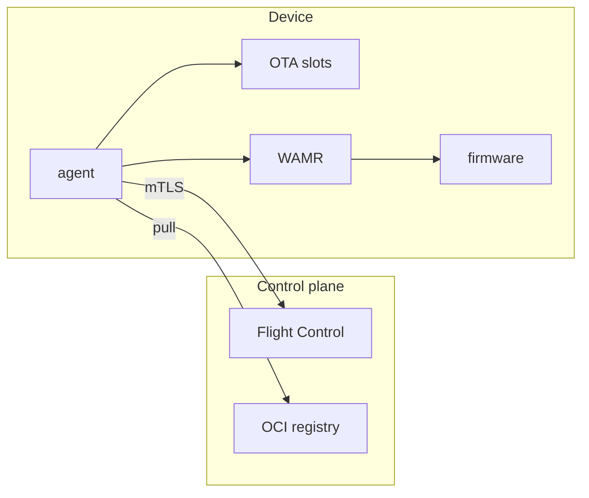
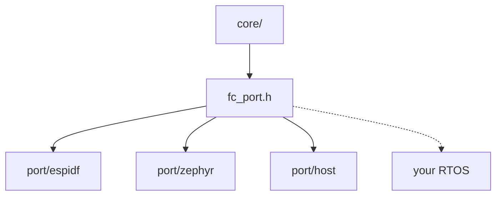
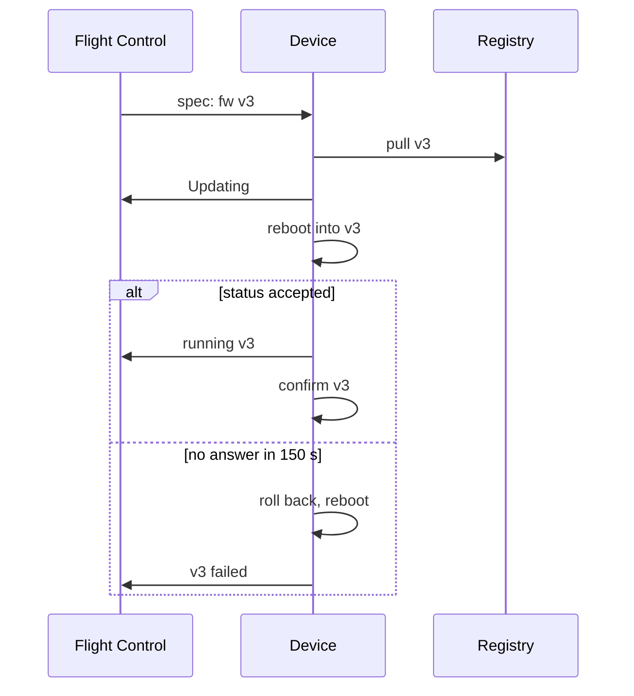

[](https://github.com/francescopace/flightctl-mcu/actions/workflows/ci.yml)
[](https://github.com/francescopace/flightctl-mcu/actions/workflows/fuzz-nightly.yml)
[](docs/DEPENDENCIES.md#esp-idf-port)
[](docs/DEPENDENCIES.md#zephyr-port)
[](LICENSE)

# flightctl-mcu

A [Flight Control](https://github.com/flightctl/flightctl) agent for microcontrollers: a portable C core, with ports for ESP-IDF, Zephyr and POSIX systems. Devices too small for Linux enroll in the same control plane as your Linux edge devices. From there you can monitor them, push configuration, update their firmware over the air, and deploy WebAssembly apps to them. Flight Control runs unmodified.

It works end to end on real hardware, with signed images and certificate renewal. Its known limits are under [Status](#status).

## Why

Flight Control (upstream of [Red Hat Edge Manager](https://docs.redhat.com/en/documentation/red_hat_edge_manager/)) manages fleets of Linux edge devices. Its agent is written in Go and expects bootc, systemd and Podman.

A sensor node or a small controller on a production line is a microcontroller with a few hundred KB of RAM and an RTOS. It ends up managed by a vendor cloud, a custom MQTT backend, or nothing at all: the gateway that collects its data shows up in Flight Control, and the devices behind it don't.

Here the microcontroller speaks the Flight Control agent API itself. That API is a small HTTP+JSON protocol over mutual TLS: enroll, long-poll the device spec, report status. The agent's own code, with its HTTP/2 client, the OCI client, signatures and apps, takes about 62 KB of flash on the ESP32-C3; 79 KB with cJSON, WiFi provisioning, the delta decoder and its port. Flight Control then treats the board as a regular device, with the same fleets, label selectors, rollouts, RBAC and UI.


*Flight Control 1.4's device list: the ESP32, C3, C5, C6 and S3 with ESP-IDF, and an ESP32-S3 with Zephyr, online and up to date.*


*An ESP32-C6's page: its status, its labels, and the WASM app `alarm` running.*

## What maps to what

| Flight Control | On the microcontroller |
|---|---|
| Enrollment request and approval | P-256 key generated on the device, CSR, certificate stored in flash |
| Certificate renewal | Same key, renewed before the certificate expires |
| `spec.config` | Files in the device's storage. The firmware can reject each one; a file the spec no longer gives is removed. |
| `spec.os.image` | Firmware pulled from an OCI registry into the inactive OTA slot, after its cosign signature is checked. One index covers every chip, and an update can be a [delta](docs/DELTA-UPDATES.md). |
| `spec.applications` | A WebAssembly module packaged as an OCI artifact, run by [WAMR](https://github.com/bytecodealliance/wasm-micro-runtime) without a reboot |
| Registry credentials and CA (`auth.json`, `certs.d`) | The same files as on Linux, as config: TLS and a password to the [registry](docs/REGISTRY.md) |
| Decommission | Key and certificate wiped; the device does not enroll again until its storage is erased |
| `spec.resources` | CPU, heap and storage sampled against the fleet's alert rules, as the Linux agent does. Without rules, CPU and storage take the Linux defaults; the heap warns under 10% free, since the network stack holds most of it. |
| `status` | `resources` from those rules, heap, CPU use, firmware version, RSSI, temperature, app state; after a crash, what it was (`lastFatalError`: the fault, the task, the `pc` and return addresses, which `addr2line` decodes against the release's ELF) |
| `flightctl console` and the UI's terminal | A closed set of commands (`status`, `apps`, `log`, `reboot`...) over a gRPC stream on the agent's connection ([CONSOLE.md](docs/CONSOLE.md)) |
| Telemetry Gateway (OpenTelemetry) | The device's metrics (heap, traffic, CPU, WiFi, temperature) and the apps' (`fc_metric`) in OTLP over gRPC, with a certificate the device asks for on its own, to Prometheus ([METRICS.md](docs/METRICS.md)) |
| The UI's Logs tab | The device's log kept in RAM, the agent's, the apps' and the system's (WiFi, TLS, a fault's report), answered to the `journalctl` the tab runs through the console: level, unit (the agent, or an app), time range, live, and the previous boot, kept across a restart or a crash ([CONSOLE.md](docs/CONSOLE.md#the-log)) |
| Fleet rollout | Works unchanged |

## How it works



The agent runs two loops. One holds a long-poll on the rendered device spec and applies whatever comes back: config, firmware, apps; it runs on the firmware's main task, which has nothing else to do. The other, on a thread of its own, sends the status, periodically and at once when something changes. Both go over one HTTP/2 connection to Flight Control, each request on its stream. Firmware and `.wasm` apps come from the registry. Apps run in WAMR and reach the hardware only through host functions the firmware exports.



`core/` is C11 on pthreads, BSD sockets, mbedTLS 4, cJSON and WAMR. What differs between platforms is behind `core/include/fc_port.h`, about 30 functions: key/value storage, system info, heap and stack figures, OTA, logging. The host port is not a mock: it runs the same agent as a process on Linux or macOS against a real Flight Control server.

Two rules hold for every feature. Nothing changes on the Flight Control server: the agent uses only the public device API, and the gaps it finds are raised upstream ([FLIGHTCTL-LIMITATIONS.md](docs/FLIGHTCTL-LIMITATIONS.md)). And it also runs on the simulated device, so CI checks it against a real Flight Control on kind; tests on the boards add to that, they don't replace it.

### The Flight Control API it uses

Checked against Flight Control 1.4.0:

- `POST/GET enrollmentrequests`, `POST/GET certificatesigningrequests`;
- `GET devices/{name}/rendered?knownRenderedVersion=`, a long-poll of about 4 minutes that returns `204` when nothing changed;
- `PUT devices/{name}/status` (the API also has `PATCH`, which the agent does not use);
- mTLS with TLS 1.3 and ECDSA P-256. The device name is derived from the public key: `lower(base32hex_nopad(sha256(X || Y)))`;
- a device is up to date when `status.config.renderedVersion` equals the rendered version served; the OS is out of date when `status.os.image` differs from `spec.os.image` as a string;
- a device becomes `Unknown` after 5 minutes without contact;
- `consoles` in the rendered spec (someone asked for a terminal on the device, or the UI's Logs tab): the device opens `flightctl.v1.RouterService/Stream` on the agent's connection ([CONSOLE.md](docs/CONSOLE.md));
- the Telemetry Gateway: a certificate request signed by `flightctl.io/device-svc-client`, CN `otel-<device name>`, approved at once; then OTLP over gRPC (`ExportMetricsServiceRequest`) with that certificate ([METRICS.md](docs/METRICS.md)).

### Firmware update with rollback



The image is streamed into the inactive slot and checked against its sha256. The device reports the new version only after the new firmware has reached the server. A broken image therefore fails its rollout batch, and the rest of the fleet keeps the old version.

## Where it runs

On ESP-IDF 6.0 (the ESP32, S3, C3, C5 and C6, with Secure Boot, flash encryption and WiFi provisioning), on Zephyr 4.5 (the ESP32-S3, and an Arm Cortex-M3 on Ethernet in QEMU), and as a process on Linux or macOS, the simulated device of the tests. The same `.wasm` file runs on all of them, whatever the CPU. A device needs 384 KB of SRAM, 2 MB of flash and a TCP/IP network.

The support levels, the boards tried and how to add a chip, a board or an RTOS are in [docs/DEVICES.md](docs/DEVICES.md).

## Try it

[docs/QUICKSTART.md](docs/QUICKSTART.md) sets up Flight Control on [kind](https://kind.sigs.k8s.io/) and a local registry, then enrolls a device: an Espressif board, or a simulated one on your machine if you have no board. kind is only the quickest way to try it: Flight Control also installs on Kubernetes or OpenShift, or on a Fedora or RHEL host as Podman quadlets, and the device works with any of them. For a Zephyr board, the build and flash steps are in [docs/ZEPHYR.md](docs/ZEPHYR.md).

## Documentation

| | |
|---|---|
| [QUICKSTART.md](docs/QUICKSTART.md) | From nothing to an enrolled device with firmware, config and an app |
| [DEVICES.md](docs/DEVICES.md) | Requirements, boards tried, adding a chip, a board or an RTOS |
| [APPS.md](docs/APPS.md) | Writing a WASM app |
| [ZEPHYR.md](docs/ZEPHYR.md) | The Zephyr port: ESP32-S3, `mps2/an385` in QEMU, `native_sim` |
| [SECURITY.md](docs/SECURITY.md) | Secure Boot, flash encryption, keys in hardware, the factory procedure |
| [PROVISIONING.md](docs/PROVISIONING.md) | Credentials over USB, WiFi over SoftAP |
| [DELTA-UPDATES.md](docs/DELTA-UPDATES.md) | Firmware updates as deltas |
| [SBOM.md](docs/SBOM.md) | Each release's SBOM, and its known vulnerabilities in Flight Control through Trustify |
| [REGISTRY.md](docs/REGISTRY.md) | The registry: TLS, credentials, the local one |
| [CONSOLE.md](docs/CONSOLE.md) | The remote console and the UI's Logs tab |
| [METRICS.md](docs/METRICS.md) | Metrics to the Telemetry Gateway (OpenTelemetry) |
| [TESTING.md](docs/TESTING.md) | Unit tests, fuzzing, end-to-end tests, what CI runs |
| [RESULTS.md](docs/RESULTS.md) | What was verified and where, measurements, current limitations |
| [FLIGHTCTL-LIMITATIONS.md](docs/FLIGHTCTL-LIMITATIONS.md) | The gaps in Flight Control in detail, with proposals |
| [ROADMAP.md](docs/ROADMAP.md) | What comes next |
| [COMPARISON.md](docs/COMPARISON.md) | Against Golioth, Memfault, Mender, AWS, Azure, hawkBit and LwM2M |
| [DEPENDENCIES.md](docs/DEPENDENCIES.md) | Versions, where each is set, licenses |

## Status

Tested on real boards and in CI: enrollment, monitoring, config, signed firmware and apps (cosign format), deltas, rollback, a registry with TLS and a password, decommissioning. Certificate renewal also passed on a physical ESP32-C6. Secure Boot is tested on emulated chips. WiFi provisioning from a phone was verified on the ESP32-C6 with ESP-IDF and the ESP32-S3 with Zephyr ([RESULTS.md](docs/RESULTS.md#what-works)).

Known limits:

- The device trusts only the registry CA its fleet gives it: no public CA bundle, and no blobs redirected to another host ([REGISTRY.md](docs/REGISTRY.md)).
- The device key is in flash in clear unless the device runs the `secure` variant (Secure Boot and flash encryption, tested in the emulator only), which Zephyr does not have: on an Espressif chip, a device that must be protected runs the ESP-IDF firmware. On Zephyr the protection comes with chips that have TF-M, after 1.0 ([SECURITY.md](docs/SECURITY.md#zephyr)).
- WiFi is the only link tried on hardware; Ethernet runs in QEMU.
- Flight Control 1.4.0 cannot revoke an enrollment certificate; its main branch can, not yet in a release.
- Apps: MQTT runs on the five ESP-IDF chips and on the Zephyr ESP32-S3. The S3 N8R8 kept its MQTT session through a signed firmware download and exported telemetry with MQTT connected ([current limitations](docs/RESULTS.md#current-limitations)). I2C, SPI, UART, ADC and PWM answer on the boards but have not been tried with devices wired to them ([APPS.md](docs/APPS.md)).
- Apps must be WASM OCI artifacts. Podman-style images with a `.wasm` inside a tarball are not supported.

The work also found gaps in Flight Control for this class of device, such as a fixed 5-minute disconnect timeout. They are written up in [docs/FLIGHTCTL-LIMITATIONS.md](docs/FLIGHTCTL-LIMITATIONS.md), with proposals; the agent's [current limitations](docs/RESULTS.md#current-limitations) in full are in RESULTS.

## Repository layout

For 1.0, the canonical source repository is [francescopace/flightctl-mcu](https://github.com/francescopace/flightctl-mcu). Build the ESP-IDF firmware from this checkout. A future transfer to the Flight Control organization would require agreement with its maintainers. The Espressif Component Registry remains an optional distribution channel for a later release.

```
core/         the agent, portable C: HTTP/TLS client, OCI client, WASM app manager
port/         one directory per stack, with its port of the core and its firmware:
              espidf (ESP-IDF project), zephyr (Zephyr application), host (simulated device)
wasm-apps/    app SDK header, example apps, build script
tools/        Flight Control on kind, registry, example fleets, credentials,
              provisioning, signing, firmware push
tests/        unit tests, fuzz targets, tests of the tools, end-to-end tests
docs/         the documents listed above
third_party/  cJSON, and the scripts that fetch WAMR and Zephyr
```

## License

Apache 2.0, see [LICENSE](LICENSE). Third-party code and its licenses are in [docs/DEPENDENCIES.md](docs/DEPENDENCIES.md#licenses).
