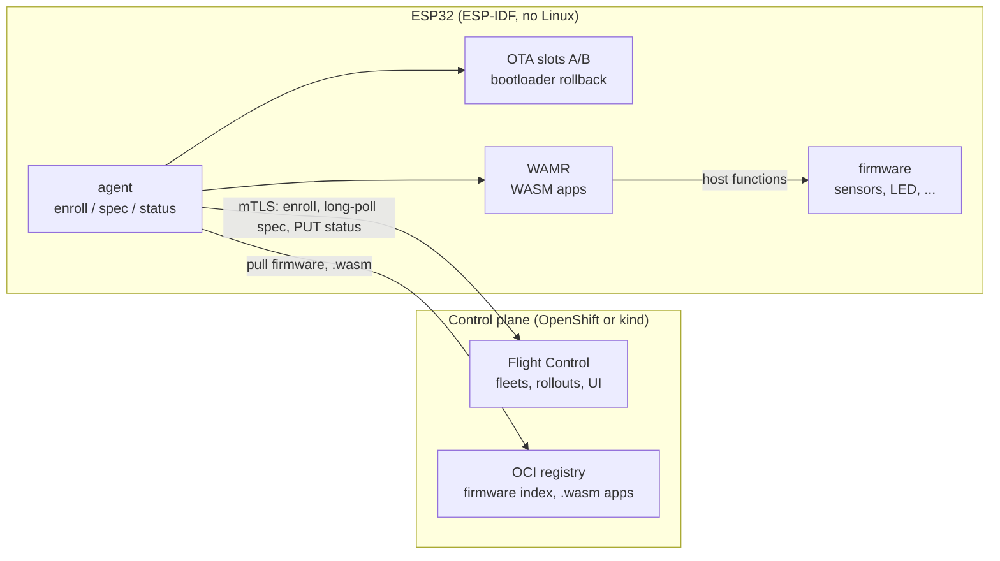
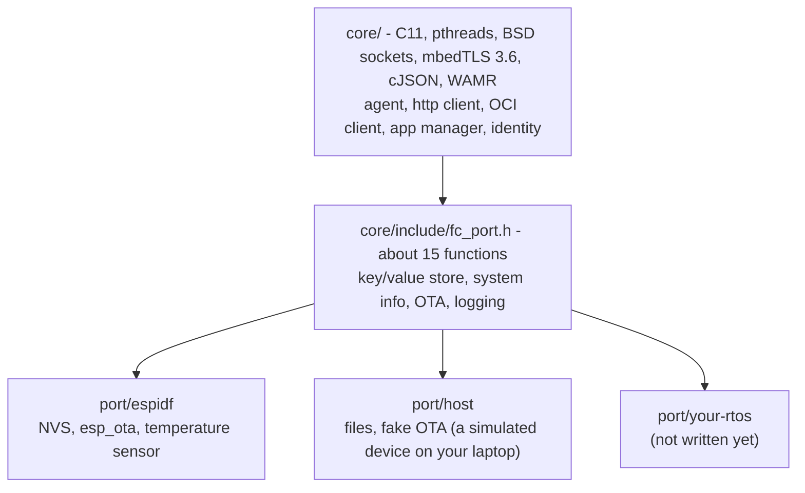
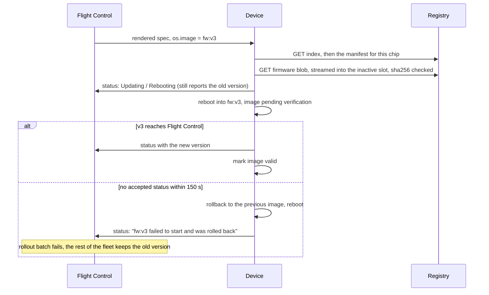

# flightctl-mcu

[](https://github.com/francescopace/flightctl-mcu/actions/workflows/ci.yml)

A [Flight Control](https://github.com/flightctl/flightctl) agent for microcontrollers. ESP32 boards enroll in the same control plane as your Linux edge devices. From there you can monitor them, push configuration, update their firmware over the air, and deploy WebAssembly apps to them. The devices don't run Linux, and Flight Control runs unmodified.

This is a proof of concept. It works end to end on real hardware, but it is not hardened (see [Limitations](#limitations)).

## Why

Flight Control (upstream of Red Hat Edge Manager) manages fleets of Linux edge devices from OpenShift: enrollment, monitoring, declarative config, OS images and container apps, with staged rollouts. Its agent is written in Go and expects a full Linux system with bootc, systemd and Podman.

Plenty of devices in the field are not like that. A sensor node or a small controller on a production line is usually a microcontroller with a few hundred KB of RAM and an RTOS. These devices end up managed by something else: a vendor cloud, a custom MQTT backend, or nothing at all. So the gateway that collects their data shows up in Flight Control, and the devices behind it don't.

The idea here is to have the microcontroller speak the Flight Control **agent API** itself. That API is a small HTTP+JSON protocol over mutual TLS:

- an enrollment request;
- long-polling the rendered device spec;
- reporting status.

A C client for it, with mbedTLS for TLS 1.3, fits in about 21 KB of flash. Once a board implements it, Flight Control treats it as a regular device: it shows up in fleets, label selectors and the UI, it takes part in rollouts, and the same RBAC applies.

## How Flight Control concepts map to an MCU

| Flight Control | On the microcontroller |
|---|---|
| Enrollment request + approval | P-256 key generated on the device, CSR, management certificate stored in flash |
| `spec.config` (inline files) | Files stored in NVS. The firmware gets each file through a callback and can reject it. |
| `spec.os.image` | Firmware image, pulled from an OCI registry into the inactive OTA slot. One image index covers all chips; each board picks its own. |
| `spec.applications` (`appType: container`) | A WebAssembly module packaged as an OCI artifact, run by [WAMR](https://github.com/bytecodealliance/wasm-micro-runtime) without a reboot |
| `status` | Heap, flash, chip and firmware version, RSSI, temperature, app state, bytes on the wire (in `customInfo`) |
| Fleet rollout (`BatchSequence`) | Works unchanged. The device reports a new version only after the new firmware has reached the server. |

## Architecture



The agent runs two threads:

- **spec thread**: holds a long-poll on `GET /devices/{name}/rendered` and applies whatever comes back (config, firmware, apps).
- **status thread**: sends `PUT /devices/{name}/status` every 60 seconds, and immediately when something changes.

Everything that differs between platforms sits behind a small port layer:



The host port is not a mock. It runs the same agent against a real Flight Control server, which is how most of the protocol work was done without flashing anything.

### Firmware update with rollback



## Supported microcontrollers

Tested on real boards with ESP-IDF 5.5.6:

| Chip | Core | Status | Free heap with an app running |
|---|---|---|---|
| ESP32-S3 | Xtensa LX7 | everything works | ~150 KB |
| ESP32-C3 | RISC-V | everything works | ~87 KB |
| ESP32-C5 | RISC-V | everything works | ~68 KB |
| ESP32 (classic) | Xtensa LX6 | everything works; temperature is simulated because there is no supported internal sensor | ~88 KB |
| ESP32-C6 | RISC-V | builds, not tested on hardware | |
| ESP32-S2 | Xtensa LX7 | not tried yet | |

"Everything" means enrollment, monitoring, config, firmware OTA with rollback and WASM apps. PSRAM is not used, so a single image runs on every board variant of a chip. The same `.wasm` file runs on Xtensa and RISC-V.

Firmware images are 1.08–1.25 MB, leaving 25–35% of a 1.6 MB OTA slot free. Most of that size is the WiFi stack and mbedTLS. The agent itself is about 21 KB and WAMR about 71 KB.

## Adding another microcontroller

### Another ESP32 chip

If ESP-IDF supports the chip, it is mostly configuration:

1. Build for it: `TARGET=esp32s2 FW_VERSION=v1 firmware/build.sh`. The build directory is `firmware/build-<target>`.
2. Put board-specific defaults in `firmware/sdkconfig.defaults.<target>`. For example the LED pin: see `sdkconfig.defaults.esp32c3` or `sdkconfig.defaults.esp32`.
3. If the chip has no temperature sensor, `port/espidf` already falls back to a simulated one (`SOC_TEMP_SENSOR_SUPPORTED`).
4. `firmware/fw-push.py` picks up every `build-*` directory, so the chip ends up in the next firmware index on its own.

Per-device differences, such as a different LED pin on a clone board, don't need a separate build. Set a label on the device (`led-gpio=38`, `led-order=rgb`, `led-ws2812=false`) and the fleet template passes it into the config.

### Another RTOS or vendor (Zephyr, NuttX, STM32, nRF, ...)

The core needs:

- POSIX threads (mutex, condition variable, threads with a configurable stack);
- BSD sockets, reachable through `mbedtls_net_*`;
- `time()` that returns the real time (certificates are validated);
- mbedTLS 3.6 with TLS 1.3 and PSA crypto;
- a platform layer for WAMR. WAMR already has one for Zephyr, NuttX, RT-Thread and RIOT, among others.

Then implement `core/include/fc_port.h` for your platform:

| Function | What it does |
|---|---|
| `fc_port_kv_get/set/del` | Persistent key/value storage: device key, certificate, config files, WASM modules |
| `fc_port_sysinfo`, `fc_port_custom_info` | Hardware and OS facts for `status.systemInfo` |
| `fc_port_write_file` | Where `spec.config` files end up |
| `fc_port_fw_platform` | The `platform.architecture` to pick from a firmware index, e.g. `esp32c3` |
| `fc_port_ota_begin/write/end` | Write an image into the inactive slot and make it the next boot image |
| `fc_port_ota_pending_verify/confirm/rollback`, `fc_port_reboot` | Confirm a new image or go back. On Zephyr this maps naturally onto MCUboot. |
| `fc_port_log` | Logging |

`port/espidf/fc_port_espidf.c` (about 300 lines) and `port/host/fc_port_host.c` are the two references. The firmware wiring in `firmware/main/` covers WiFi, time sync, the demo app and its host functions; it is ESP-IDF specific and would be rewritten for another platform.

## Repository layout

```
core/            agent, HTTP/TLS client, OCI client, WASM app manager (portable C)
port/espidf/     ESP-IDF port
port/host/       host port (simulated device)
host/            simulated device executable
firmware/        ESP-IDF project: main app, build/flash/push scripts
wasm-apps/       example WASM app (the alarm LED logic) and its build script
deploy/kind/     Flight Control on kind
deploy/registry/ local OCI registry
deploy/fleet/    example fleet
third_party/     WAMR fetch script (WAMR itself is not vendored)
ci/              helpers for the GitHub Actions workflow
docs/            PoC plan and results
```

## Try it

You need Docker, kind, helm, kubectl, the [flightctl CLI](https://github.com/flightctl/flightctl/releases), esptool, oras, Python 3 with PyYAML, and for WASM apps clang plus `wasm-ld` (`brew install lld`). The ESP-IDF toolchain runs in the `espressif/idf:v5.5.6` container, so you don't install it.

The scripts were written on macOS (Apple Silicon). The host agent and the firmware build are also tested on Linux in CI; the kind setup has only been run on macOS.

**1. Control plane.** Flight Control on kind, reachable from your LAN at `<your-ip>.nip.io`, and a plain-HTTP OCI registry on port 5001:

```bash
deploy/kind/up.sh
```

```bash
deploy/registry/up.sh
```

```bash
flightctl login https://api.<your-ip>.nip.io:8443 --insecure-skip-tls-verify -t "$(kubectl create token flightctl-admin -n flightctl --duration=24h)"
```

The UI is at `http://ui.<your-ip>.nip.io:8080`; log in with the same token.

**2. Credentials and settings.** The enrollment certificate is embedded in the firmware. It goes to `.secrets/`, which is git-ignored:

```bash
deploy/enrollment.sh
```

```bash
third_party/fetch-wamr.sh
```

```bash
cp firmware/sdkconfig.wifi.example firmware/sdkconfig.wifi
```

```bash
cp firmware/sdkconfig.local.example firmware/sdkconfig.local
```

Put your WiFi credentials in `sdkconfig.wifi`. Put the agent endpoint that `deploy/enrollment.sh` printed in `sdkconfig.local`. Both files are git-ignored.

**3. Build and flash a board.** `flash.sh` detects the chip on the port:

```bash
TARGET=esp32c3 FW_VERSION=v1 firmware/build.sh
```

```bash
firmware/flash.sh /dev/cu.usbmodem1101
```

**4. Approve it.** A few seconds after boot the board asks to enroll:

```bash
flightctl get enrollmentrequests
```

```bash
flightctl approve -l stage=canary enrollmentrequest/<name>
```

**5. Give it firmware, config and an app.** Push a firmware index and the WASM app to the registry, then apply the fleet. `apply.sh` fills in the registry address, which defaults to your LAN IP on port 5001; set `REGISTRY=host:port` to use another one. Use the same tags as in `deploy/fleet/alarm-lab.yaml`, or edit them there.

```bash
firmware/fw-push.py <your-ip>:5001/flightctl-mcu/fw:v2.6
```

```bash
wasm-apps/build.sh alarm v2.1
```

```bash
deploy/fleet/apply.sh
```

The fleet selects devices labelled `app=alarm` (the firmware requests that label at enrollment). It rolls out to the `stage=canary` device first, then to the rest.

**No board?** Run the simulated device on your machine:

```bash
cmake -S . -B build/host -G Ninja -DMbedTLS_DIR=$(brew --prefix mbedtls@3)/lib/cmake/MbedTLS && cmake --build build/host
```

```bash
build/host/fc-host-agent --server agent-api.<your-ip>.nip.io:8443 --ca .secrets/ca.crt --enroll-cert .secrets/enroll.crt --enroll-key .secrets/enroll.key --label site=lab
```

## Writing a WASM app

An app exports `tick(now_ms)`, which the firmware calls every `TICK_MS` milliseconds. That value comes from the app's `envVars` in the fleet and defaults to 100. The app talks to the hardware only through host functions in the `env` module.

The firmware provides:

- `temp_mc()`: temperature in milli-°C;
- `threshold_mc()`: the threshold from the fleet config;
- `led(r, g, b)`: drives the board LED.

The agent adds:

- `set_state(ptr, len)`: shown in `status.customInfo["app.<name>"]`;
- `log(ptr, len)`: writes to the device log.

See [wasm-apps/alarm/alarm.c](wasm-apps/alarm/alarm.c). Compiled, it is a few hundred bytes. Keep the link flags in [wasm-apps/build.sh](wasm-apps/build.sh): exporting `__heap_base` and `__data_end` lets WAMR shrink the 64 KB WebAssembly memory page to what the module actually uses. Without that, the module does not fit on a C3.

## Limitations

This is a PoC. Do not put it on a network you care about.

- **Security**:
  - The registry is plain HTTP without authentication.
  - Firmware and apps are not signed.
  - The device key is stored unencrypted (no Secure Boot or flash encryption).
- **Provisioning**: WiFi credentials and enrollment credentials are compiled into the firmware.
- **Certificates**: the management certificate is not renewed.
- **Connections**: every request opens a new TLS connection. Idle traffic is about 730 KB/hour per device, mostly handshakes. Fine on WiFi, too much for NB-IoT.
- **App formats**: apps must be WASM OCI artifacts (`application/vnd.wasm.content.layer.v1+wasm`). Podman-style images with a `.wasm` inside a tarball are not supported.

Some of what we ran into points at gaps in Flight Control for this class of device:

- a fixed 5-minute disconnect timeout;
- no way for a device to say it only runs WASM apps;
- `matchExpressions` in fleet selectors is silently ignored;
- rollout success is judged on `renderedVersion` only.

These are written up, with measurements, in [docs/POC-RESULTS.md](docs/POC-RESULTS.md). The original plan is in [docs/POC-PLAN.md](docs/POC-PLAN.md).

## CI

GitHub Actions builds the simulated device on Linux, the firmware for every supported chip, and the example WASM app, on every push. The firmware jobs use throwaway credentials (`ci/dummy-secrets.sh`). Nothing talks to a Flight Control server yet; an end-to-end test against Flight Control on kind is still to do.

## License

Apache 2.0, see [LICENSE](LICENSE).

## Third-party code

- [cJSON](https://github.com/DaveGamble/cJSON) (MIT), vendored in `core/third_party/cjson`
- [WAMR](https://github.com/bytecodealliance/wasm-micro-runtime) (Apache 2.0 with LLVM exception), fetched at build time
- [mbedTLS](https://github.com/Mbed-TLS/mbedtls) (Apache 2.0), from ESP-IDF or your system
