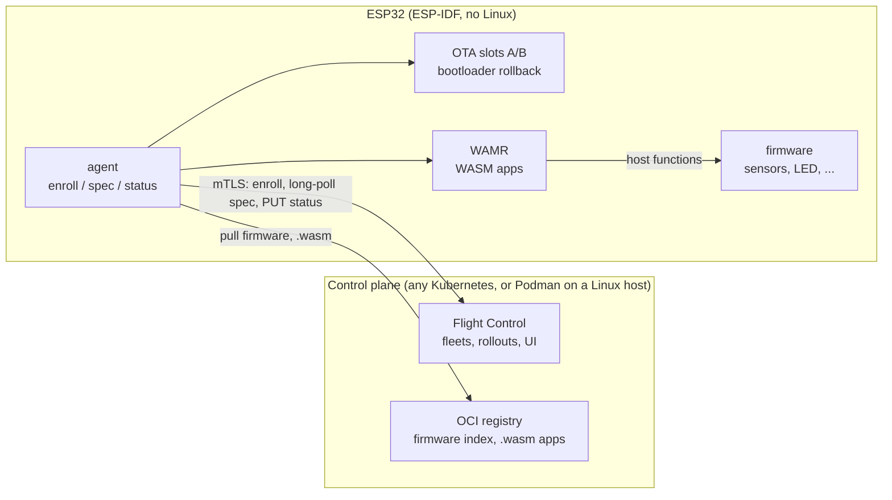
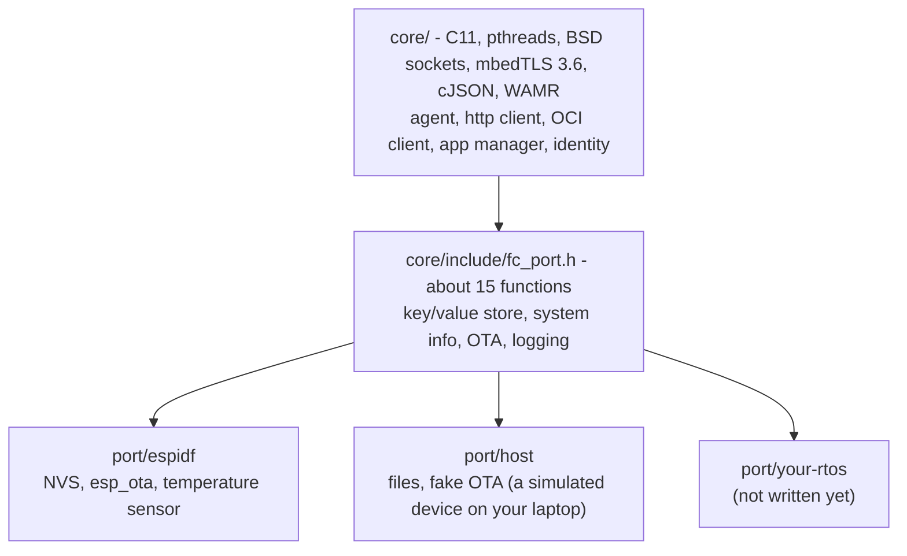
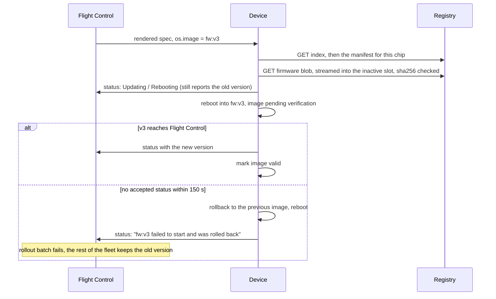

# flightctl-mcu

[](https://github.com/francescopace/flightctl-mcu/actions/workflows/ci.yml)

A [Flight Control](https://github.com/flightctl/flightctl) agent for microcontrollers. ESP32 boards enroll in the same control plane as your Linux edge devices. From there you can monitor them, push configuration, update their firmware over the air, and deploy WebAssembly apps to them. The devices don't run Linux, and Flight Control runs unmodified.

It works end to end on real hardware, with signed images and certificate renewal. It is not production ready yet: see [Limitations](#limitations) and the [roadmap](docs/ROADMAP.md).

## Why

Flight Control (upstream of Red Hat Edge Manager, [video overview](https://www.youtube.com/watch?v=BrLQr61dTik)) manages fleets of Linux edge devices: enrollment, monitoring, declarative config, OS images and container apps, with staged rollouts. Its agent is written in Go and expects a full Linux system with bootc, systemd and Podman.

The service itself is not tied to OpenShift. It installs with Helm on any Kubernetes cluster that supports the Gateway API (OpenShift and MicroShift included), or without Kubernetes on a single Fedora or RHEL host, as Podman quadlets. This repo uses kind on a laptop.

Plenty of devices in the field are not like that. A sensor node or a small controller on a production line is usually a microcontroller with a few hundred KB of RAM and an RTOS. These devices end up managed by something else: a vendor cloud, a custom MQTT backend, or nothing at all. So the gateway that collects their data shows up in Flight Control, and the devices behind it don't.

The idea here is to have the microcontroller speak the Flight Control **agent API** itself. That API is a small HTTP+JSON protocol over mutual TLS:

- an enrollment request;
- long-polling the rendered device spec;
- reporting status.

A C client for it, with mbedTLS for TLS 1.3, fits in about 21 KB of flash. Once a board implements it, Flight Control treats it as a regular device: it shows up in fleets, label selectors and the UI, it takes part in rollouts, and the same RBAC applies.

## How Flight Control concepts map to an MCU

| Flight Control | On the microcontroller |
|---|---|
| Enrollment request + approval | P-256 key generated on the device, CSR, management certificate stored in flash |
| Certificate signing request (renewal signer) | The device renews its management certificate for the same key before it expires |
| `spec.config` (inline files) | Files stored in NVS. The firmware gets each file through a callback and can reject it. |
| `spec.os.image` | Firmware image, pulled from an OCI registry into the inactive OTA slot. One image index covers all chips; each board picks its own. Its cosign signature is checked first. |
| `spec.applications` (`appType: container`) | A WebAssembly module packaged as an OCI artifact, run by [WAMR](https://github.com/bytecodealliance/wasm-micro-runtime) without a reboot |
| `status` | Heap, flash, chip and firmware version, RSSI, temperature, app state, bytes on the wire (in `customInfo`) |
| Fleet rollout (`BatchSequence`) | Works unchanged. The device reports a new version only after the new firmware has reached the server. |

## Architecture



The agent runs two threads:

- **spec thread**: holds a long-poll on `GET /devices/{name}/rendered` and applies whatever comes back (config, firmware, apps).
- **status thread**: sends `PUT /devices/{name}/status` every 60 seconds, and immediately when something changes.

Everything that differs between platforms sits behind a small port layer:



The host port is not a mock. It runs the same agent against a real Flight Control server, which is how most of the protocol work was done without flashing anything.

### Firmware update with rollback



## Supported microcontrollers

Tested on real boards with ESP-IDF 5.5.6:

| Chip | Core | Status | Free heap with an app running |
|---|---|---|---|
| ESP32-S3 | Xtensa LX7 | everything works | ~150 KB |
| ESP32-C3 | RISC-V | everything works | ~87 KB |
| ESP32-C5 | RISC-V | everything works | ~68 KB |
| ESP32 (classic) | Xtensa LX6 | everything works; temperature is simulated because there is no supported internal sensor | ~88 KB |
| ESP32-C6 | RISC-V | everything except rollback, which was not exercised; on the DevKitC flash over the native USB port with the board powered up holding BOOT, then replug it | ~177 KB |
| ESP32-S2 | Xtensa LX7 | everything works, using the PSRAM in the package (S2FNR2, as on the Lolin S2 Mini): internal RAM alone is not enough for TLS; no serial log on the S2 Mini, because the console is on UART0 | ~40 KB internal + 2 MB PSRAM |

"Everything" means enrollment, monitoring, config, firmware OTA with rollback and WASM apps. PSRAM is not used, so a single image runs on every board variant of a chip. The exception is the S2, which needs its PSRAM (see the table). The same `.wasm` file runs on Xtensa and RISC-V.

Firmware images are 1.08–1.25 MB, leaving 25–35% of a 1.6 MB OTA slot free. Most of that size is the WiFi stack and mbedTLS. The agent itself is about 21 KB and WAMR about 71 KB.

## Adding another microcontroller

### Another ESP32 chip

If ESP-IDF supports the chip, it is mostly configuration:

1. Build for it: `TARGET=esp32c61 FW_VERSION=v1 firmware/build.sh`. The build directory is `firmware/build-<target>`.
2. Put board-specific defaults in `firmware/sdkconfig.defaults.<target>`. For example the LED pin: see `sdkconfig.defaults.esp32c3` or `sdkconfig.defaults.esp32`.
3. If the chip has no temperature sensor, `port/espidf` already falls back to a simulated one (`SOC_TEMP_SENSOR_SUPPORTED`).
4. `firmware/fw-push.py` picks up every `build-*` directory, so the chip ends up in the next firmware index on its own.

Per-device differences, such as a different LED pin on a clone board, don't need a separate build. Set a label on the device (`led-gpio=38`, `led-order=rgb`, `led-ws2812=false`) and the fleet template passes it into the config.

### Another RTOS or vendor (Zephyr, NuttX, STM32, nRF, ...)

The core needs:

- POSIX threads (mutex, condition variable, threads with a configurable stack);
- BSD sockets, reachable through `mbedtls_net_*`;
- `time()` that returns the real time (certificates are validated);
- mbedTLS 3.6 with TLS 1.3 and PSA crypto;
- a platform layer for WAMR. WAMR already has one for Zephyr, NuttX, RT-Thread and RIOT, among others.

Then implement `core/include/fc_port.h` for your platform:

| Function | What it does |
|---|---|
| `fc_port_kv_get/set/del` | Persistent key/value storage: device key, certificate, config files, WASM modules |
| `fc_port_sysinfo`, `fc_port_custom_info` | Hardware and OS facts for `status.systemInfo` |
| `fc_port_write_file` | Where `spec.config` files end up |
| `fc_port_fw_platform` | The `platform.architecture` to pick from a firmware index, e.g. `esp32c3` |
| `fc_port_ota_begin/write/end` | Write an image into the inactive slot and make it the next boot image |
| `fc_port_ota_pending_verify/confirm/rollback`, `fc_port_reboot` | Confirm a new image or go back. On Zephyr this maps naturally onto MCUboot. |
| `fc_port_log` | Logging |

`port/espidf/fc_port_espidf.c` (about 300 lines) and `port/host/fc_port_host.c` are the two references. The firmware wiring in `firmware/main/` covers WiFi, time sync, the demo app and its host functions; it is ESP-IDF specific and would be rewritten for another platform.

## Repository layout

```
core/            agent, HTTP/TLS client, OCI client, WASM app manager (portable C)
port/espidf/     ESP-IDF port
port/host/       host port (simulated device)
host/            simulated device executable
firmware/        ESP-IDF project: main app, build/flash/push scripts
wasm-apps/       app SDK header, example apps (alarm, trend) and the build script
deploy/kind/     Flight Control on kind
deploy/registry/ local OCI registry
deploy/fleet/    example fleet
deploy/provision.py  writes a device's credentials partition (fc_creds)
deploy/signing/  signing key and signer for firmware and apps (cosign format)
deploy/auto-approve/ enrollment approval from an allow list
tests/fuzz/      libFuzzer targets and seed inputs
third_party/     WAMR fetch script (WAMR itself is not vendored)
ci/              helpers for the GitHub Actions workflow
docs/            roadmap and results
```

## Try it

You need Docker, kind, helm, kubectl, the [flightctl CLI](https://github.com/flightctl/flightctl/releases), esptool, oras, Python 3 with PyYAML, and for WASM apps clang plus `wasm-ld` (`brew install lld`). The ESP-IDF toolchain runs in the `espressif/idf:v5.5.6` container, so you don't install it.

The scripts were written on macOS (Apple Silicon). CI runs the host agent, the firmware build and the kind setup on Linux too.

**1. Control plane.** Flight Control on kind, reachable from your LAN at `<your-ip>.nip.io`, and a plain-HTTP OCI registry on port 5001. If you already run Flight Control elsewhere, on Kubernetes or on a Linux host, skip the first script and set its agent endpoint in `firmware/sdkconfig.local` (step 2).

```bash
deploy/kind/up.sh
```

```bash
deploy/registry/up.sh
```

```bash
flightctl login https://api.<your-ip>.nip.io:8443 --insecure-skip-tls-verify -t "$(kubectl create token flightctl-admin -n flightctl --duration=24h)"
```

The UI is at `http://ui.<your-ip>.nip.io:8080`; log in with the same token.

**2. Credentials.** The enrollment credentials go to `.secrets/`, which is git-ignored:

```bash
deploy/enrollment.sh
```

Create the key that signs firmware and apps. The device gets its public half, and from then on installs only images signed with it. The push scripts sign with it automatically:

```bash
deploy/signing/keygen.sh
```

**3. Build and flash a board.** The firmware has no credentials in it, so one build serves every installation. `flash.sh` detects the chip on the port:

```bash
third_party/fetch-wamr.sh
```

```bash
TARGET=esp32c3 FW_VERSION=v1 firmware/build.sh
```

```bash
firmware/flash.sh /dev/cu.usbmodem1101
```

That is a debug build. `VARIANT=release` builds with `-Os` and quieter logs, about 15% smaller, in `firmware/build-<chip>-release`; push those with `fw-push.py --variant release`.

**4. Provision it.** `provision.py` writes the board's `fc_creds` partition: the CA, the enrollment credentials, the signing key, the agent endpoint (by default `agent-api.<your-ip>.nip.io:8443`) and the labels. Pass the WiFi as well:

```bash
deploy/provision.py --port /dev/cu.usbmodem1101 --wifi-ssid <ssid> --wifi-password <password>
```

`--image` writes the same partition into a merged flash image instead (the emulator uses it), `--out` into a file. During development you can also build the WiFi and the endpoint into the firmware, from `firmware/sdkconfig.wifi` and `firmware/sdkconfig.local` (see the `.example` files); a provisioned value wins.

**5. Approve it.** A few seconds after boot the board asks to enroll:

```bash
flightctl get enrollmentrequests
```

```bash
flightctl approve -l stage=canary enrollmentrequest/<name>
```

For more than a few boards, list them in `deploy/auto-approve/allowlist.yaml` (start from `allowlist.example.yaml`), by device name or MAC address with their labels, and let the script approve them as they show up:

```bash
deploy/auto-approve/auto-approve.py deploy/auto-approve/allowlist.yaml --watch 10
```

**6. Give it firmware, config and an app.** Push a firmware index and the WASM app to the registry, then apply the fleet. `apply.sh` fills in the registry address, which defaults to your LAN IP on port 5001; set `REGISTRY=host:port` to use another one. Use the same tags as in `deploy/fleet/alarm-lab.yaml`, or edit them there.

```bash
firmware/fw-push.py <your-ip>:5001/flightctl-mcu/fw:v2.10
```

```bash
wasm-apps/build.sh alarm v2.2
```

```bash
deploy/fleet/apply.sh
```

The fleet selects devices labelled `app=alarm` (the firmware requests that label at enrollment). It rolls out to the `stage=canary` device first, then to the rest.

**No board?** Run the simulated device on your machine:

```bash
cmake -S . -B build/host -G Ninja -DMbedTLS_DIR=$(brew --prefix mbedtls@3)/lib/cmake/MbedTLS && cmake --build build/host
```

```bash
build/host/fc-host-agent --server agent-api.<your-ip>.nip.io:8443 --ca .secrets/ca.crt --enroll-cert .secrets/enroll.crt --enroll-key .secrets/enroll.key --signing-key .secrets/signing.pub --label site=lab
```

## Writing a WASM app

Apps include [wasm-apps/sdk/fc_app.h](wasm-apps/sdk/fc_app.h), which is the interface between an app and the device, with a version number. An app exports `tick(now_ms)`, which the device calls every `TICK_MS` milliseconds. That value comes from the app's `envVars` in the fleet and defaults to 100. The app reaches the hardware only through host functions:

- from the agent, on every device: `fc_set_state()`, shown in Flight Control as `customInfo["app.<name>"]`, and `fc_log()`;
- from the firmware: `fc_temp_mc()`, `fc_threshold_mc()` (from the fleet config) and `fc_led(r, g, b)`.

`FC_APP_ABI()` declares the interface version the app was built for, so an older device refuses it with a clear error instead of failing later.

There are two examples:

- [alarm](wasm-apps/alarm/alarm.c): the LED logic of the temperature alarm, a few hundred bytes. It uses only blue, dim for the pre-alarm and blinking for the alarm, so boards with a single-colour LED look the same as RGB ones.
- [trend](wasm-apps/trend/trend.c): no LED. It smooths the temperature and reports whether it is rising or falling, and how fast.

Build and push with `wasm-apps/build.sh <app> <version>`. Keep its link flags: exporting `__heap_base` and `__data_end` lets WAMR shrink the 64 KB WebAssembly memory page to what the module actually uses. Without that, an app does not fit on a C3.

## Limitations

What is done:

- **Signed images.** Firmware and apps are signed in cosign's format (`cosign verify --key` accepts them). A device with a signing key in its firmware refuses anything unsigned or signed with another key.
- **Certificate renewal.** The device renews its management certificate before it expires, as the Linux agent does.
- **Kept connections.** HTTP keep-alive, one connection per agent thread: a simulated device idles at about 220 KB/hour, against 560 KB/hour with a connection per request. What is left is mostly the full status sent every minute. Status updates triggered by apps are grouped (one every 15 s at most), so an app whose state flaps cannot flood the network.

What is not:

- **Security**:
  - The registry is plain HTTP without authentication. Signatures make that safe against tampering, not against reading.
  - The device key is stored unencrypted (no Secure Boot or flash encryption yet).
- **Provisioning**: credentials are written over USB (`deploy/provision.py`); there is no provisioning over BLE or SoftAP yet, and the enrollment certificate is one per installation, not per batch.
- **App formats**: apps must be WASM OCI artifacts (`application/vnd.wasm.content.layer.v1+wasm`). Podman-style images with a `.wasm` inside a tarball are not supported.

Some of what we ran into points at gaps in Flight Control for this class of device:

- a fixed 5-minute disconnect timeout;
- no way for a device to say it only runs WASM apps;
- `matchExpressions` in fleet selectors is silently ignored;
- rollout success is judged on `renderedVersion` only.

These are written up, with measurements, in [docs/RESULTS.md](docs/RESULTS.md). What comes next is in [docs/ROADMAP.md](docs/ROADMAP.md).

## CI

GitHub Actions runs on every push that touches code. It builds once and tests what it built: the end-to-end jobs take the host agent, the firmware images and the WASM apps from the build jobs.

- **Builds**: the simulated device on Linux, the firmware for every supported chip in debug and release profiles (with `ccache`), and the example WASM apps. The firmware has no credentials in it.
- **Fuzzing** ([ci/fuzz.sh](ci/fuzz.sh)): the HTTP response reader, the OCI manifest and signature handling, and the agent's handling of rendered specs and certificates. 30 seconds per target on every push, 20 minutes per target every night ([fuzz-nightly.yml](.github/workflows/fuzz-nightly.yml)), with the corpus kept from one night to the next. Crashes found so far are kept as seed inputs in `tests/fuzz/corpus`.
- **End-to-end test** ([ci/e2e.sh](ci/e2e.sh)): the job deploys Flight Control 1.3.1 on kind and a registry on the runner. The simulated device then goes through:
  - enrollment, approved by the allow-list script;
  - Online status;
  - inline config;
  - a signed WASM app install, and `cosign verify` on its signature;
  - an in-place update from v1 to v2;
  - a config change;
  - an unsigned app, which it must refuse;
  - an update while the registry is down, which must complete once it is back;
  - the app's removal, then the second example app;
  - the renewal of its management certificate (the server issues 2-minute certificates for the test), and a status accepted after the first one expired;
  - a server restart, after which it must reconnect and take a new spec.
- **Firmware in the emulator** ([ci/e2e-emu.sh](ci/e2e-emu.sh)): the real firmware for the C3 and the C5 runs in Espressif's [esp-emu](https://github.com/espressif/esp-emulator), whose WiFi access point NATs to the runner, against Flight Control on kind. It provisions the debug image for the test cluster, then goes through enrollment, a signed update to the release image with a reboot into the other slot, a signed app and an unsigned one, certificate renewal, and the rollback of a broken image that cannot reach the server (built with a 30-second confirmation window instead of 150).

You can run both tests against a cluster you already have:

```bash
SKIP_DEPLOY=1 ci/e2e.sh
```

```bash
SKIP_DEPLOY=1 CHIP=esp32c5 ci/e2e-emu.sh
```

The emulator test needs `esp-emu` on the PATH or in `~/.local/bin`. In CI it does not rebuild the firmware: it provisions the images the firmware job built. To try a build in the emulator by hand, provision its merged image for the emulator's access point and run it:

```bash
deploy/provision.py --image firmware/build-esp32c3/merged-binary.bin --wifi-ssid myssid --wifi-password mypassword
```

```bash
esp-emu --chip esp32c3 --firmware firmware/build-esp32c3/merged-binary.bin --net user
```

## License

Apache 2.0, see [LICENSE](LICENSE).

## Third-party code

- [cJSON](https://github.com/DaveGamble/cJSON) (MIT), vendored in `core/third_party/cjson`
- [WAMR](https://github.com/bytecodealliance/wasm-micro-runtime) (Apache 2.0 with LLVM exception), fetched at build time
- [mbedTLS](https://github.com/Mbed-TLS/mbedtls) (Apache 2.0), from ESP-IDF or your system
