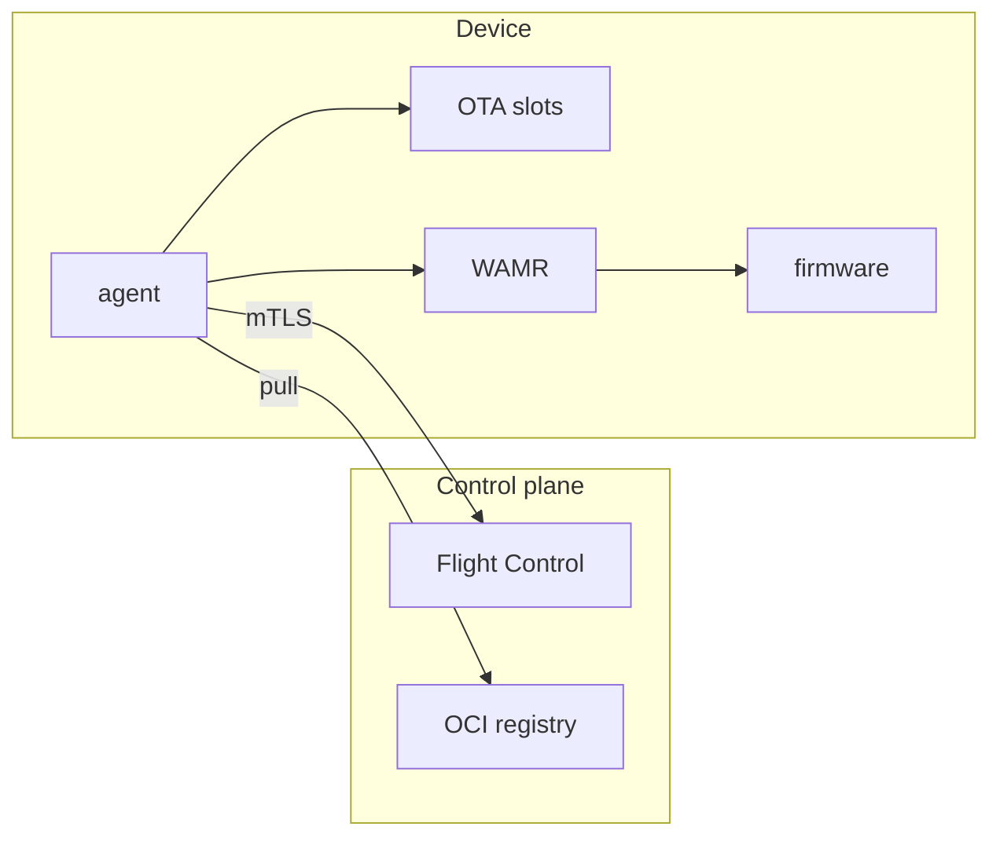
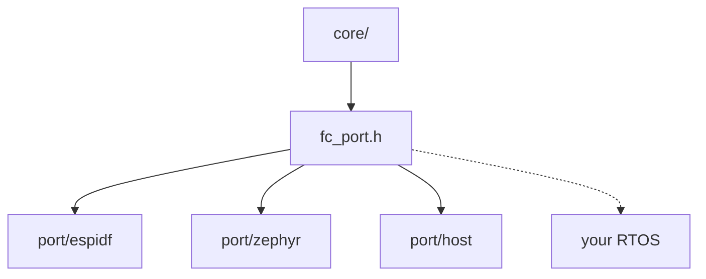
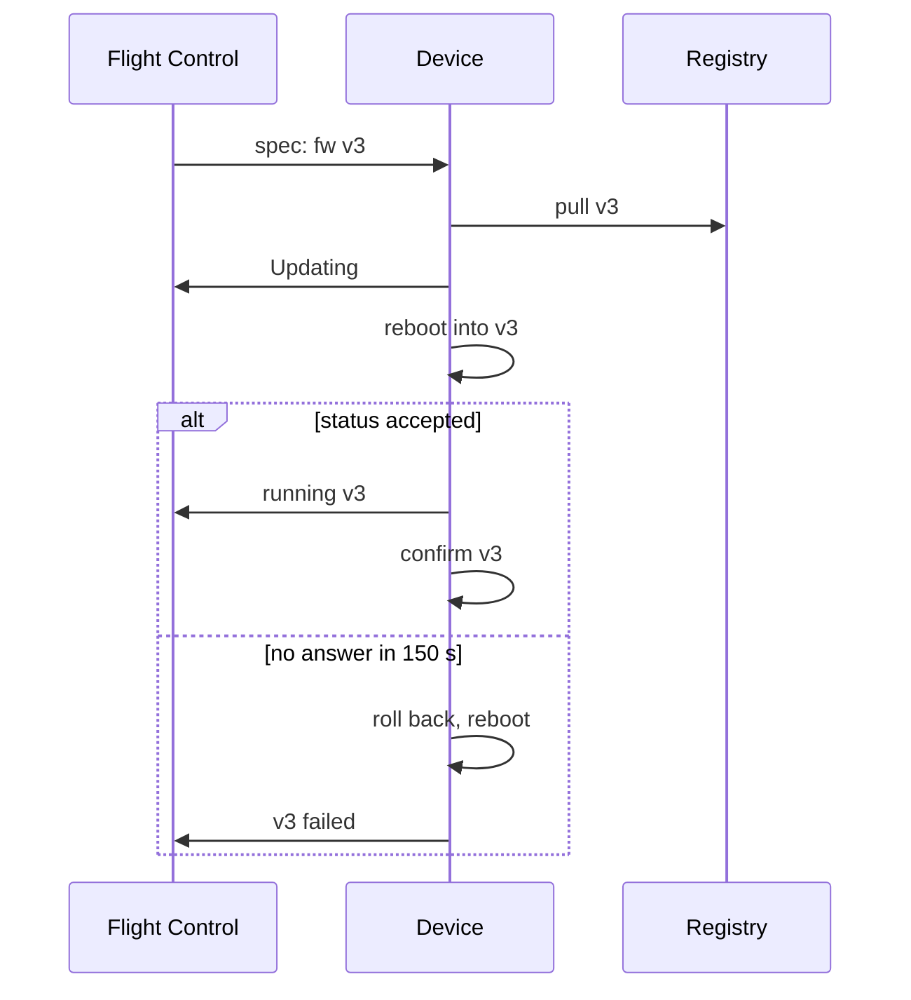

[](https://github.com/francescopace/flightctl-mcu/actions/workflows/ci.yml)
[](https://github.com/francescopace/flightctl-mcu/actions/workflows/fuzz-nightly.yml)
[](docs/DEPENDENCIES.md#esp-idf-port)
[](docs/DEPENDENCIES.md#zephyr-port)
[](LICENSE)

# flightctl-mcu

A [Flight Control](https://github.com/flightctl/flightctl) agent for microcontrollers: a portable C core, with ports for ESP-IDF, Zephyr and POSIX systems. Devices too small for Linux enroll in the same control plane as your Linux edge devices. From there you can monitor them, push configuration, update their firmware over the air, and deploy WebAssembly apps to them. Flight Control runs unmodified.

It works end to end on real hardware, with signed images and certificate renewal. Its known limits are under [Status](#status).

## Why

Flight Control (upstream of [Red Hat Edge Manager](https://docs.redhat.com/en/documentation/red_hat_edge_manager/)) manages fleets of Linux edge devices. Its agent is written in Go and expects bootc, systemd and Podman.

A sensor node or a small controller on a production line is a microcontroller with a few hundred KB of RAM and an RTOS. It ends up managed by a vendor cloud, a custom MQTT backend, or nothing at all: the gateway that collects its data shows up in Flight Control, and the devices behind it don't.

Here the microcontroller speaks the Flight Control agent API itself. That API is a small HTTP+JSON protocol over mutual TLS: enroll, long-poll the device spec, report status. The agent's own code, with the OCI client, signatures and apps, takes about 35 KB of flash; 49 KB with cJSON, the delta decoder and its port. Flight Control then treats the board as a regular device, with the same fleets, label selectors, rollouts, RBAC and UI.

## What maps to what

| Flight Control | On the microcontroller |
|---|---|
| Enrollment request and approval | P-256 key generated on the device, CSR, certificate stored in flash |
| Certificate renewal | Same key, renewed before the certificate expires |
| `spec.config` | Files in the device's storage. The firmware can reject each one. |
| `spec.os.image` | Firmware pulled from an OCI registry into the inactive OTA slot, after its cosign signature is checked. One index covers every chip, and an update can be a [delta](docs/DELTA.md). |
| `spec.applications` | A WebAssembly module packaged as an OCI artifact, run by [WAMR](https://github.com/bytecodealliance/wasm-micro-runtime) without a reboot |
| Registry credentials and CA (`auth.json`, `certs.d`) | The same files as on Linux, as config: TLS and a password to the [registry](docs/REGISTRY.md) |
| Decommission | Key and certificate wiped; the device does not enroll again until its storage is erased |
| `spec.resources` | CPU, heap and storage sampled against the fleet's alert rules, as the Linux agent does. Without rules, CPU and storage take the Linux defaults; the heap warns under 10% free, since the network stack holds most of it. |
| `status` | `resources` from those rules, heap, CPU use, firmware version, RSSI, temperature, app state |
| Fleet rollout | Works unchanged |

## How it works



The agent runs two threads. One holds a long-poll on the rendered device spec and applies whatever comes back: config, firmware, apps. The other sends the status, periodically and at once when something changes. Firmware and `.wasm` apps come from the registry. Apps run in WAMR and reach the hardware only through host functions the firmware exports.



`core/` is C11 on pthreads, BSD sockets, mbedTLS 4, cJSON and WAMR. What differs between platforms is behind `core/include/fc_port.h`, about 20 functions: key/value storage, system info, OTA, logging. The host port is not a mock: it runs the same agent as a process on Linux or macOS against a real Flight Control server, which is how most of the protocol work was done without flashing anything.

### Firmware update with rollback



The image is streamed into the inactive slot and checked against its sha256. The device reports the new version only after the new firmware has reached the server. A broken image therefore fails its rollout batch, and the rest of the fleet keeps the old version.

## Where it runs

| Stack | Runs on | What works |
|---|---|---|
| **ESP-IDF** 6.0 | ESP32, S2, S3, C3, C5, C6 | Everything, plus Secure Boot, flash encryption and WiFi provisioning over SoftAP and BLE. Six boards, and emulated chips in CI. |
| **Zephyr** 4.5 | Raspberry Pi Pico W, ESP32-S3 | Enrollment, monitoring, config, WASM apps, firmware through MCUboot. A new board is two files. |
| **Linux, macOS** | Any POSIX system | The simulated device of the tests. A firmware update only saves the image to a file. |

"Everything" is enrollment, monitoring, config, firmware OTA with rollback and WASM apps. The same `.wasm` file runs on all of them, whatever the CPU. A device needs about 256 KB of RAM, 2 MB of flash and a TCP/IP network.

The requirements in full, the boards tried and how to add a chip, a board or an RTOS are in [docs/DEVICES.md](docs/DEVICES.md).

## Try it

[docs/QUICKSTART.md](docs/QUICKSTART.md) sets up Flight Control on kind and a local registry, then enrolls a device: an Espressif board, or a simulated one on your machine if you have no board. kind is only the quickest way to try it: Flight Control also installs on Kubernetes or OpenShift, or on a Fedora or RHEL host as Podman quadlets, and the device works with any of them. For a Zephyr board, the build and flash steps are in [docs/ZEPHYR.md](docs/ZEPHYR.md).

## Documentation

| | |
|---|---|
| [QUICKSTART.md](docs/QUICKSTART.md) | From nothing to an enrolled device with firmware, config and an app |
| [DEVICES.md](docs/DEVICES.md) | Requirements, boards tried, adding a chip, a board or an RTOS |
| [APPS.md](docs/APPS.md) | Writing a WASM app |
| [ZEPHYR.md](docs/ZEPHYR.md) | The Zephyr port: Pico W, ESP32-S3, `native_sim` |
| [SECURITY.md](docs/SECURITY.md) | Secure Boot, flash encryption, keys in hardware, the factory procedure |
| [PROVISIONING.md](docs/PROVISIONING.md) | Credentials over USB, WiFi over SoftAP or BLE |
| [DELTA.md](docs/DELTA.md) | Firmware updates as deltas |
| [REGISTRY.md](docs/REGISTRY.md) | The registry: TLS, credentials, the local one |
| [TESTING.md](docs/TESTING.md) | Unit tests, fuzzing, end-to-end tests, what CI runs |
| [RESULTS.md](docs/RESULTS.md) | What was verified and where, measurements, gaps in Flight Control |
| [ROADMAP.md](docs/ROADMAP.md) | What comes next |
| [DEPENDENCIES.md](docs/DEPENDENCIES.md) | Versions, where each is set, licenses |

## Status

Tested on real boards and in CI: enrollment, monitoring, config, signed firmware and apps (cosign format), deltas, rollback, a registry with TLS and a password, decommissioning. Certificate renewal, Secure Boot and provisioning in the field are tested on emulated chips ([RESULTS.md](docs/RESULTS.md#what-works)).

Not there yet:

- The device trusts only the registry CA its fleet gives it: no public CA bundle, and no blobs redirected to another host ([REGISTRY.md](docs/REGISTRY.md)).
- Secure Boot and flash encryption (the `secure` variant) are tested in the emulator only. Without them the device key is in flash in clear.
- WiFi is the only link tried.
- Flight Control 1.4.0 cannot revoke an enrollment certificate; its main branch can, not yet in a release.
- Apps must be WASM OCI artifacts. Podman-style images with a `.wasm` inside a tarball are not supported.

The work also found gaps in Flight Control for this class of device, such as a fixed 5-minute disconnect timeout. They are written up in [docs/RESULTS.md](docs/RESULTS.md#flight-control-limitations-found-upstream-proposals), with the [current limitations](docs/RESULTS.md#current-limitations) in full.

## Repository layout

```
core/         the agent, portable C: HTTP/TLS client, OCI client, WASM app manager
port/         one directory per stack, with its port of the core and its firmware:
              espidf (ESP-IDF project), zephyr (Zephyr application), host (simulated device)
wasm-apps/    app SDK header, example apps, build script
tools/        Flight Control on kind, registry, example fleets, credentials,
              provisioning, signing, firmware push
tests/        unit tests, fuzz targets, tests of the tools, end-to-end tests
docs/         the documents listed above
third_party/  cJSON, and the scripts that fetch WAMR, detools and Zephyr
```

## License

Apache 2.0, see [LICENSE](LICENSE). Third-party code and its licenses are in [docs/DEPENDENCIES.md](docs/DEPENDENCIES.md#licenses).
