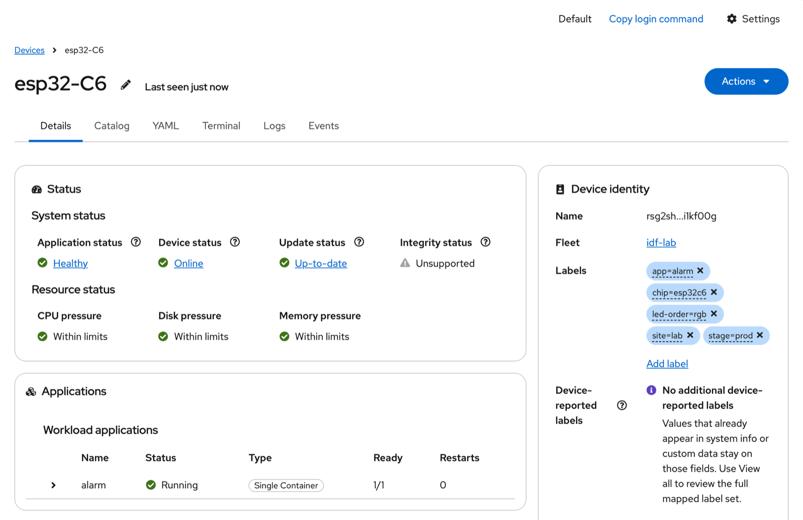
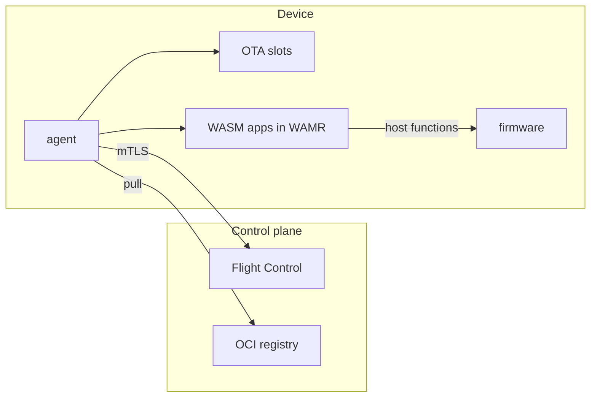
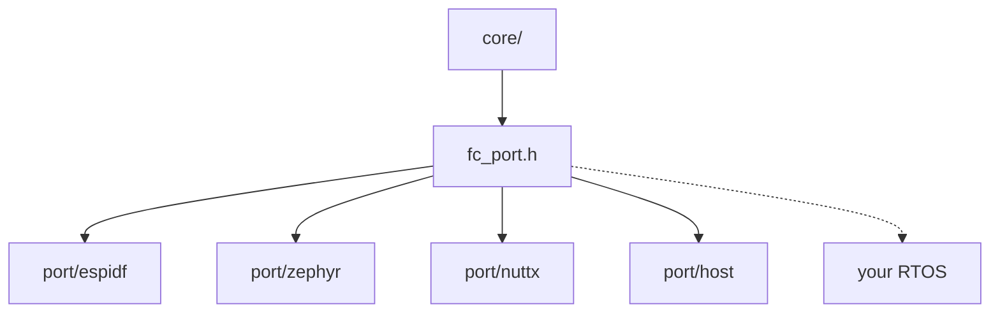
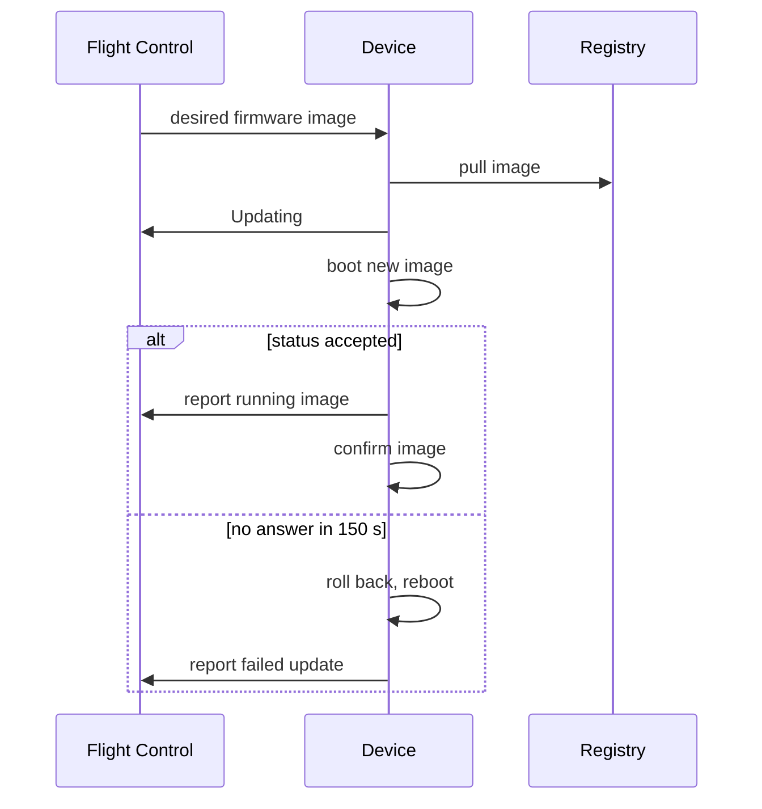

[](https://github.com/francescopace/flightctl-mcu/actions/workflows/ci.yml)
[](https://github.com/francescopace/flightctl-mcu/actions/workflows/fuzz-nightly.yml)
[](docs/DEPENDENCIES.md#esp-idf-port)
[](docs/DEPENDENCIES.md#zephyr-port)
[](docs/DEPENDENCIES.md#nuttx-port)
[](LICENSE)

# flightctl-mcu

flightctl-mcu brings microcontrollers (ESP32, STM32, Nordic nRF, Raspberry Pi RP2350) into the same [Flight Control](https://github.com/flightctl/flightctl) fleets as Linux devices. One C agent runs on **ESP-IDF, Zephyr and Apache NuttX**.

Apps are [WebAssembly](https://webassembly.org/) modules. You compile an app once, publish it as a signed OCI artifact, and the same `.wasm` file runs unchanged on Xtensa, RISC-V and Arm Cortex-M boards, whichever of the three RTOSes the board's firmware uses. Change the image in the fleet spec and the device swaps the app without reflashing or rebooting.

The firmware embeds [WAMR](https://github.com/bytecodealliance/wasm-micro-runtime) (WebAssembly Micro Runtime) with optimizations on top of upstream for this use: short callbacks on chips with a few hundred KB of RAM. On ESP-IDF one of them cut the time of an app callback by 21–43% across five boards. [Runtime changes and measurements](docs/WAMR.md#runtime-configuration)

One physical ESP32-S3 has enrolled and run the same signed apps on all three ports. [Same board, three ports](docs/BENCHMARKS.md#esp32-s3-n8r8-comparison-on-one-board)

**[Hardware compatibility matrix](docs/DEVICES.md#hardware-compatibility)** · **[Compare app benchmarks](docs/BENCHMARKS.md)** · **[Build and enroll](docs/QUICKSTART.md)**

**Status:** pre-1.0. [Roadmap](docs/ROADMAP.md#v100-in-progress)

## Why

Flight Control (upstream of [Red Hat Edge Manager](https://docs.redhat.com/en/documentation/red_hat_edge_manager/)) manages fleets of Linux edge devices. Its agent is written in Go and expects bootc, systemd and Podman.

A sensor node or a small controller on a production line is a microcontroller with a few hundred KB of RAM and an RTOS. It ends up managed by a vendor cloud, a custom MQTT backend, or nothing at all: the gateway that collects its data shows up in Flight Control, and the devices behind it don't.

flightctl-mcu closes that gap. Its agent speaks Flight Control’s HTTP/JSON agent API over mutual TLS. It enrolls, long-polls for its spec and reports status, so operators can use the same fleets, label selectors, rollouts, RBAC and UI as for Linux devices. For RAM and flash requirements, see [What a device needs](docs/DEVICES.md#what-a-device-needs).


*Flight Control 1.4's device list: the ESP32, C3, C5, C6 and S3 with ESP-IDF, and an ESP32-S3 with Zephyr, online and up to date.*

## Apps

An app is a WebAssembly module of up to 64 KiB, packaged as an OCI artifact. The agent runs each app on its own WAMR thread, up to two per device. This one blinks `led0` and compiles to about 300 bytes:

```c
#include "fc_app.h"

FC_APP_ABI()

static int32_t led, on;

int32_t init(void)
{
    led = fc_led_open(FC_STR("led0")); /* granted by FC_ALLOW: "led0" */
    fc_timer_start(500, 1);            /* FC_EV_TIMER every 500 ms */
    return led < 0;
}

void on_event(int32_t type, int32_t handle, int32_t value)
{
    if (type == FC_EV_TIMER) {
        on = !on;
        fc_led_rgb(led, 0, 0, on ? 40 : 0);
    }
}
```

Deploying an app is an entry in the fleet spec. This is the catalog's temperature [alarm](wasm-apps/alarm/alarm.c):

```yaml
applications:
  - name: alarm
    appType: container
    image: <registry>/flightctl-mcu/alarm:<version>
    envVars:
      FC_ALLOW: "led0"
```

**One module for every port.** The module contains no chip or RTOS code. It opens peripherals by name, and the board map or devicetree gives each name its wiring. The same module runs on ESP-IDF, Zephyr and NuttX boards that provide the peripherals it needs. [Writing an app](docs/APPS.md) · [Port differences](docs/APPS.md#ports) · [NuttX app hardware](docs/NUTTX.md#app-hardware-on-esp32-s3) · [wasm3-arduino blink](docs/APPS.md#the-blink-of-wasm3-arduino)

**Update an app without rebooting the device.** Change the app image in the fleet spec. The agent downloads the new WASM module and restarts the app while the firmware keeps running.

**Apps run in a sandbox.** A module reaches only its own memory and the functions the firmware exposes: GPIO, I²C, SPI, UART, ADC, PWM, sensors, storage, MQTT and metrics. `FC_ALLOW` names the peripherals and services each app may use. Each callback has a budget of 5 million instructions. After a trap the agent restarts the app while the firmware keeps running. With the publisher's key provisioned, the agent checks the artifact's signature before downloading it. [Grants](docs/APPS.md#what-an-app-may-use) · [Limits](docs/APPS.md#size-and-limits) · [Signing keys](docs/SECURITY.md#two-signing-keys)

**WAMR, optimized for this use.** The firmware runs WAMR 2.4.6's fast interpreter with **patches on top of upstream**. Decoded instructions use 16-bit handler offsets, and frequent instruction pairs dispatch directly on selected targets. On a classic ESP32 at 240 MHz, the Richards benchmark took 969 ms per iteration as a WASM app, compared to 9,991 ms for the same benchmark in MicroPython 1.29. [Runtime configuration](docs/WAMR.md#runtime-configuration) · [Interpreter dispatch](docs/WAMR.md#interpreter-dispatch) · [Runtime comparison](docs/WAMR.md#comparison-with-toit) · [Callback measurements](docs/BENCHMARKS.md#timer-callbacks) · [Patch inventory](third_party/fetch-wamr.sh)


*An ESP32-C6's page: its status, its labels, and the WASM app `alarm` running.*

## Incremental firmware updates

**Send only the firmware changes.** If the release includes a delta for the installed image, the device uses it to rebuild the new firmware in the inactive slot. It checks the digest before rebooting. Without a matching delta, it downloads the full image. On one Zephyr ESP32-S3 update, the delta was 19 KB, or 2.2% of the full image. [Measured update sizes and times](docs/DELTA-UPDATES.md#what-was-verified)

## What maps to what

| Flight Control | On the microcontroller |
|---|---|
| Enrollment and renewal | Generates a P-256 key, requests a certificate and renews it with the same key. |
| `spec.config` | Writes config files and removes managed files dropped from the spec. |
| `spec.os.image` | Installs firmware from an OCI registry into the inactive OTA slot. |
| `spec.applications` | Runs WASM modules packaged as OCI artifacts. [App guide](docs/APPS.md) |
| Registry credentials and CA | Uses the fleet's `auth.json` and `certs.d` files. [Registry setup](docs/REGISTRY.md#fleet-configuration) |
| `spec.resources` | Checks CPU, heap and storage against fleet alert rules. |
| `status` | Reports firmware version, resource health, app state and the last crash. [Crash diagnostics](docs/CONSOLE.md#download-a-crash-dump) |
| CLI and UI console | Runs built-in commands such as `status`, `apps` and `reboot`. [Console commands](docs/CONSOLE.md) |
| UI Logs tab | Shows device and app logs from the current and previous boot. [Log filters](docs/CONSOLE.md#the-log) |
| Telemetry Gateway | Sends device and app metrics to Prometheus via the gateway. [Metrics](docs/METRICS.md) |
| Fleet rollout | Applies updates in the batches defined by the fleet. |
| Decommission | Removes management credentials and stops checking in. Re-enrollment requires erasing device storage. |

## How it works



The agent uses separate streams on one HTTP/2 connection to watch for spec changes and report status. Apps access hardware through host functions: the firmware exports them to the module, and the port implements them with the chip's drivers.



The host port runs the same C11 agent on Linux and macOS. CI uses it to test against Flight Control on kind.

### Firmware update with rollback



The device verifies the image digest before rebooting. In the example fleet, a failed canary stops the next batch.

## Documentation

| | | |
|---|---|---|
| **Start** | [QUICKSTART.md](docs/QUICKSTART.md) | From nothing to an enrolled device with firmware, config and an app |
| | [DEVICES.md](docs/DEVICES.md) | Hardware requirements, supported targets and how to add a port |
| | [COMPARISON.md](docs/COMPARISON.md) | How flightctl-mcu compares with other MCU fleet managers |
| **Apps** | [APPS.md](docs/APPS.md) | Writing a WASM app |
| | [WAMR.md](docs/WAMR.md) | WAMR patches, interpreter dispatch, SDK allocator and comparison with other runtimes |
| | [BENCHMARKS.md](docs/BENCHMARKS.md) | Signed app workloads on physical boards, grouped by test configuration |
| **Ports** | [ESP-IDF.md](docs/ESP-IDF.md) | ESP-IDF profiles, RAM and OTA slot sizes |
| | [ZEPHYR.md](docs/ZEPHYR.md) | The Zephyr port |
| | [NUTTX.md](docs/NUTTX.md) | The Apache NuttX port, provisioning and optional MCUboot firmware updates |
| **Operations** | [PROVISIONING.md](docs/PROVISIONING.md) | Credentials over USB, WiFi over SoftAP |
| | [SECURITY.md](docs/SECURITY.md) | Secure Boot, flash encryption, keys in hardware, the factory procedure |
| | [REGISTRY.md](docs/REGISTRY.md) | The registry: TLS, credentials, the local one |
| | [DELTA-UPDATES.md](docs/DELTA-UPDATES.md) | Firmware updates as deltas |
| | [CONSOLE.md](docs/CONSOLE.md) | The remote console and the UI's Logs tab |
| | [METRICS.md](docs/METRICS.md) | Metrics to the Telemetry Gateway (OpenTelemetry) |
| | [SBOM.md](docs/SBOM.md) | Each release's SBOM, and its known vulnerabilities in Flight Control through Trustify |
| **Project** | [TESTING.md](docs/TESTING.md) | Unit tests, fuzzing, end-to-end tests, what CI runs |
| | [DEPENDENCIES.md](docs/DEPENDENCIES.md) | Versions, where each is set, licenses |
| | [ROADMAP.md](docs/ROADMAP.md) | What comes next |
| | [FLIGHTCTL-LIMITATIONS.md](docs/FLIGHTCTL-LIMITATIONS.md) | The gaps in Flight Control in detail, with proposals |

## License

Apache 2.0, see [LICENSE](LICENSE). Third-party code and its licenses are in [docs/DEPENDENCIES.md](docs/DEPENDENCIES.md#licenses).
