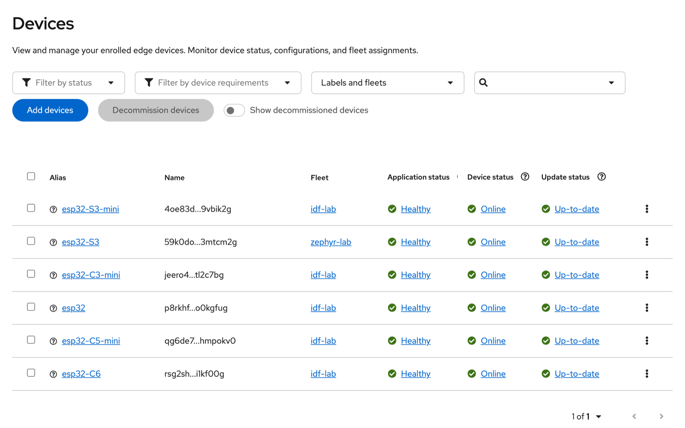
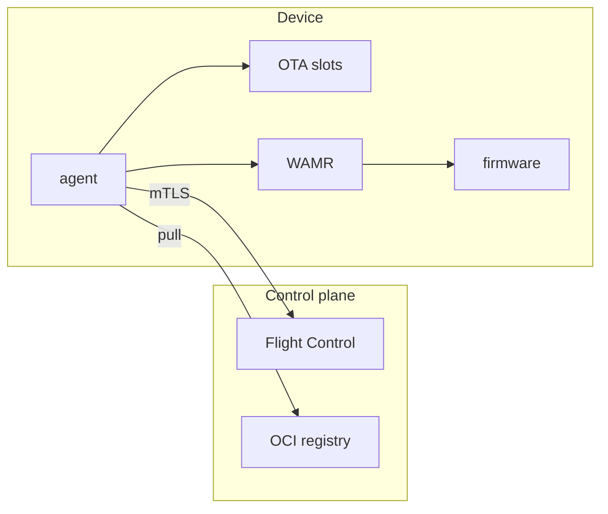
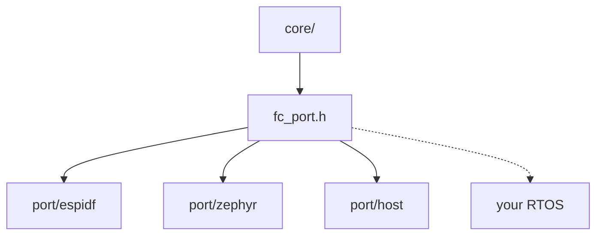
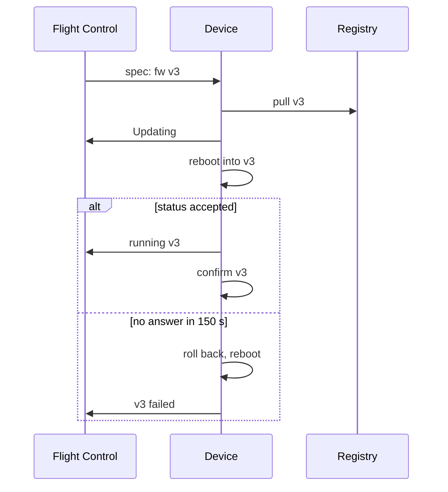

# flightctl-mcu

A [Flight Control](https://github.com/flightctl/flightctl) agent for microcontrollers: a portable C core, with ports for ESP-IDF, Zephyr and POSIX systems. Devices too small for Linux enroll in the same control plane as your Linux edge devices. From there you can monitor them, push configuration, update their firmware over the air, and deploy WebAssembly apps to them. Flight Control runs unmodified.

It works end to end on real hardware, with signed images and certificate renewal.

## Why

Flight Control (upstream of [Red Hat Edge Manager](https://docs.redhat.com/en/documentation/red_hat_edge_manager/)) manages fleets of Linux edge devices. Its agent is written in Go and expects bootc, systemd and Podman.

A sensor node or a small controller on a production line is a microcontroller with a few hundred KB of RAM and an RTOS. It ends up managed by a vendor cloud, a custom MQTT backend, or nothing at all: the gateway that collects its data shows up in Flight Control, and the devices behind it don't.

The microcontroller uses Flight Control’s HTTP/JSON agent API over mutual TLS. It enrolls, long-polls for its spec and reports status, so operators can use the same fleets, label selectors, rollouts, RBAC and UI as for Linux devices. For flash requirements, see [What a device needs](docs/DEVICES.md#what-a-device-needs).

*Flight Control 1.4's device list: the ESP32, C3, C5, C6 and S3 with ESP-IDF, and an ESP32-S3 with Zephyr, online and up to date.*

## WASM apps and incremental firmware updates

**Update an app without rebooting the device.** Change the app image in the fleet spec. The agent downloads the new WASM module and restarts the app while the firmware keeps running. The same module runs on ESP-IDF and Zephyr boards that provide the peripherals it needs. [WASM apps](docs/APPS.md)

**Send only the firmware changes.** If the release includes a delta for the installed image, the device uses it to rebuild the new firmware in the inactive slot. It checks the digest before rebooting. Without a matching delta, it downloads the full image. On one Zephyr ESP32-S3 update, the delta was 19 KB, or 2.2% of the full image. [Delta updates](docs/DELTA-UPDATES.md) · [Board measurements](docs/RESULTS.md#firmware-deltas)

*An ESP32-C6's page: its status, its labels, and the WASM app `alarm` running.*

## What maps to what

| Flight Control | On the microcontroller |
|---|---|
| Enrollment and renewal | Generates a P-256 key, requests a certificate and renews it with the same key. |
| `spec.config` | Writes config files and removes managed files dropped from the spec. |
| `spec.os.image` | Installs firmware from an OCI registry into the inactive OTA slot. |
| `spec.applications` | Runs WASM modules packaged as OCI artifacts. [App guide](docs/APPS.md) |
| Registry credentials and CA | Uses the fleet's `auth.json` and `certs.d` files. [Registry setup](docs/REGISTRY.md#fleet-configuration) |
| `spec.resources` | Checks CPU, heap and storage against fleet alert rules. |
| `status` | Reports firmware version, resource health, app state and the last crash. [Crash diagnostics](docs/CONSOLE.md#download-a-crash-dump) |
| CLI and UI console | Runs built-in commands such as `status`, `apps` and `reboot`. [Console commands](docs/CONSOLE.md) |
| UI Logs tab | Shows device and app logs from the current and previous boot. [Log filters](docs/CONSOLE.md#the-log) |
| Telemetry Gateway | Sends device and app metrics to Prometheus via the gateway. [Metrics](docs/METRICS.md) |
| Fleet rollout | Applies updates in the batches defined by the fleet. |
| Decommission | Removes management credentials and stops checking in. Re-enrollment requires erasing device storage. |

## How it works

The agent uses separate streams on one HTTP/2 connection to watch for spec changes and report status. Apps access hardware through functions exposed by the firmware.

The host port runs the same C11 agent on Linux and macOS. CI uses it to test against Flight Control on kind.

### Firmware update with rollback

The device verifies the image digest before rebooting. In the example fleet, a failed canary stops the next batch.

## Documentation

| | |
|---|---|
| [QUICKSTART.md](docs/QUICKSTART.md) | From nothing to an enrolled device with firmware, config and an app |
| [DEVICES.md](docs/DEVICES.md) | Hardware requirements, supported targets and how to add a port |
| [APPS.md](docs/APPS.md) | Writing a WASM app |
| [ZEPHYR.md](docs/ZEPHYR.md) | The Zephyr port |
| [SECURITY.md](docs/SECURITY.md) | Secure Boot, flash encryption, keys in hardware, the factory procedure |
| [PROVISIONING.md](docs/PROVISIONING.md) | Credentials over USB, WiFi over SoftAP |
| [DELTA-UPDATES.md](docs/DELTA-UPDATES.md) | Firmware updates as deltas |
| [SBOM.md](docs/SBOM.md) | Each release's SBOM, and its known vulnerabilities in Flight Control through Trustify |
| [REGISTRY.md](docs/REGISTRY.md) | The registry: TLS, credentials, the local one |
| [CONSOLE.md](docs/CONSOLE.md) | The remote console and the UI's Logs tab |
| [METRICS.md](docs/METRICS.md) | Metrics to the Telemetry Gateway (OpenTelemetry) |
| [TESTING.md](docs/TESTING.md) | Unit tests, fuzzing, end-to-end tests, what CI runs |
| [RESULTS.md](docs/RESULTS.md) | Verified hardware, firmware sizes, performance and resource limits |
| [FLIGHTCTL-LIMITATIONS.md](docs/FLIGHTCTL-LIMITATIONS.md) | The gaps in Flight Control in detail, with proposals |
| [ROADMAP.md](docs/ROADMAP.md) | What comes next |
| [COMPARISON.md](docs/COMPARISON.md) | How flightctl-mcu compares with other MCU fleet managers |
| [DEPENDENCIES.md](docs/DEPENDENCIES.md) | Versions, where each is set, licenses |

## License

Apache 2.0, see [LICENSE](LICENSE). Third-party code and its licenses are in [docs/DEPENDENCIES.md](docs/DEPENDENCIES.md#licenses).
