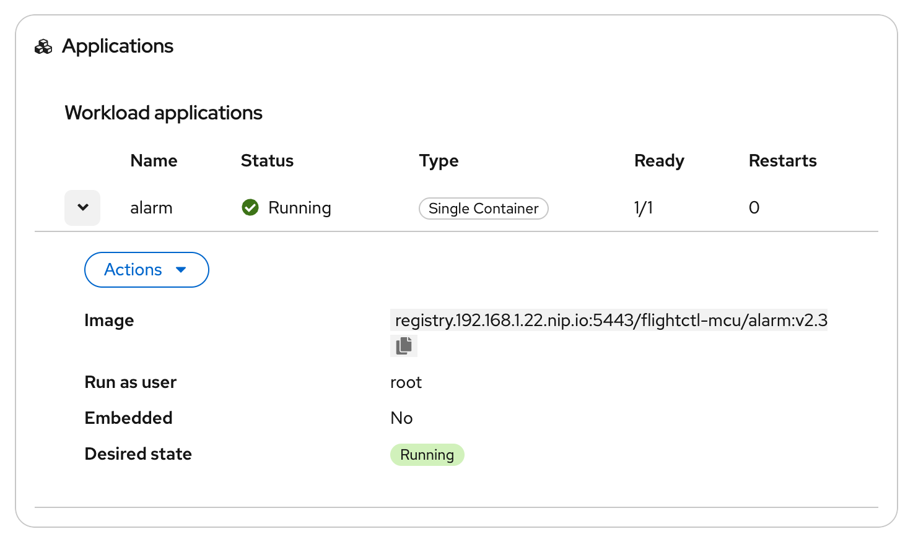

# Writing a WASM app

Package the `.wasm` module as a WASM OCI artifact. The agent runs one WAMR thread per app and can replace it without rebooting. Set `appType: container` in the fleet. The image must carry a WASM layer directly. A module inside a tar layer will fail to load.

For C apps, start with [alarm.c](../wasm-apps/alarm/alarm.c). Build and publish with `wasm-apps/build.sh <app> <version>`. The [SDK header](../wasm-apps/sdk/fc_app.h) defines the signatures, events and errors. For example, `fc_gpio_irq` imports `fc.gpio_irq`. ABI version 1 can change until v1.0.0. After that, changes within the version are additive.

`FC_ALLOW` is the app's environment variable that lists the hardware names and grants it may use. [Grants](#what-an-app-may-use)

| Group | Functions | Granted by |
|---|---|---|
| State, log and info | `fc_set_state`, `fc_log`, `fc_info` | always |
| Time and timers | `fc_time_ms`, `fc_time_unix_ms`, `fc_timer_start`, `fc_sleep_ms`, `fc_random` | always |
| Handles | `fc_close` | an open handle owned by the app |
| Config | `fc_config_get` | always |
| Private storage | `fc_kv_get`, `fc_kv_set`, `fc_kv_del`, `fc_queue_push`, `fc_queue_peek`, `fc_queue_ack` | always |
| Local readings | `fc_local_send`, `FC_EV_LOCAL` | `local.to:<receiver>` on the sender and `local.from:<sender>` on the receiver |
| GPIO and LEDs | `fc_gpio_open`, `fc_gpio_read`, `fc_gpio_write`, `fc_gpio_irq`, `fc_led_open`, `fc_led_rgb` | a name in `FC_ALLOW` |
| I²C | `fc_i2c_open`, `fc_i2c_read`, `fc_i2c_write`, `fc_i2c_write_read` | a name in `FC_ALLOW` |
| SPI | `fc_spi_open`, `fc_spi_transfer` | a name in `FC_ALLOW` |
| UART | `fc_uart_open`, `fc_uart_read`, `fc_uart_write` | a name in `FC_ALLOW` |
| ADC and PWM | `fc_adc_open`, `fc_adc_read_mv`, `fc_pwm_open`, `fc_pwm_duty` | a name in `FC_ALLOW` |
| Sensors | `fc_sensor_read` (temperature or battery channels), `fc_sensor_subscribe` (temperature triggers) | board-map name in `FC_ALLOW`; built-in `die_temp` needs no grant |
| Metrics | `fc_metric` | `metrics` |
| MQTT | `fc_mqtt_publish`, `fc_mqtt_subscribe`, `fc_mqtt_topic`, `fc_event_data` | `mqtt` |
| C library (`env`) | Functions from `string.h`, `stdio.h`, `stdlib.h`, `ctype.h` and `math.h`. [Function list](#the-c-library) | always |
| Clock (`env`) | `clock_ms` | always |
| Arduino (`arduino`) | `pinMode`, `digitalWrite`, `getPinLED`, `delay`, `millis`, `print`, `getGreeting`. [Arduino interface](#the-blink-of-wasm3-arduino) | GPIO and LED access use names in `FC_ALLOW` |

MQTT functions return `FC_ENOTSUP` on firmware built without MQTT. See [port differences](#ports).



[Runtime configuration and interpreter benchmarks](WAMR.md) · [App benchmarks by board](BENCHMARKS.md)

## How an app runs

Declare the ABI with `FC_APP_ABI()`. Implement `tick`, `on_event`, or both. The SDK checks the signatures at compile time.

| Export | When it runs | Notes |
|---|---|---|
| `init()` | Once after loading | A nonzero return fails startup |
| `tick()` | Every `TICK_MS` milliseconds | 10–60,000, default 100 |
| `on_event(type, handle, value)` | On a local reading, sensor notification, GPIO edge, timer, UART or MQTT input, config change or broker connection change | |

Callbacks run one at a time. Use a timer for periodic work and `fc_close` to stop it. An event-only app sleeps between events. Callback [limits](#size-and-limits) also apply to module initialization, including C++ constructors.

Whenever an app stops, the agent closes its handles, restores GPIO outputs to their safe level (or input) and turns off LEDs. After a trap it retries in a few seconds. See `status.applications[].restarts` for the count.

**After a device restart**, saved apps start after the first accepted status, or after three minutes without one if the agent is ready. On ESP-IDF, Wi-Fi and clock synchronization must finish first.

| Operation | Board | Environment | Time (s) |
|---|---|---|---:|
| Alarm threshold change to confirmed state | C6 | Physical | 4.4 |
| Alarm threshold change to confirmed state | Zephyr S3 | Physical | 6.3 |
| Config change to signed `battery` app confirmed running over TLS | C3 | Physical | 9.0 |
| Config change to signed `battery` app confirmed running over TLS | Zephyr S3 | Physical | 9.9 |
| Cached app startup with management offline, fixed-size primary, after boot | ESP-IDF S3 | Emulation | 181.0 |
| Cached app startup with management offline, its secondary, after boot | ESP-IDF S3 | Emulation | 182.7 |
| Cached app startup with management offline, expandable primary, after boot | ESP-IDF S3 | Emulation | 181.2 |

With the expandable primary, the secondary was still parked 45 s later. [Two apps](#size-and-limits) · [Method](TESTING.md#management-timings)

A device crash counts against an app in any of these cases:

- The app was loading.
- The app started less than a minute ago.
- The agent has had no successful management exchange since the app started. After the first accepted status, a successful rendered-spec poll also counts.

A management stall below the agent's heap reserve can also count against the app. Two consecutive attributed crashes leave the app in `Error` with `crashed the device as it started`. Changing the image, env vars or firmware, or removing the app, clears the block. A normal power cycle or update resets the consecutive crash count.

## Standalone modules

Set `FC_ENTRY` to a no-argument export to run a standalone module once. A module with `_start` and no callbacks needs no setting. It may import `env.clock_ms` (i32 or i64 milliseconds since app start), the [C library](#the-c-library) and [Arduino functions](#the-blink-of-wasm3-arduino). Imports from `fc` require the callback interface.

- The module allocates memory at startup and stays in `Preparing` until the agent has been idle for 2 s, or 30 s have elapsed.
- Its entry runs without an instruction budget. On ESP-IDF the interpreter checks every 4,096 operations whether to yield to the idle task.
- On return, the app becomes `Completed` and records its result in `customInfo["app.<name>"]`.
- It runs again after an image or env change or a device restart.
- A trap triggers the usual retry. Removing or updating the app stops it.

Both catalog CoreMark modules export `run`. The wasm3 build needs 64 KiB of contiguous linear memory and the wasm-coremark build needs 128 KiB, plus space for the agent and app thread. A valid run returns iterations per second. Use the wasm3 entry’s `references.container` value for `<wasm3-tag>` below. [Lab catalog](../tools/kind/mcu-lab.yaml) · [Scores by board](BENCHMARKS.md#coremark-module-sizes)

```yaml
        - name: coremark
          appType: container
          image: <registry>/flightctl-mcu/coremark:<wasm3-tag>
          envVars:
            FC_ENTRY: run
```

## Hardware by name

Open peripherals by name. On ESP-IDF, the firmware supplies defaults such as `led0`. Add the board's wiring to `/etc/fc/board.json` through the fleet template. On Zephyr, use [devicetree names](ZEPHYR.md#hardware-for-apps).

```json
{
  "gpio": { "button0": { "pin": 0, "active_low": true }, "relay1": { "pin": 5, "safe": 0 } },
  "led":  { "led0": { "pin": 48, "ws2812": true, "order": "grb" } },
  "i2c":  { "i2c0": { "sda": 8, "scl": 9, "hz": 400000 } },
  "adc":  { "level": { "pin": 1 } },
  "pwm":  { "fan": { "pin": 6 } }
}
```

| Entry | Field | Meaning |
|---|---|---|
| GPIO, LED | `active_low` | 1 means on |
| GPIO, LED | `safe` | Output level when the app stops |
| LED | `order` | Byte order of a WS2812 LED |
| I²C | `sda`, `scl` | Bus pins |
| I²C | `hz` | Optional, default 100 kHz |
| SPI | `sck`, `mosi`, `miso` | Bus pins, one data pin may be omitted |
| SPI | `cs` | Chip select |
| SPI | `mode` | 0–3 |
| SPI | `hz` | Default 1 MHz |
| UART | `tx`, `rx` | One may be omitted |
| UART | `de` | Optional RS-485 driver-enable pin |
| UART | `baud` | Defaults to 115200 when the app requests 0 |
| PWM | `hz` | Defaults to 1 kHz when the app requests 0 |
| Sensor | `"source": "die_temp"` | The built-in temperature source |
| Sensor | `"dt"` | On Zephyr, a temperature probe declared in the app hardware devicetree |
| Sensor | Battery `source` | References an ADC channel or I²C bus by name. [Battery channels](#battery-channels) |

- Names are unique across the map.
- A fleet template can use labels to select pins per device.
- SPI devices with matching bus pins share the bus.
- For a firmware-defined name, `"pin": -1` (or omitted bus pins) keeps its original wiring.
- The device rejects invalid field types, unknown sections, reserved or nonexistent pins, and conflicting pin assignments.
- A valid map change restarts apps using the interface.
- Opening an unknown name returns `FC_ENOENT`.

## What an app may use

Set `FC_ALLOW` to space-separated hardware names and the grants an app needs (`mqtt`, `metrics`, `local.to:<receiver>`, `local.from:<sender>`). [Functions that need no grant](#writing-a-wasm-app)

| Resource | Sharing rule |
|---|---|
| Sensor | Several apps can read it, each with its own grant for that name |
| Open peripheral | One app at a time, a second opener receives `FC_EBUSY` |
| I²C | A grant covers the whole bus |
| SPI | A grant covers one device, and the bus serializes their transfers |

Holding chip select holds the SPI bus until the callback returns.

For an alarm deployed across boards, set `"sensor": "line_temp"` in `/etc/fc-app/alarm.json` and grant `FC_ALLOW: "line_temp led0"`. The board map selects the probe:

| Board | `/etc/fc/board.json` |
|---|---|
| ESP-IDF with a die temperature sensor | `{"sensor":{"line_temp":{"source":"die_temp"}}}` |
| Zephyr ESP32-S3 DevKitC | `{"sensor":{"line_temp":{"dt":"core-temperature"}}}` |

A Zephyr board can expose an ambient probe by adding a child with `temperature-sensor = <&probe>;` to its `flightctl,app-hw` node and enabling the sensor driver. Set `die-temperature;` for a probe providing the die temperature channel. The alarm samples the selected probe every `sample_ms`. If the name exists but the app lacks its grant, Flight Control reports `sensor access denied`.

Use `fc_sensor_subscribe` to receive hardware notifications on a granted board-map name.

- The call returns a handle.
- `on_event(FC_EV_SENSOR, handle, mode)` tells the app to read the latest sample with `fc_sensor_read`.
- Pending events coalesce per subscription.
- One subscription owns the physical probe's trigger settings, and other granted apps can still read it.
- `fc_close(handle)`, app stop and grant revocation cancel the subscription and discard its queued events.

| Mode | Bounds to pass | Where | How events are produced |
|---|---|---|---|
| `FC_SENSOR_READY`, a new sample is available | Zero for both | ESP-IDF C3, C5, C6 and S3, Zephyr S3 and Pico 2 W | The die sensor is read once per second, and only successful reads produce events |
| `FC_SENSOR_THRESHOLD` | Lower and upper, in millidegrees Celsius | ESP-IDF C5 and C6, whole-degree bounds within −10 to 80 °C | Hardware comparator |
| `FC_SENSOR_THRESHOLD` | Lower and upper, in millidegrees Celsius | Other bounds, and C3, S3 and Zephyr Pico 2 W | A one-second sample signals a change between the low, in-range and high zones. A first sample at or beyond either bound also signals. |
| `FC_SENSOR_THRESHOLD` | Lower and upper, in millidegrees Celsius | Other Zephyr probes | The driver’s threshold trigger |
| Either | — | Original ESP32 on ESP-IDF | `FC_ENOTSUP`, for die-temperature reads too |

- The example alarm uses hardware notifications when available and keeps its sampling timer for pre-alarm and recovery.
- Install firmware providing `sensor_subscribe` before deploying a module that imports it.
- For rollback, restore the older module first to keep the app running through the firmware change.

Grants persist across reboots. Changing an app's environment restarts it.

```yaml
spec:
  template:
    spec:
      config:
        - name: board
          inline:
            - path: /etc/fc/board.json
              content: '{"gpio": {"relay1": {"pin": 5, "safe": 0}, "button0": {"pin": 0, "active_low": true}}}'
        - name: pump
          inline:
            - path: /etc/fc-app/pump.json
              content: '{"period_ms": 5000, "max_level_mv": 2400}'
      applications:
        - name: pump
          appType: container
          image: registry.example.com/flightctl-mcu/pump:<app-tag>
          envVars:
            FC_ALLOW: "relay1 button0 led0"
```

## Battery channels

Use `fc_sensor_read(name, nlen, &value)` to poll a battery channel. Grant the app only the sensor names it reads. The firmware claims the underlying ADC channel or I²C bus for each reading and releases it before returning. A raw peripheral grant is unnecessary.

| Source in the board map | Input | Value | SBS word read |
|---|---|---|---|
| `battery_adc` | Named ADC channel wired to the pack through a known divider | Battery millivolts, rounded to the nearest mV after scaling | — |
| `sbs_voltage` | Named I²C bus connected to an SBS gauge | Pack voltage in mV | Voltage (0x09) |
| `sbs_percent` | Same bus | Relative state of charge, 0–100% | RelativeStateOfCharge (0x0d) |
| `sbs_charging` | Same bus | 1 for positive current into the pack, 0 for idle or discharge | Signed Current (0x0a) |

| Condition | Result |
|---|---|
| Read succeeded | 0, and the value is written |
| Any failure | The output stays unchanged |
| Name not in the board map | `FC_ENOENT` |
| Grant missing | `FC_EPERM` |
| Open handle on the same input | `FC_EBUSY` |
| Bus read failed | The driver's error |
| Charge above 100% | `FC_EIO` |
| `fc_sensor_subscribe` on a battery channel | `FC_ENOTSUP` |

For a voltage divider, first declare the wired ADC channel in the board map. On ESP-IDF use a supported ADC1 pin. On Zephyr use an ADC channel exposed by the board's app hardware devicetree. This map uses a channel named `vbat_adc` whose pin sees half the pack voltage.

```json
{"sensor":{"battery_mv":{"source":"battery_adc","input":"vbat_adc","divider_num":2,"divider_den":1}}}
```

- The multiplier is `divider_num / divider_den`, both positive integers with the numerator at least as large as the denominator.
- Use the actual divider ratio and keep the input within the board's ADC range.
- Accuracy depends on the ADC calibration and resistor tolerances.
- Configure this source only where the divider is wired. A floating pin can return a plausible voltage.
- A divider supplies voltage only.

For a Smart Battery gauge on an existing bus named `i2c0`, use this map. The firmware reads standard two-byte little-endian words at the 7-bit address `0x0b`. Omit channels the gauge does not implement.

```json
{
  "sensor": {
    "battery_mv":       {"source":"sbs_voltage",  "input":"i2c0"},
    "battery_pct":      {"source":"sbs_percent",  "input":"i2c0"},
    "battery_charging": {"source":"sbs_charging", "input":"i2c0"}
  }
}
```

| Example `battery` app | Value |
|---|---|
| `FC_ALLOW` | `battery_mv battery_pct battery_charging metrics` |
| Config file | `/etc/fc-app/battery.json`, for example `{"low_mv":3300,"sample_ms":30000}` |
| `low_mv` | Low-battery threshold for your pack |
| `sample_ms` | 30 seconds by default, minimum 1 second |
| Samples | At startup, on config change and every `sample_ms` |

- It reports `app.battery.low_battery` as 1 below a positive threshold and 0 at or above it. Without a configured threshold it skips that gauge.
- Other gauges are `voltage_mv`, `charge_pct` and `charging` under the same prefix.
- Each updates only on a valid reading. The telemetry gateway may continue to receive the last good value after a read error.

| State shown in Flight Control | Cause |
|---|---|
| `battery unavailable` | The voltage channel is absent or unsupported |
| `battery access denied` | Missing grant |
| `battery read failed` | Transient error |

Readings on esp-emulator 1.2.0. [Battery telemetry test](TESTING.md#end-to-end-tests)

| Emulated chip | ADC input (mV) | Production ADC driver (mV) | Signed `battery` app with a 2:1 divider (mV) |
|---|---:|---:|---:|
| ESP32-C3 | 1,650 | 1,640 | 3,280 |
| ESP32-C3 | 1,980 | 1,962 | 3,924 |
| ESP32-S3 | 1,650 | 1,650 | 3,300 |
| ESP32-S3 | 1,980 | 1,980 | 3,960 |

With the simulated Smart Battery gauge, both chips reported 3,700 mV, 62% charge and charging. Battery accuracy and charging with a physical pack remain unverified.

## Config and storage

Put app settings in `/etc/fc-app/<app name>.json` as a flat JSON object. `fc_config_get` reads a value as text. Use `fc_config_int`, `fc_config_double` or `fc_config_milli` for numbers (`"40.5"` becomes 40500 thousandths). A changed file raises `FC_EV_CONFIG`. The app can reload settings without restarting.

Use `fc_kv_*` for infrequent writes such as calibration. Each app has a [storage quota](#size-and-limits) for keys and values, with up to 31 characters per key. Each write replaces the whole flash record. Data survives reboots and upgrades until the app is removed.

- During an update, flash must hold the replacement alongside resident modules and the catalog.
- The agent verifies the new module, commits its catalog entry, then reclaims the old copy. A failed write leaves the old version active.
- Three maximum-size modules exceed the Zephyr S3's 176 KiB storage partition.
- Older firmware needs registry access to reload apps updated to the new catalog format.

`fc_info` returns device and app names, firmware version and board. Before enrollment the device name returns `FC_EAGAIN`.

### Persistent sample queues

Choose a private KV key for each FIFO.

| Call | Condition | Result | Notes |
|---|---|---|---|
| `fc_queue_push` | One nonempty binary sample stored | 0 | |
| `fc_queue_push` | Quota full | `FC_ENOSPC` | The samples already queued are preserved |
| `fc_queue_peek` | Head present | Payload length | Copies the oldest payload and its 32-bit ID |
| `fc_queue_peek` | Empty queue | `FC_ENOENT` | |
| `fc_queue_peek` | Short buffer | `FC_ENOSPC` | Both outputs untouched |
| `fc_queue_ack` | ID matches the head | Removes only the matching head | After the consumer confirms delivery, call it with the ID from `fc_queue_peek` |
| `fc_queue_ack` | Stale ID while another head exists | `FC_EAGAIN` | |

A failed storage operation gives `FC_EIO`. Re-read the head before retrying.

- Queues share the app's [storage quota](#size-and-limits). Reserve room for settings when sizing the queue.
- Each queue uses the key length, an 8-byte header and 2 bytes per payload. A queue named `samples` held 680 four-byte readings at the full quota.
- The head survives an app restart, firmware reboot and upgrade under the same app name.
- IDs start at 1, advance modulo 2³² and survive an empty queue. Removing the app or deleting its queue key resets the sequence.
- A crash after delivery and before acknowledgement can repeat the sample. Deduplicate by device, app, queue and ID.
- Each push and successful acknowledgement rewrites the app's KV record. Peeking does no writes.

| `samples` queue on the in-memory KV port | Writes | Written (B) |
|---|---:|---:|
| Filling the queue | 680 | 1,401,480 |
| Acknowledging every reading | 680 | 1,397,400 |

Flash wear depends on the filesystem and wear leveling. Adjust the sampling interval or batch readings to fit the write budget. All six physical boards recovered three queued readings in order after reboot. [Queue test](../tests/unit/test_apps.c)

The [sampler example](../wasm-apps/sampler/sampler.c):

- It reads `die_temp` at startup and every 60 seconds by default. Its startup settings are `sensor` and `sample_ms` (minimum 1,000).
- With the `mqtt` grant and a configured broker, it publishes the head on its relative `sample` topic at connection, on each sample timer and after an acknowledgement.
- The payload is an unsigned 32-bit ID followed by signed millidegrees Celsius, both little-endian.
- After storing a sample, the consumer publishes its four ID bytes on the same app's relative `ack` topic, with retain off. It should acknowledge duplicates too.
- A transport-level MQTT PUBACK leaves the head intact.

### Pass readings between local apps

`fc_local_send(peer, len, value)` queues one signed 32-bit reading on the other app's device-local event queue.

- Use the peer name from the fleet spec (1–47 bytes, with no spaces or NUL).
- In the [local alarm example](../wasm-apps/localalarm/localalarm.c), the receiver handles `on_event(FC_EV_LOCAL, -1, value)` and compares the reading with `threshold_c` (default 45 °C).
- The receiver needs an `on_event` export.
- Both apps must run together.
- Install firmware supporting the new imports before deploying the modules.

| App name in the spec | `FC_ALLOW` for local temperature readings |
|---|---|
| `sampler` | `local.to:localalarm` |
| `localalarm` | `local.from:sampler` |

These grants work with MQTT disabled. Add the sensor grant on the sender if sampling a named probe.

| Condition | `fc_local_send` returns |
|---|---|
| Reading queued for the receiver | 0 |
| Grant missing at either end | `FC_EPERM` |
| Peer absent | `FC_ENOENT` |
| Peer stopped, or all 16 of its event slots occupied | `FC_EAGAIN` |

Local sends keep FIFO order. Stopping the receiver discards pending events. The receiver's callback runs asynchronously.

## Where the data goes

| Data | Call | Grant | Where it goes |
|---|---|---|---|
| Occasional state such as `calibrating` or `alarm` | `fc_set_state` | None | `customInfo["app.<name>"]` in Flight Control, with changes recorded as events |
| Numeric gauges and counters | `fc_metric` | `metrics` | The [Telemetry Gateway](METRICS.md), once configured |
| Payloads and commands | MQTT functions | `mqtt` | The broker configured below |

On ESP-IDF, Zephyr and NuttX, each changed state adds an INFO entry to the device's log buffer. Read it with `log` in the agent's remote console. App stdout still goes to the serial console.

### MQTT

All apps share one broker connection. Supply its settings and CA through the fleet.

```yaml
spec:
  template:
    spec:
      config:
        - name: mqtt
          inline:
            - path: /etc/fc/mqtt.json
              content: '{"broker": "mqtts://broker.example.com:8883", "username": "pumps", "password": "...",
                         "fleetPrefix": "flightctl/fleet/pumps/{app}/"}'
            - path: /etc/fc/mqtt-ca.crt
              content: |
                -----BEGIN CERTIFICATE-----
                ...
```

| Broker setting | Default | Meaning |
|---|---|---|
| `broker` | Required | The broker address |
| `broker` as `mqtts://host[:port]` or `host:port` | Port 8883 | TLS, with the hostname verified against `mqtt-ca.crt` |
| `broker` as `mqtt://host[:port]` | Port 1883 | Plain TCP |
| `username`, `password` | Optional | Broker credentials |
| `clientId` | `{device}` | The device's name in Flight Control |
| `keepAliveSeconds` | 60 | 10 to 3600 |
| `devicePrefix` | `flightctl/{device}/{app}/` | Where an app publishes and subscribes |
| `fleetPrefix` | None | Where an app may subscribe too, for commands to every device of the fleet |

Anyone who can read the inline fleet spec can read the credentials. Restrict the broker account to the fleet’s prefixes.

The device substitutes `{device}` and `{app}` in each prefix and adds a trailing slash if needed. Prefixes cannot contain wildcards. App topics are relative. For example, `pump` on device `abc` publishes `temp` to `flightctl/abc/pump/temp`. Subscription filters accept `+` and `#`.

| Behavior | Limit |
|---|---|
| QoS | 0 or 1 |
| Unacknowledged publish on disconnect | Lost |
| Not supported | Persistent sessions, QoS 2, will messages and client certificates |
| Payload | 512 bytes |
| Relative topic | 64 characters |
| Oversized or unqueueable message | Dropped, counted and acknowledged |
| Incoming queue | 4,096 B shared by default (`FC_MQTT_POOL_SIZE`) |
| Share of the queue one app can hold | Half |
| Subscriptions across all apps | Up to 16 |
| First reconnect retry | After 1–2 s |
| Reconnect backoff | Up to two minutes |
| Subscriptions after a reconnect | Restored |
| `FC_EV_NET` | 1 on connection, 0 on loss |
| Handshake waits for | An accepted status, idle management traffic, a contiguous 24 KiB block and 12 KiB free above the agent's reserve |

After enrollment the agent starts the client before the apps. Changing either config file restarts it. Once connected, MQTT stays up during downloads. [Acknowledgement latency](BENCHMARKS.md#catalog-apps) · [Broker test](TESTING.md#mqtt-broker)

Delivery on established MQTT/TLS connections:

| Board | Publish interval (s) | Duration (min) | Messages delivered | Longest subscriber gap (s) |
|---|---:|---:|---:|---:|
| Each ESP-IDF board | 5 | 8 | 96 | 5.1 |
| Zephyr S3 | 10 | 45 | 270 | — |

During a separate signed update at a 1 s interval, the broker received 20 messages from the original boot after `Updating`, then messages from the new boot.

For a local broker, `tools/mqtt/up.sh` starts Mosquitto at `mqtt.<LAN IP>.nip.io:8883`. It creates a CA and a user restricted to `flightctl/#`. Use `tools/fleet/mqtt-config.py` to add the two config files to a fleet.

## Ports

- On Zephyr, the fleet can alias a hardware node in the board map. Grant the alias in `FC_ALLOW`.
- The S3 overlay exposes the physical die probe as `core-temperature`.
- The built-in `die_temp` reads the first app hardware node marked `die-temperature`.
- The three physical Zephyr targets report a read error when the temperature is unavailable.

[Zephyr hardware configuration](ZEPHYR.md#hardware-for-apps)

| Resource | ESP-IDF | Zephyr | NuttX on ESP32-S3 | Host simulator |
|---|---|---|---|---|
| GPIO with interrupts | Yes | Devicetree names | Yes | Simulated, nothing presses `button0` |
| `led0` | Board LED (`CONFIG_FC_LED_GPIO`, WS2812 or plain) unless `board.json` moves it | S3 onboard RGB pixel, Pico 2 W and nRF7002-DK green LEDs, console output on emulated targets | Yes | Simulated, printed |
| `die_temp` | Chip sensor on C3, C5, C6 and S3, `FC_ENOTSUP` on the original ESP32 | Physical on S3 N8R8, Pico 2 W and nRF7002-DK, uptime in the simulator | Yes | Simulated: 30 to 46 °C over two minutes |
| I²C | Master on any two pins | Devicetree controllers | Yes | `i2c0` with one device at 0x48 |
| SPI | Master, chip select driven by the firmware | Devicetree devices, chip select driven by the firmware | Yes | MISO wired to MOSI |
| UART | UART1, and UART2 on the ESP32 and S3 (UART0 is the console) | Excluding the console | Yes | RX wired to TX, with `FC_EV_UART` |
| ADC | ADC1 pins, calibrated from the chip's eFuse | Devicetree channels, in millivolts by their reference | Yes | 1,650 mV on any pin |
| PWM | LEDC | Devicetree channels | Yes | Printed when it changes |

[NuttX pins, counts and behavior](NUTTX.md#app-hardware-on-esp32-s3)

| ESP-IDF limit | Value |
|---|---|
| I²C buses on the ESP32 and S3 | Up to 2 |
| I²C buses on the C chips | 1 |
| SPI devices on one bus | Up to 4 |
| SPI buses on the ESP32 and S3 | 2 |
| SPI transfer pieces, without DMA | 64 bytes |
| UART bytes received ahead | 512 |
| ADC channels | Up to 8 |
| ADC input range | 0 to about 3.1 V |
| PWM channels, each at its own frequency | Up to 4 |
| PWM duty | To 14 bits |

- **RS-485.** ESP-IDF runs half duplex with `de`. On Zephyr ESP32-S3, enable runtime UART configuration and set `de-gpios`. The port holds DE through the last stop bit, including after a timed-out write or close. Other Zephyr controllers with `de-gpios` return `FC_ENOTSUP`.
- **Zephyr.** UART is interrupt-driven, with 512 bytes received ahead. An I²C or SPI transfer lasts as long as the driver makes it.
- **Host simulator.** The I²C device returns the simulated temperature in hundredths of a degree in register 0. Registers 2 and 3 are writable. SPI and UART return what is sent.

## Size and limits

| Resource | Limit | Notes |
|---|---|---|
| Apps per device | 2 | |
| WASM file | 64 KiB per download | With the app heap check enabled, the smaller of 64 KiB and one quarter of the free heap above the agent’s 40 KiB reserve. |
| Linear memory in the SDK build | One 64 KiB page | Includes the app’s stack and any `malloc` arena. |
| Linear memory in other modules | As declared | Can be more than one page. |
| Linear memory allocation | Can be shrunk by WAMR | When the module exports `__heap_base` and `__data_end` and the 16-byte-aligned data end fits below or at the heap base. |
| Open handles per app | 12 | GPIOs, LEDs, timers and other handles. |
| Timers per app | 4 | |
| Storage per app | 4,096 B (`FC_KV_QUOTA`) | Keys, values and [sample queues](#persistent-sample-queues). |
| Queued events per app | 16 | |
| Local send to a full queue | Rejected with `FC_EAGAIN` | |
| Other event to a full queue | Can evict the oldest | The count is reported through `FC_EV_OVERFLOW`. |
| Instructions in one call of `init`, `tick` or `on_event` | 5 million | |
| Time in the device's functions in one call | 1 s | Waits and the C library. |
| The export in `FC_ENTRY`, or `_start` | No limit | Stopped when the app is removed or updated. |
| One wait (`fc_sleep_ms`, `fc_uart_read`), one I²C transfer, one UART write, or waiting for another app's SPI device | 100 ms | |
| One I²C transfer | 1,024 B each way (`FC_I2C_MAX`) | |
| One SPI transfer | 4,096 B (`FC_SPI_MAX`) | |

**Memory at startup.**

| Startup need | Amount |
|---|---|
| Decoded module, on ESP-IDF | 2.5–3.5 times its file size, typically |
| Linear memory | One contiguous block |
| Module instance | About 3.5 KiB |
| App thread stack | 8 KiB |
| Free internal RAM after instantiation, for the agent to reconnect | 40 KiB |

An update can briefly hold both module versions. Compare these fields in `customInfo.heapAgentBytes`:

| Field | Meaning |
|---|---|
| `after` | Free bytes after startup |
| `low` | Subsequent minimum |
| `floor` | Reserve |

On Zephyr the equivalent check (`CONFIG_FC_APP_HEAP_CHECK`) is off by default and unverified on hardware. [Measured RAM use](ESP-IDF.md#runtime-memory)

**Two apps.**

- Set `FC_PRIMARY: "true"` on one app to load it first.
- A secondary can start once the primary has its fixed memory and sufficient RAM remains.
- If the primary can still grow its linear memory, the secondary waits.
- Updating or restarting the primary can park the secondary, releasing its hardware, thread and module. Its stored code and data survive.
- A completed one-shot keeps its result.

**When allocation fails.** [CoreMark measurements](BENCHMARKS.md#coremark-module-sizes)

- Status distinguishes a lack of contiguous space from insufficient free heap.
- The agent checks for enough memory every 30 s.
- For a primary it can release idle management TLS and reload the committed module from flash.
- On C5 and C6 without PSRAM, the loader tries to reserve a contiguous block early for eligible linear memories of 16 KiB or more.

**Build flags.**

- Keep the flags from `wasm-apps/build.sh`, including `-mcpu=mvp` and exports for `__heap_base` and `__data_end`.
- WAMR supports tail calls but lacks reference types.
- If an app needs a new firmware import, deploy the firmware and app in the same spec. The agent installs and confirms firmware first.
- An unsupported import rejects the app update and preserves the installed version.
- Rebuild legacy apps that import `env.set_state`, `env.log` or `env.led`.

Split long computations across callbacks. The instruction limit counts interpreter operations. Native calls and waits share a separate time allowance per callback. Hitting either limit stops the app.

| Board | Five million instructions in a counting loop (s) |
|---|---:|
| ESP32 | 1.20 |
| C3 | 1.06 |
| C5 | 0.66 |
| C6 | 1.30 |
| S3 Mini | 0.90 |

### The C library

Apps import these native functions from `env`. Their declarations are in the [SDK libc headers](../wasm-apps/sdk/libc/).

| Header | Functions |
|---|---|
| `string.h` | `memcmp`, `memcpy`, `memmove`, `memset`, `memchr`, `strlen`, `strcmp`, `strncmp`, `strncasecmp`, `strcpy`, `strncpy`, `strchr`, `strrchr`, `strstr`, `strspn`, `strcspn` |
| `stdio.h` | `snprintf`, `sprintf`, `printf`, `puts`, `putchar` |
| `stdlib.h` | `atoi`, `strtol`, `strtoul`, `abort` |
| `ctype.h` | `isalnum`, `isalpha`, `isdigit`, `isgraph`, `isprint`, `isspace`, `isupper`, `isxdigit`, `tolower`, `toupper` |
| `math.h` | `expf`, `logf`, `tanhf` |

An out-of-bounds pointer, invalid buffer length or `abort()` traps the app.

Output:

- `printf`, `puts` and `putchar` write INFO-level app logs.
- Lines split at 96 characters. A single `printf` writes up to 127 characters.
- Pending text is flushed when the callback returns.
- The port's libc formats conversions, including widths, precisions and `%f`.

Heap, for `malloc`, `calloc`, `realloc` and `free`:

- Declare an arena at file scope, for example `FC_HEAP(4096);`. It counts toward the module's fixed linear memory.
- Each allocation adds four bytes and rounds up to eight.
- `malloc` returns NULL if no free block fits.
- From SDK v0.9.5-rc.1, `malloc` searches an address-ordered list of free blocks and `free` joins adjacent free blocks. Rebuild the app to pick up this allocator. [Allocator measurements](WAMR.md#sdk-allocator)
- `free` makes a block available to the same app. The firmware allocates the module's linear memory from the device heap when it instantiates the app, and gets it back when the module unloads.

The SDK also maps common math operations such as `sqrtf` and `fabsf` directly to WASM instructions. The linker permits only the libc imports listed in [libc.syms](../wasm-apps/sdk/libc/libc.syms). Files and `vsnprintf` are unavailable.

## Examples

| App | What it does | Grants | Setup |
|---|---|---|---|
| [alarm](../wasm-apps/alarm/alarm.c) | Temperature alarm | `led0` for a blue warning 2 °C below the threshold and a blinking alarm | `sensor` (default `die_temp`), `threshold_c`, `hysteresis_c` and `sample_ms` in `/etc/fc-app/alarm.json` |
| [battery](../wasm-apps/battery/battery.c) | Polls named battery channels and publishes voltage, low-battery, relative charge and charging gauges | `battery_mv battery_pct battery_charging metrics` | [Configuration](#battery-channels) |
| [sampler](../wasm-apps/sampler/sampler.c) and [localalarm](../wasm-apps/localalarm/localalarm.c) | Queue temperature for acknowledged MQTT delivery and pass live readings to an alarm on the same device | [Local grants](#pass-readings-between-local-apps) | |
| [trend](../wasm-apps/trend/trend.c) | Reports temperature and rate of change, and like `alarm` stays idle on chips without a temperature sensor | `metrics` to export both | |
| [libccheck](../wasm-apps/libccheck/libccheck.c) | Exercises libc, and a passing run reports `bad=0` | — | |
| [hwcheck](../wasm-apps/hwcheck/hwcheck.c) | Inspects bus responses, UART loopback, ADC voltage and PWM output | `i2c0 spi0 uart0 adc0 pwm0` | |
| [mqttdemo](../wasm-apps/mqttdemo/mqttdemo.c) | Publishes temperature on `temp`, receives commands on device `cmd/#` and fleet `cmd`, and replies on `ack` | `mqtt`, and `led0` for LED commands | |
| [CoreMark](../wasm-apps/coremark/fetch.sh) | [One-shot benchmark](#standalone-modules) | — | Fetch both verified modules, set `COREMARK_TAG` to the wasm3 tag in the lab catalog and run `wasm-apps/push.sh coremark wasm3 "${COREMARK_TAG:?}"` |

### TinyML with emlearn

Both apps classify 12 temperature samples as steady, warming, cooling or unstable. Neither needs grants. [Inference benchmarks](BENCHMARKS.md#catalog-apps)

| App | Model | Module (B) | Linear memory used (KB) | Imports | Lab catalog channel of `tinyml` | Also reports |
|---|---|---:|---:|---|---|---|
| [tinyml](../wasm-apps/tinyml/tinyml.c) | Random forest with five trees and 193 nodes | 4,121 | 1.2 | — | `stable` | — |
| [tinymlp](../wasm-apps/tinymlp/tinymlp.c) | Neural network with 236 parameters, same features | 6,774 | 2.4 | `expf`, `logf`, `tanhf` | `neural` | Confidence |

Each channel installs one module. To publish the neural variant, build `tinymlp` with `NO_PUSH=1`, then run `APP_REPO=tinyml wasm-apps/push.sh tinymlp <build-version> <neural-tag>` using the neural channel’s container tag.

- The models assume 5 s between samples. Setting `sample_ms` changes the sampling interval without retraining.
- To reproduce the forest, use the pinned [training requirements](../wasm-apps/tinyml/requirements.txt) and [training script](../wasm-apps/tinyml/train.py).
- For your own forest, `dtype="float"` preserves fractional thresholds.
- The [feature adapter](../wasm-apps/tinyml/features.h) accounts for the difference between strict and inclusive thresholds on integer inputs.
- emlearn uses majority votes, so close calls can differ from scikit-learn's averaged probabilities.

### The blink of wasm3-arduino

The device runs the [wasm3-arduino blink](https://github.com/wasm3/wasm3-arduino) as published in Rust (283 B), C++ (369 B), AssemblyScript (2.2 KB) and TinyGo (5.2 KB). Grant `FC_ALLOW: "led0"`. To fetch the modules, verify their SHA-256 and publish the Rust build, set `ARDUINO_TAG` to its full Rust tag in the [lab catalog](../tools/kind/mcu-lab.yaml).

```bash
wasm-apps/arduino/fetch.sh
wasm-apps/push.sh arduino rust "${ARDUINO_TAG:?}"
```

| Function | On the device |
|---|---|
| `pinMode(pin, mode)`, `digitalWrite(pin, value)` | pin n is the n-th name of `FC_ALLOW`, counted from 0: a GPIO opens as `fc_gpio_open` opens it, an LED lights white |
| `getPinLED()` | the pin of `led0` in `FC_ALLOW` |
| `delay(ms)` | any length, in steps of 10 ms (`delay(0)` and `delay(1)` wait 10 ms), each one letting the device's other threads run; removing or updating the app stops it within 10 ms |
| `millis()` | milliseconds since the app started |
| `print(s, len)` | the app's log, a line at a time, as `printf` |
| `getGreeting(buf, len)` | `Hello from Flight Control` |

Only `getPinLED()` and `millis()` return values. Each blink exports a non-returning `_start()` and stays `Running` until stopped. In a callback, `delay` counts toward its native-call limit. Each build needs 64 KiB of contiguous memory, which can prevent a second app from starting. [Blink memory by board](BENCHMARKS.md#app-combinations)
