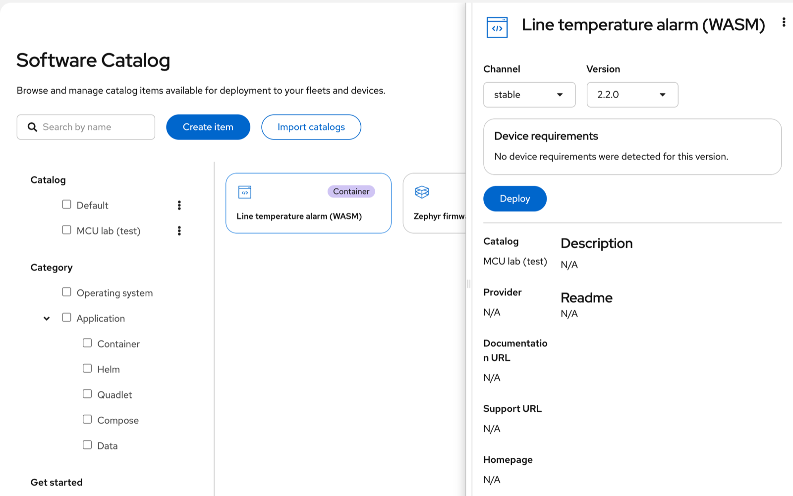

# Writing a WASM app

An app is a WebAssembly module deployed as a WASM OCI artifact. The device runs it with WAMR, one thread per app, and can replace it without rebooting. The table lists the imports available to apps. For the C signatures, arguments, return values, event types and error codes of the `fc` module, see the [SDK header](../wasm-apps/sdk/fc_app.h). A C function such as `fc_gpio_irq` imports `gpio_irq` from `fc`. The app interface is version 1. It can change before the project’s v1.0.0 tag. After that, changes within interface version 1 are additive.

| Group | Functions | Granted by |
|---|---|---|
| State, log and info | `fc_set_state`, `fc_log`, `fc_info` | always |
| Time and timers | `fc_time_ms`, `fc_time_unix_ms`, `fc_timer_start`, `fc_sleep_ms`, `fc_random` | always |
| Handles | `fc_close` | an open handle owned by the app |
| Config | `fc_config_get` | always |
| Storage | `fc_kv_get`, `fc_kv_set`, `fc_kv_del` | always |
| GPIO and LEDs | `fc_gpio_open`, `fc_gpio_read`, `fc_gpio_write`, `fc_gpio_irq`, `fc_led_open`, `fc_led_rgb` | a name in `FC_ALLOW` |
| I²C | `fc_i2c_open`, `fc_i2c_read`, `fc_i2c_write`, `fc_i2c_write_read` | a name in `FC_ALLOW` |
| SPI | `fc_spi_open`, `fc_spi_transfer` | a name in `FC_ALLOW` |
| UART | `fc_uart_open`, `fc_uart_read`, `fc_uart_write` | a name in `FC_ALLOW` |
| ADC and PWM | `fc_adc_open`, `fc_adc_read_mv`, `fc_pwm_open`, `fc_pwm_duty` | a name in `FC_ALLOW` |
| Chip sensors | `fc_sensor_read` (`die_temp`) | always |
| Metrics | `fc_metric` | `metrics` |
| MQTT | `fc_mqtt_publish`, `fc_mqtt_subscribe`, `fc_mqtt_topic`, `fc_event_data` | `mqtt` |
| C library (`env`) | Functions from `string.h`, `stdio.h`, `stdlib.h`, `ctype.h` and `math.h`. [Function list](#the-c-library) | always |
| Clock (`env`) | `clock_ms` | always |
| Arduino (`arduino`) | `pinMode`, `digitalWrite`, `getPinLED`, `delay`, `millis`, `print`, `getGreeting`. [Arduino interface](#the-blink-of-wasm3-arduino) | GPIO and LED access use names in `FC_ALLOW` |

A firmware without [MQTT](#mqtt) returns `FC_ENOTSUP` from its functions, so an app written for it loads and can tell. What each port has is under [Ports](#ports).


*An app on its device's page: `Running`, with its image in the registry. Flight Control shows a WASM app as a container application (`Single Container`).*


*The same app as an item of Flight Control's software catalog, ready to deploy to a fleet or a device.*

## How an app runs

The app exports `fc_abi_version` (with `FC_APP_ABI()`), and then any of these:

- `init()`: called once after loading. It opens what the app needs. A non-zero return is an error.
- `tick()`: called every `TICK_MS` milliseconds (an env var of the app, from 10 to 60000, 100 by default). `fc_time_ms` gives the time.
- `on_event(type, handle, value)`: called for each GPIO edge, timer, UART data, MQTT message, new config, or change in the broker connection.

`fc_app.h` declares these prototypes, so a definition with another signature does not compile. The device refuses, when it downloads it, an app that exports neither `tick` nor `on_event` (nor runs once, below), or that imports a function the firmware does not have. One that imports `env.set_state`, `env.log` or `env.led` was built with the interface of earlier firmware and must be rebuilt.

All of them run on the app's thread, one at a time, so the app needs no locks. Each call may run a budget of instructions and spend at most a second in the device's functions (`FC_CALL_LIMIT_MS`: its waits and the C library, which the budget does not count). A trap, or a call past either limit, stops the app; the device restarts it after a few seconds and counts it in `status.applications[].restarts`. An app in an endless loop is stopped that way too, so it can always be updated or removed. Code that the module runs as it is instantiated, before `init` (a start section, or an exported `__wasm_call_ctors`: C++ constructors, TinyGo's initialization), runs as one more such call, with the same limits, and may call `fc` as the app.

A trap is the app's; a crash of the firmware is the device's, and it restarts. The device starts its saved apps once its first status is accepted after boot, or once 3 minutes have elapsed without an accepted status and the agent can run the saved apps. On ESP-IDF the status thread starts after WiFi has an IP address and the clock has synchronized. A boot that is still waiting for either prerequisite also waits to start the apps. A crash that comes while an app's module is loading, or while an app is in its first minute or has no status accepted since it started, counts as a crash of that app; so does a restart the device makes itself for want of an accepted status with the heap below the agent's 40 KB. An app counted twice in a row is not started again: its status is `Error`, "crashed the device as it started", until its image, its env vars or the firmware change, or it leaves the spec. A restart that was not a crash (power, an update) resets the count; a crash is a fault, an abort or a watchdog on ESP-IDF, a fatal error on Zephyr.

## Modules built for no device

A module built for no device in particular, such as a benchmark, runs as it was published. The fleet names the export to call in the app's env var `FC_ENTRY`; a module with neither `tick` nor `on_event` that exports `_start` needs none. The device calls that export once, with no arguments:

- once the agent has had nothing on hand for 2 s (no status update due or being sent, no spec being applied), and at most 30 s after the app started, so that a benchmark does not share the CPU with the agent's first status updates; until then the app is `Preparing`. Its memory is taken as soon as the app starts; if it does not fit, the app waits for the heap ([below](#size-and-limits));
- on the app’s thread, with no instruction budget. On ESP-IDF it runs at normal app priority. Every 4,096 interpreter operations the ESP-IDF runner checks whether to yield so the idle task can service the watchdog. Concurrent one-shot apps share this idle window. Removing or updating the app stops it.
- when it returns, the app is `Completed` and not run again until its image or env vars change, or the device restarts. What it returned is its state, in `customInfo["app.<name>"]`, such as `run() returned 12.500`; a float is given to the thousandth. A trap is an `Error`, and it is run again after a few seconds, as any app.

Such a module may import `env.clock_ms`, as CoreMark does: the milliseconds since the app started, as an i32 or an i64. `env` is the module that clang's `wasm-ld --allow-undefined` and Emscripten import from by default; there the device has `clock_ms` and the functions of its [C library](#the-c-library), and refuses any other when the module is downloaded. It may also use tail calls (`return_call`). It may not yet import from `fc`: its call has none of an app's events or limits on waits around it. It may import from `arduino`, as [wasm3-arduino's blink](#the-blink-of-wasm3-arduino) does.

The MCU lab catalog provides two unmodified CoreMark builds. The wasm3 module needs a contiguous 64 KiB block of linear memory. The wasm-coremark module (`v1.1.0-wasm-coremark`) needs 128 KiB. The app thread and agent need additional free RAM. Both modules export `run()`, which returns iterations per second after at least 10 s of timed work, or zero for an invalid run. [Scores by board](RESULTS.md#coremark)

```yaml
        - name: coremark
          appType: container
          image: <registry>/flightctl-mcu/coremark:v1.1.0-wasm3
          envVars:
            FC_ENTRY: run
```

An app that polls a sensor every second needs only `tick`. An app that waits for a button or a command sleeps between events and costs no CPU. Other periods are timers (`fc_timer_start`), stopped with `fc_close`.

When the app stops, for whatever reason (a trap, an update, its removal), the device closes what it opened and leaves the hardware safe: a GPIO output goes to the `safe` level the board map gives it, or back to an input without one, and an LED goes off. A pump stays off while its app is replaced.

## Hardware by name

The app opens `"relay1"` or `"button0"`, never a pin number. The names come from the **board map**: the firmware has its own (on ESP-IDF, `led0`, the board's LED), and the fleet adds what is wired to the board with the config file `/etc/fc/board.json`, entry by entry:

```json
{
  "gpio": { "button0": { "pin": 0, "active_low": true }, "relay1": { "pin": 5, "safe": 0 } },
  "led":  { "led0": { "pin": 48, "ws2812": true, "order": "grb" } },
  "i2c":  { "i2c0": { "sda": 8, "scl": 9, "hz": 400000 } },
  "adc":  { "level": { "pin": 1 } },
  "pwm":  { "fan": { "pin": 6 } }
}
```

The fleet's template can vary it per device, from labels, as with any config file. A name is unique in the whole map, whatever its kind: `FC_ALLOW` lists names without saying what they are. `active_low` makes levels logical (1 is "on"); `safe` is the level an output takes when its app stops; a plain LED has `active_low` too, a WS2812 its byte `order`. An I2C bus has `sda`, `scl` and its clock in `hz` (100 kHz without it). An SPI device has its bus's `sck`, `mosi` and `miso` (one of the last two may be left out), its chip select `cs`, its `mode` (0 to 3) and its clock in `hz` (1 MHz without it); devices with the same three bus pins share the bus. A UART has `tx`, `rx` (one may be left out), `de`, the pin that enables an RS-485 transceiver while it sends, and the `baud` used when the app asks for 0 (115200 without it). A PWM may have its frequency in `hz`, used when the app asks for 0 (1 kHz without it). For a name the firmware already has, `"pin": -1` (or no pins, for a bus) keeps the firmware's pins: a template can set `led0`'s colour order on every board without knowing where its LED is.

The device checks a new `board.json` before it keeps it, and refuses it, as an update error in the device's status, when it names a pin the firmware uses (flash, PSRAM, the console's UART and USB pins) or one the chip does not have, puts two names on one pin (a bus's pins included), or has an unknown section or field type. A new map restarts the apps that use the interface.

The same app then runs on every board whose map has the names it uses. A name it asks for and the map lacks gives `FC_ENOENT`.

## What an app may use

The fleet grants each app what it may open, in its env var `FC_ALLOW`: names from the board map, and `mqtt` and `metrics` for the network. Without `FC_ALLOW` an app has state, log, info, time, config, storage and the chip's sensors, and no GPIO, bus or network. Two apps may be granted the same name, but only one holds it at a time: the other gets `FC_EBUSY`. So two apps cannot drive the same relay, and an app given to a fleet by mistake reaches nothing it was not given. A whole I2C bus is one name, so the sensors on it belong to one app; an SPI bus is shared, each device a name, so two apps may each hold a device on it, taking turns (a device that keeps its chip select between transfers holds the bus until the end of the app's call).

The device keeps an app's env vars with it, so an app started at boot, before the device reaches the server, has its grants. A change to them restarts the app.

```yaml
spec:
  template:
    spec:
      config:
        - name: board
          inline:
            - path: /etc/fc/board.json
              content: '{"gpio": {"relay1": {"pin": 5, "safe": 0}, "button0": {"pin": 0, "active_low": true}}}'
        - name: pump
          inline:
            - path: /etc/fc-app/pump.json
              content: '{"period_ms": 5000, "max_level_mv": 2400}'
      applications:
        - name: pump
          appType: container
          image: registry.example.com/flightctl-mcu/pump:v1
          envVars:
            FC_ALLOW: "relay1 button0 led0"
```

## Config and storage

Updating an installed app temporarily needs space for its replacement alongside both resident modules, plus the catalog and filesystem or NVS overhead. The device writes the verified WASM to a spare key, commits the catalog entry with its version and digest, then reclaims the previous module. A failed write leaves the old catalog active and reports an update error. The WASM limit is 65,536 B per module. Three modules at that limit exceed the Zephyr S3 storage partition of 176 KiB.

The firmware can read the older catalog that stored modules by app name. After an app has been updated in the new format, reverting to older firmware requires access to the registry to download that app again.

The app's `envVars` are for the device (`FC_ALLOW`, `TICK_MS`). The app's own settings are in `/etc/fc-app/<app name>.json`, a flat JSON object that `fc_config_get` reads key by key, as text. The header turns a value into a number: `fc_config_int` an integer, `fc_config_double` any number, `fc_config_milli` a number into rounded thousandths (`"40.5"` into 40500, to compare with milli-degrees or millivolts). A new file raises `FC_EV_CONFIG`, so the app can apply it without restarting; a file that comes again unchanged with a new version of the device's spec does not.

`fc_kv_*` keeps up to 4 KB per app, keys and values together, across reboots and new versions of the app: a calibration, a counter, the last state. Keys are up to 31 characters. An app's keys are one record in flash, rewritten whole at each `fc_kv_set`, so they are for what changes seldom. They are removed with the app.

`fc_info` gives the device's name in Flight Control (`FC_EAGAIN` until it has enrolled), the app's, the firmware's version and the board, for payloads and log lines.

## Where the data goes

Today an app reports its **state** (`fc_set_state`): a short text in Flight Control, `customInfo["app.<name>"]`, such as `ok`, `alarm` or `calibrating`. Flight Control records each change as an event, so it is for what changes seldom.

**Metrics** (`fc_metric`, granted by `metrics`): numbers for Flight Control's Telemetry Gateway, which adds the device's ID and exports them to Prometheus as `app_<app>_<name>`. A gauge is set, a counter added to; the device sends the last value of each with its own metrics, in one batch per interval, once the fleet gives the gateway's address ([METRICS.md](METRICS.md)). The first metric allocates a table for up to eight metrics for that app. Unloading its module frees the table.

And their own way out:

- **MQTT** (`fc_mqtt_*`): the application's own data and commands, with a broker the fleet gives. The device keeps one connection for all the apps. Each app publishes and subscribes under its own prefix, by default `flightctl/<device>/<app>/`, and can subscribe under the fleet's, to receive a command sent once to every device. QoS is 0 or 1; topics are at most 64 characters and payloads 512 bytes.

### MQTT

Tested against mosquitto on the host ([TESTING.md](TESTING.md#mqtt-broker)) and on the boards with both ports ([RESULTS.md](RESULTS.md#apps-on-the-boards), memory in [RAM](RESULTS.md#ram)). The fleet gives the broker in `/etc/fc/mqtt.json` and its CA in `/etc/fc/mqtt-ca.crt`, two config files:

```yaml
spec:
  template:
    spec:
      config:
        - name: mqtt
          inline:
            - path: /etc/fc/mqtt.json
              content: '{"broker": "mqtts://broker.example.com:8883", "username": "pumps", "password": "...",
                         "fleetPrefix": "flightctl/fleet/pumps/{app}/"}'
            - path: /etc/fc/mqtt-ca.crt
              content: |
                -----BEGIN CERTIFICATE-----
                ...
```

| Field | What it is |
|---|---|
| `broker` | `mqtts://host:port` (8883 if no port) or `host:port`: TLS 1.2 or 1.3, the broker's certificate checked against `mqtt-ca.crt` and its name. `mqtt://host:port` (1883): plain TCP, for a broker on a network the fleet trusts; the device logs it. Required. |
| `username`, `password` | the broker's user, if it asks for one. They are in the fleet's spec, readable by whoever reads the fleet: give each fleet its own user, limited by the broker to its prefixes. |
| `clientId` | `{device}` by default, the device's name in Flight Control |
| `keepAliveSeconds` | 60 by default, 10 to 3600 |
| `devicePrefix` | where an app publishes and subscribes, `flightctl/{device}/{app}/` by default |
| `fleetPrefix` | where an app may subscribe too, for commands to every device of the fleet; none by default |

`{device}` and `{app}` are the device's and the app's names; a prefix ends with `/` (added if missing) and has no wildcard. An app's topics are relative to them: `fc_mqtt_publish("temp")` from app `pump` on device `abc` is `flightctl/abc/pump/temp`, and a subscription takes MQTT's wildcards (`+`, `#`) within the prefix. A message for two apps reaches each with its own topic.

The device reconnects by itself, 1 to 2 s after a lost link, then waiting longer after each failure, up to 2 minutes, and subscribes again; a session is not kept on the broker. QoS 1 is sent once: a message published while the link drops, before the broker's acknowledgment, is not sent again. A message received waits for its app in a pool of 4 KB shared by all the apps, of which one app holds at most half; a message larger than 512 bytes, with a topic longer than 64 characters under its prefix, or for which there is no room is dropped, counted, logged once a minute at most, and still acknowledged. At most 16 subscriptions for all the apps together.

Not planned for 1.0: the device's own certificate for the broker, a QoS 1 message sent again after a lost link, QoS 2, a will message, a persistent session.

The device starts the client after enrolling, before the apps, so an app's heap check counts it, and again when the fleet changes either file. It connects only once the agent's own connection is up (a status accepted since the restart) and while the agent has nothing else on the network (no download, no spec being applied, no metrics export, no status due, no firmware being verified), with a free block of 24 KB for the TLS handshake and at least 12 KB free above the agent's 40 KB ([below](#size-and-limits)), what the connection keeps; until then it logs why, once a minute. A client whose thread found no memory is started again at the agent's next long-poll. Once connected, it stays connected through downloads. An app granted `mqtt` hears `FC_EV_NET` 1 when the link comes, or as it starts if the link is up, and 0 when it goes.

What it costs: 12.9 KB of flash on the C3 (12.7 KB on the S3 with Zephyr) and 52 bytes of static RAM, with 4 more per app for the message it is handling; about 1 KB at the first subscription; once a broker is configured, the pool (4 KB), the client's thread (8 KB of stack; what it never used is `mqtt` in `stackMinFreeBytes`), 1 KB of packet buffers, and the TLS connection: with ESP-IDF, mbedTLS's buffers sized to each record, small for MQTT; on Zephyr, where the receive buffer is the full record, a second 17 KB block reserved for it, since this connection stays open while a download takes the agent's block.

For a lab, `tools/mqtt/up.sh` starts mosquitto in Docker on port 8883 of the machine as `mqtt.<LAN IP>.nip.io`, with its CA and a password in `.secrets/mqtt/`, the user limited to `flightctl/#`; `tools/fleet/mqtt-config.py` adds the two files to a fleet's manifest.

## Ports

On Zephyr the board map's names come from the devicetree, not from pins: the children of a node with compatible `flightctl,app-hw` ([ZEPHYR.md](ZEPHYR.md#hardware-for-apps)). The fleet can rename a node in `/etc/fc/board.json` with `"dt": "<node>"`. Grant the new name in `FC_ALLOW`. A GPIO keeps its polarity and safe output level unless the fleet overrides them. A board without that node has only the simulated `led0` and `die_temp`.

| | ESP-IDF | Zephyr | Host simulator |
|---|---|---|---|
| GPIO with interrupts | yes | yes, the devicetree's names | simulated; nothing presses `button0` |
| `led0` | the board's LED (`CONFIG_FC_LED_GPIO`, WS2812 or plain) unless `board.json` moves it | simulated, printed on the console | simulated, printed |
| `die_temp` | the chip's sensor; `FC_ENOTSUP` on the ESP32, which has none | simulated: 30 to 46 °C over two minutes | simulated, the same |
| I2C | master, any two pins; up to two buses on the ESP32 and S3, one on the C chips | the devicetree's controllers; a transfer lasts as long as the driver makes it | `i2c0`, with one device at 0x48: register 0 the simulated temperature in hundredths of a degree, 2 and 3 writable |
| ADC | ADC1's pins, 0 to about 3.1 V, calibrated from the chip's eFuse; up to 8 channels | the devicetree's channels, in millivolts by their reference | 1650 mV on any pin |
| PWM | LEDC, up to 4, each at its own frequency, duty to 14 bits | the devicetree's channels | printed when it changes |
| SPI | master, up to 4 devices on one bus (two buses on the ESP32 and S3), chip select driven by the firmware; transfers in pieces of 64 bytes, without DMA | the devicetree's devices, chip select driven by the firmware; a transfer lasts as long as the driver makes it | MISO wired to MOSI: what is sent comes back |
| UART | UART1, and UART2 on the ESP32 and S3 (UART0 is the console's); RS-485 half duplex with `de`; 512 bytes received ahead | interrupt-driven, 512 bytes received ahead, excluding the console. On ESP32-S3, enable runtime UART configuration and set `de-gpios` for RS-485. The port holds DE through the last stop bit, including after a timed-out write or close. Other controllers with `de-gpios` return `FC_ENOTSUP` | RX wired to TX: what is written comes back, with `FC_EV_UART` |

CI tests the ESP-IDF drivers against virtual peripherals on the S3 (GPIO interrupts, I2C, SPI, UART and PWM) and the C3 (calibrated ADC). On Zephyr S3, the same WASM app reads GPIO5 first by its devicetree name and then by its fleet alias. The responding RS-485 peer runs on Zephyr `native_sim`. [S3 wiring](RESULTS.md#esp32-s3-virtual-wiring) · [C3 ADC](RESULTS.md#esp32-c3-virtual-adc) · [Zephyr GPIO](RESULTS.md#zephyr-esp32-s3-hardware-names) · [RS-485](RESULTS.md#zephyr-rs-485)

## Size and limits

| | |
|---|---|
| Apps per device | 2 |
| WASM file | Up to 64 KiB per download. With the app heap check enabled, the limit is the smaller of 64 KiB and one quarter of the free heap above the agent’s 40 KiB reserve. |
| Linear memory | The SDK build declares one 64 KiB page, including the app’s stack and any `malloc` arena. Other modules can declare more. WAMR can shrink the allocation when the module exports `__heap_base` and `__data_end` and the 16-byte-aligned data end fits below or at the heap base. |
| Open handles per app (GPIOs, LEDs, timers...) | 12 |
| Timers per app | 4 |
| Storage per app | 4 KB |
| Queued events | 16 per app; past that the oldest go, and the app hears how many with `FC_EV_OVERFLOW` |
| One call of `init`, `tick` or `on_event` | 5 million instructions, and 1 s in the device's functions (waits, and the C library) |
| The export in `FC_ENTRY`, or `_start` | no limit, stopped when the app is removed or updated |
| One wait (`fc_sleep_ms`, `fc_uart_read`), one I2C transfer, one UART write, or waiting for another app's SPI device | 100 ms |
| One I2C transfer | 1 KB each way (`FC_I2C_MAX`) |
| One SPI transfer | 4 KB (`FC_SPI_MAX`) |

Set `FC_PRIMARY: "true"` in one app's `envVars` to give it first use of contiguous memory. At boot the device loads that module first. The second app can stay installed in flash while the primary starts. Updating the primary or restarting it after a trap releases the other app's thread, hardware handles and module. Its stored WASM and key/value data survive. A completed one-shot app keeps its result. Its finished thread is joined and its event and handle buffers are released. Reloading the board map preserves both apps’ metric counters across the restart.

Each installed app gets its own descriptor on demand. An empty slot takes no descriptor or event queue. At boot a saved secondary can report `Preparing` from its catalog entry while the primary takes its memory. A secondary that was already running releases its I/O buffers when parked and retains its descriptor for status and restart. Removing either app frees its descriptor without moving or restarting the survivor.

The second app can start once the primary has obtained its fixed memory, subject to the agent's heap floor. If the primary starts with room to grow its WebAssembly memory, it has exclusive use of the app heap for that run. A runner that makes room wakes the outstanding spec poll. The agent can then start a saved secondary or fetch its pending image. Admission uses the current and maximum page counts of the WAMR instance. A module already at its maximum has fixed memory for this purpose. Fleets that omit `FC_PRIMARY` keep the existing scheduling policy.

The instruction budget counts WAMR's fast-interpreter operations: 5 million last about a second on the boards ([RESULTS.md](RESULTS.md#timings) has each chip's figure). The device's functions run natively, outside that count: the time spent in them, the waits and the C library ([below](#the-c-library)), has its own limit of a second per call, and only that time counts against it. So a call that loops and calls them is stopped by whichever runs out first, and lasts at most the budget plus a second. A longer computation is split across ticks. Code run as the module is instantiated is stopped the same way.

On ESP-IDF the decoded module typically takes 2.5–3.5 times its file size. For example, a C3 with 77 KiB of free internal heap can download a module of about 9 KiB. During an update the running version still occupies memory while its replacement loads. Starting the new app also needs contiguous linear memory, about 3.5 KiB for the instance and an 8 KiB thread stack. [RAM measurements](RESULTS.md#ram)

On ESP-IDF, an app instance must leave 40 KiB of internal RAM for the agent to reconnect and receive a spec. The agent measures free internal RAM after creating the instance, before reopening its connection. It reports the minimum observed afterward in `customInfo.heapAgentBytes`. An export waits for 20 KiB above the floor. MQTT requires room for its connection as well. PSRAM on an ESP32-S3 has its own budget. Zephyr can enable the same app check with `CONFIG_FC_APP_HEAP_CHECK`. [RAM measurements](RESULTS.md#ram)

On ESP-IDF builds for the C5 and C6 without PSRAM, the loader can shorten its temporary heap reservation before decoding bytecode. For a module that defines a single unshared linear memory of at least 16 KiB, it uses the declared initial size rounded up to the allocator's size class. At startup it uses the size after loading, which WAMR may have reduced. If that size is still at least 16 KiB, the firmware tries to reserve the block before allocating app handles, the event queue and the native stack. The stack prefers the remaining main SRAM and can fall back to RTC FAST memory. WAMR uses the reserved block for the instance. If the reservation fails, or the handles or thread cannot be created with it held, startup can continue through the existing allocation and retry paths. [CoreMark measurements](RESULTS.md#memory-placement-on-c5-and-c6)

The app's status reports whether an allocation lacked a large enough contiguous block or would have left too little memory for the agent. Every 30 s the agent checks for the required block, the app thread's stack and the heap floor. A primary can release idle management TLS for its retry. If its own loaded module divides the heap, the agent can unload it and read the same committed bytes back from flash, with one further idle TLS turn after unloading. An active request or console session retains its connection. If the required memory is still unavailable, the app waits. A change of image, app environment or firmware, or a device restart, can also trigger a new attempt.

`fc_app.h` has a few helpers (`fc_fmt_int`, `fc_config_int`, `fc_config_double`, `fc_config_milli`, `FC_STR`). They are compiled into the app, so they can change without touching the interface. Build and push with `wasm-apps/build.sh <app> <version>`, and keep its link flags. Exporting `__heap_base` and `__data_end` lets WAMR shrink eligible modules to the memory they use. This is especially useful on the C3 when two apps share the heap. It also builds for the WebAssembly MVP (`-mcpu=mvp`): the firmware's WAMR has no reference types, and clang 20 and later otherwise encode indirect calls in a way it refuses. Tail calls are the one feature beyond the MVP it has.

An app that imports a function only a newer firmware has goes out in the same spec as that firmware. The device installs the firmware first, and once the new one is confirmed after its restart, applies the spec's apps with it. While the firmware's download is to be tried again, the apps stay as they are; a firmware refused or rolled back leaves them to the one that runs. Published alone to a fleet whose firmware lacks the function, the app is refused (`imports env.strrchr, which this firmware does not have`) and the version that runs is kept.

### The C library

The firmware has a small C library for apps, part of the interface: WAMR's libc-builtin, of which an app may import these functions from `env`, declared in [wasm-apps/sdk/libc/](../wasm-apps/sdk/libc/) (`string.h`, `stdio.h`, `stdlib.h`, `ctype.h`, `math.h`):

| Header | Functions |
|---|---|
| `string.h` | `memcmp`, `memcpy`, `memmove`, `memset`, `memchr`, `strlen`, `strcmp`, `strncmp`, `strncasecmp`, `strcpy`, `strncpy`, `strchr`, `strrchr`, `strstr`, `strspn`, `strcspn` |
| `stdio.h` | `snprintf`, `sprintf`, `printf`, `puts`, `putchar` |
| `stdlib.h` | `atoi`, `strtol`, `strtoul`, `abort` |
| `ctype.h` | `isalnum`, `isalpha`, `isdigit`, `isgraph`, `isprint`, `isspace`, `isupper`, `isxdigit`, `tolower`, `toupper` |
| `math.h` | `expf`, `logf`, `tanhf` |

They run as native code, outside the app's instruction budget, and take nothing from the app's memory or the heap. A call into the app may spend at most a second in them, counted with the device's waits: the time each takes is added up, and the one that passes the second stops the app (`a call spent more than 1 s in the device's functions`), so a loop of `memset` or `strstr` over a large buffer cannot run on. The app's own instructions between them do not count there, only against the budget. A module run once (`FC_ENTRY`) has no such limit. A pointer or a length that leaves the app's memory stops the app, as a trap does; so does `abort()`. `printf`, `puts` and `putchar` write to the app's log at INFO, as `fc_log` does, a line at a time: a line longer than 96 characters is split, one `printf` writes at most 127, and a line without its newline is logged when the call into the app returns. The formats are C's (`%d`, `%ld`, `%u`, `%x`, `%s`, `%c`, `%f`, widths and precisions); each conversion is formatted by the firmware's own C library. On Zephyr that is picolibc, built with floating point for it (`CONFIG_PICOLIBC_IO_FLOAT`); without it `%f` would print `*float*`. The library passes its tests on Zephyr too, on `native_sim` and on an emulated Cortex-M3 (`mps2/an385` in QEMU), with `trend` and `hwcheck` (`tests/zephyr-apps.sh`). It takes no static RAM beyond a 100-byte line buffer per app: its table of functions, as the `fc` one, is const, in flash. What it costs in flash is in [RESULTS.md](RESULTS.md#firmware-size).

`malloc`, `calloc`, `realloc` and `free` are in `stdlib.h`, but not the device's: a small allocator built into the app, over an arena in the app's own memory whose size the app gives once, at file scope: `FC_HEAP(4096);`. The arena is static data, so the device counts it with the app's memory before loading the app, and WAMR still shrinks the page to what the module uses; wasi-libc's `malloc` grows the memory instead (`memory.grow`), and a module that uses it keeps its declared initial memory. The allocator adds 0.3 KB of `.wasm` for `malloc` and `free`, 0.7 KB with `calloc` and `realloc`. Each block takes 4 bytes more than asked, rounded up to 8, and `malloc` gives NULL when no free block is large enough. An app that does not call it has neither its code nor the arena.

Of `math.h` the device has `expf`, `logf` and `tanhf`, which emlearn's neural networks need ([tinymlp](#tinyml-with-emlearn)): native and timed as the others. Built into the app, musl's take 2.1 KB of `.wasm`, which takes 2.5 to 3.5 times as much heap as the module loads, and 0.6 KB of tables in the app's memory. An inference of `tinymlp`'s network takes 2,954 instructions of a call's budget with the device's, 5,465 with musl's. The others an app needs most are WebAssembly instructions, declared in `math.h` with no import: `sqrtf`, `fabsf`, `floorf`, `ceilf`, `truncf`, `rintf`, `nearbyintf`, `copysignf`, `fminf`, `fmaxf`, and the same for `double`. The device's results may differ from another C library's in the last bit.

There is no `vsnprintf`, no other math function and no files. `build.sh` passes `-I wasm-apps/sdk/libc` and `--allow-undefined-file=wasm-apps/sdk/libc/libc.syms`, which lets the linker import exactly these functions, also when clang calls `memcpy` or `memset` itself (a struct copy, a zeroed array).

## Examples

`alarm` and `trend` have no `tick`: timers wake them, and they sleep in between. On a chip without a temperature sensor both set their state to say so and stay idle, with no timer running. What the examples did on the boards is in [RESULTS.md](RESULTS.md#apps-on-the-boards).

- [alarm](../wasm-apps/alarm/alarm.c): the line temperature alarm. It reads `die_temp`, takes `threshold_c`, `hysteresis_c` and `sample_ms` from `/etc/fc-app/alarm.json`, and applies a new file without restarting. It drives `led0` when the fleet grants it (`FC_ALLOW: "led0"`); without the grant it reports only its state. The same source builds two images, to show an app updated without a reboot: `alarm:v1` lights the LED solid blue above the threshold, and `alarm:v2` adds a pre-alarm (dim blue, 2 °C below) and blinks with a second timer. Blue only, so boards with a single-colour LED look the same as RGB ones. About 2 KB of `.wasm`.
- [trend](../wasm-apps/trend/trend.c): no grants needed. It reports whether the temperature is rising or falling, and how fast. With `metrics` granted it also sends the temperature and the rate as metrics (`app_<name>_temp_c`, `app_<name>_rate_c_per_min`). It formats its state with `snprintf` and logs with `printf` ([the C library](#the-c-library)). About 1.6 KB.
- [libccheck](../wasm-apps/libccheck/libccheck.c): no grants needed. It runs the [C library](#the-c-library)'s functions and gives what they returned as its state, with `bad=0` when each gave what C says. About 2 KB.
- [hwcheck](../wasm-apps/hwcheck/hwcheck.c): a board's buses and channels, checked. Granted `i2c0 spi0 uart0 adc0 pwm0` (names the fleet's `board.json` gives), it says every 2 s what each answers: the I2C devices that acknowledge, an SPI transfer, the UART's bytes written and read back, the ADC's millivolts, the PWM set to half. About 1.3 KB.
- [mqttdemo](../wasm-apps/mqttdemo/mqttdemo.c): MQTT both ways ([MQTT](#mqtt)). Granted `mqtt` (and `led0`), it publishes the temperature on `temp` every `period_ms`, takes commands on `cmd/#` and on the fleet's `cmd`, answers each on `ack`, and turns `led0` on and off for `led on` and `led off`. On a firmware without MQTT its state says so and it stays idle. About 1.9 KB.
- [tinyml](../wasm-apps/tinyml/tinyml.c): a TinyML model from emlearn ([below](#tinyml-with-emlearn)). No grants needed. About 4.1 KB.
- [tinymlp](../wasm-apps/tinymlp/tinymlp.c): the same with a small neural network ([below](#tinyml-with-emlearn)). No grants needed. It imports `expf`, `logf` and `tanhf`. About 6.8 KB.
- The [CoreMark fetch script](../wasm-apps/coremark/fetch.sh) downloads both published modules and verifies their SHA-256 hashes. To publish the 64 KiB variant with the catalog tag, run `wasm-apps/push.sh coremark wasm3 v1.1.0-wasm3`. [Deployment example](#modules-built-for-no-device)
- [The blink of wasm3-arduino](../wasm-apps/arduino/fetch.sh), as published, not rebuilt ([below](#the-blink-of-wasm3-arduino)).

### TinyML with emlearn

`tinyml` runs a random forest made with [emlearn](https://emlearn.readthedocs.io). It reads the last minute of `die_temp` (12 samples, 5 s apart) and says whether the temperature is `steady`, `warming`, `cooling` or `unstable` (swinging up and down), as `warming (52.4 C)`. `sample_ms` in `/etc/fc-app/<name>.json` changes the period; the model still reads the samples as 5 s apart, so 500 makes a minute pass in 6 s. Of its 4.1 KB of `.wasm`, the model (5 trees, 193 nodes) takes 1.6 KB; its memory is 1.2 KB. It imports only from `fc`.

The model is the C that emlearn writes ([model.h](../wasm-apps/tinyml/model.h)), built unmodified with `fc_app.h`: with `method="inline"` it needs only `stdint.h`. [train.py](../wasm-apps/tinyml/train.py) trains it on synthetic data from a fixed seed; with the versions in [requirements.txt](../wasm-apps/tinyml/requirements.txt) (emlearn 0.23.2, scikit-learn 1.9.1), in a new environment on Python 3.14 and macOS arm64, it wrote the same file, byte for byte. For a model of your own:

- emlearn's default thresholds are `int16_t` and truncated (`x <= 12.5` becomes `x < 12`). With `dtype="float"` they stay exact, and WebAssembly has floats without imports.
- emlearn goes left when a feature is less than a threshold, scikit-learn when it is less or equal. For integer features, `model_predict_int()` in [features.h](../wasm-apps/tinyml/features.h) passes each a quarter less, and the two agree.
- emlearn gives each tree one vote; scikit-learn averages the trees' probabilities, and on a close vote may answer otherwise.

`tests/unit/test_tinyml.c` checks on the host that the C features are those trained on, and that the C model gives the trees' majority vote on 200 test windows and around each threshold. `test_apps.c` runs the `.wasm` under WAMR.

`tinymlp` does the same with a neural network, emlearn's `eml_net.h`: a multi-layer perceptron with the forest's three features in hundredths, hidden layers of 16 and 8 with `tanh`, and a softmax over the four classes, 236 parameters. It also says how sure it is, as `warming 97% (52.4 C)`. Its [train.py](../wasm-apps/tinymlp/train.py) trains it on `tinyml`'s data (0.990 of the test windows right) and writes [model.h](../wasm-apps/tinymlp/model.h) with emlearn's `method="loadable"`, and copies the four emlearn headers it includes, unmodified, next to it; `build.sh` puts the app's directory on the include path. The network needs `expf`, `logf` and `tanhf`, which the app imports from [the C library](#the-c-library). Of its 6.8 KB of `.wasm` the weights take 0.9 KB; its memory is 2.4 KB. `tests/unit/test_tinymlp.c` checks on the host that the C network gives scikit-learn's class on the 200 test windows; `test_apps.c` runs the `.wasm` under WAMR. The app does not time its inference.

### The blink of wasm3-arduino

[wasm3-arduino](https://github.com/wasm3/wasm3-arduino) publishes its blink built four ways, each importing only from a module `arduino`: Rust (283 B), C++ (369 B), AssemblyScript (2.2 KB) and TinyGo (5.2 KB). The device has that module, so they run as published: `wasm-apps/arduino/fetch.sh` downloads them and checks their SHA-256, then `wasm-apps/push.sh arduino rust v1.1.0-rust` publishes the Rust build with its catalog tag. Give the app `FC_ALLOW: "led0"`.

| Function | On the device |
|---|---|
| `pinMode(pin, mode)`, `digitalWrite(pin, value)` | pin n is the n-th name of `FC_ALLOW`, counted from 0: a GPIO opens as `fc_gpio_open` opens it, an LED lights white. One app holds a name at a time, and an output goes back to its safe level when the app stops |
| `getPinLED()` | the pin of `led0` in `FC_ALLOW` |
| `delay(ms)` | any length, in steps of 10 ms (`delay(0)` and `delay(1)` wait 10 ms), each one letting the device's other threads run; removing or updating the app stops it within 10 ms |
| `millis()` | milliseconds since the app started |
| `print(s, len)` | the app's log, a line at a time, as `printf` |
| `getGreeting(buf, len)` | `Hello from Flight Control` |

Only `getPinLED()` and `millis()` return a value. The firmware logs a pin access error once for an ungranted pin or a write before `pinMode`. Each build exports `_start()`, which never returns, so the device runs it once with no instruction budget ([Modules built for no device](#modules-built-for-no-device)): the app is `Running` until it is removed. In an app with `tick()` or `on_event()`, a `delay` counts against the call's second in the device's functions. Each build keeps its whole 64 KB of memory, in one block: the C++ and AssemblyScript ones do not export `__heap_base`, and the Rust one's `__heap_base` is below its `__data_end` rounded up to 16 bytes. So it may not fit beside another app on the classic ESP32 and the C5 ([RESULTS.md](RESULTS.md#apps-on-the-boards)).
