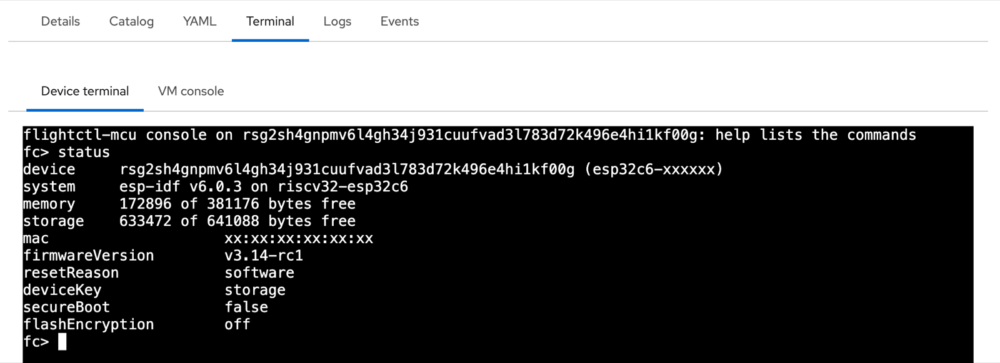
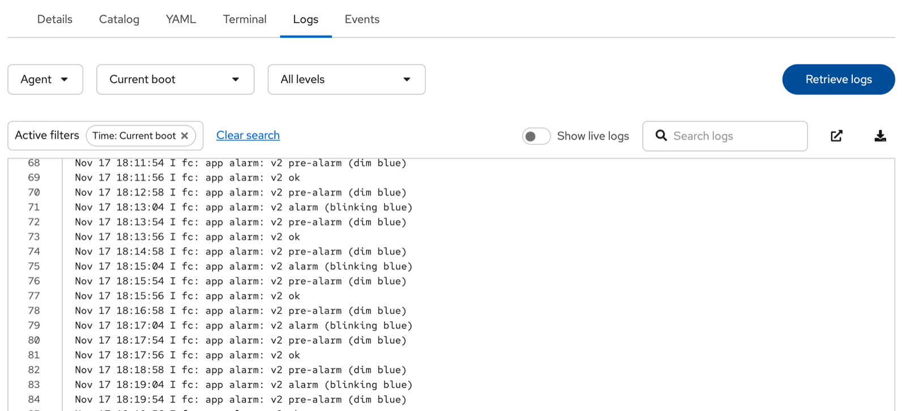

# Remote console

Open the UI terminal or run `flightctl console device/<name>`. The MCU accepts these commands.

| Command | What it gives |
|---|---|
| `help` | the commands |
| `status` | the device's name, system, memory, storage, and its `customInfo` (heap, firmware, active boot slot where available, network) |
| `apps` | the WASM apps, their status and the state each reports |
| `coredump info` | size in bytes of the saved crash dump, or zero if none is available |
| `coredump read` | the complete native dump on binary stdout in a non-interactive CLI session |
| `log` | the device's log: the last 50 lines, or `-n N`; `-p err` (or `warning`, `info`) and above; `-f` follows it until Ctrl-C |
| `reboot` | restarts the device, once the session has ended |
| `exit` | ends the session (so does Ctrl-D on an empty line) |

Run one command directly, or pass `--tty` for a prompt. An unknown command exits with status 127. In the prompt, Backspace edits, Ctrl-C or Ctrl-U clears the line, and Ctrl-D on an empty line exits. For a script, use `-- /bin/bash -s` and send one supported command per line on stdin.

```bash
flightctl console device/<name> -- status
```



## Download a crash dump

After reboot, `status.systemInfo.customInfo.coredumpBytes` gives the size of a valid dump in flash. An operator with console access can download the dump while the device is online. It can contain sensitive task memory. In a local terminal, set `device` to the device name and save the bytes in a new private file.

```bash
umask 077
flightctl console --notty "device/$device" -- coredump info
flightctl console --notty "device/$device" -- coredump read > crash.bin
wc -c < crash.bin
```

Check that the byte count matches `coredump info`. If the connection drops, repeat the download. Reading leaves the dump in flash. A later crash can replace it, and decommissioning erases it.

Use the ELF for the platform and release that **crashed**, including when the device rolled back after the fault. Set `release` to that release's registry reference by digest and `platform` to its architecture in the index.

```bash
tools/fw-elf.py "$release" "$platform" firmware.elf
```

With the ESP-IDF tools active, run `esp-coredump --chip esp32c3 info_corefile -t raw -c crash.bin firmware.elf`, substituting the device's chip. With Zephyr, start the target GDB (`arm-zephyr-eabi-gdb firmware.elf` for Arm) and connect it to Zephyr's coredump GDB server.

```gdb
target remote | python3 /path/to/zephyr/scripts/coredump/coredump_gdbserver.py --pipe firmware.elf crash.bin
info registers pc
bt
```

ESP-IDF captures registers and task snapshots. Zephyr on Arm captures registers and thread stacks. The Xtensa backend on the ESP32-S3 captures the faulting thread's registers and stack.

The ESP-IDF factory layout reserves 64 KiB for a dump and 576 KiB for the agent's data. An OTA update preserves the installed partition table. Devices with the older 640 KiB data partition still report `lastFatalError`. Saving a native dump requires provisioning with the new factory layout. The Zephyr ESP32-S3 DevKitC with 8 MiB of flash reserves 128 KiB for a dump. [Measured dump sizes](RESULTS.md#what-works)

## The log

A 4 KB RAM ring holds roughly 40–80 lines. It includes agent messages, app logs, ESP-IDF errors and warnings, and the Zephyr system log. ESP-IDF keeps agent info messages even in quiet release builds. Most other ESP-IDF info messages and bare printk output are serial-only.

After a warm restart, use boot `-1` to read the previous boot. After a crash its final `fatal:` line identifies the fault, task and program counter, also reported in `lastFatalError`. Power loss or invalid retained RAM clears the ring.

```
Nov 16 21:07:04 I fc: enrolled, starting management loop
Nov 16 21:07:05 W wifi:Password length matches WPA2 standards, authmode threshold changes from OPEN to WPA2
Nov 16 21:12:30 W fc: app alarm: 31.5 C over the threshold
```

Timestamps are UTC once the clock synchronizes. Earlier lines show uptime.

The UI's **Logs** tab runs a filtered `journalctl` request through the console. The device serves it from the ring.

| The tab's filter | What the device shows |
|---|---|
| Agent (`-u flightctl-agent.service`) | the agent's and the apps' lines (the apps run inside the agent) |
| System, without a unit | every line, the system's too |
| System, with a unit | the lines of an app when the unit is the app's name (`alarm` or `alarm.service`); the agent's and the apps' for `flightctl-agent` or a glob that takes it; none for another unit |
| The kernel's (`-k`, from a command) | the system's lines |
| Level (`-p`) | E is `err`, W `warning`, I `info`, D `debug`; the level chosen and above |
| Current boot (`-b 0`), previous boot (`-b -1`), the last hour, day, week, a range of dates | as asked; without a boot, both; an older boot is empty |
| Live | the lines kept, then the new ones as they are written, until the tab stops |
| File path (under `/var/log`) | not found: the device has no files to show |


*The Logs tab on the ESP32-S3 with Zephyr: the agent's lines of the current boot, here the app `alarm` changing state.*

The console recognizes the subset of shell syntax used by the Flight Control 1.4 Logs tab. Arbitrary shell commands are unsupported.

## How it works

When a session appears in `spec.consoles`, the device opens a gRPC stream (`flightctl.v1.RouterService/Stream`) on its existing HTTP/2 connection. The server forwards stdin, stdout and exit status using `v5.channel.k8s.io`.

A failed stream open is retryable. Once opened, the agent remembers the session before executing its command. The last 64 IDs survive reboot, so a listed command cannot replay. An unjoined session closes after one minute. The device polls every 5 s with active sessions and every 15 s when only remembered ones are listed. [Stale console sessions](FLIGHTCTL-LIMITATIONS.md#15-a-console-session-whose-user-left-before-the-device-came-stays-listed)

## Limits

- One session at a time. A second receives `another console session is open on this device`.
- Sessions close after 10 minutes without input, except while following logs. A firmware or app download also closes the session.
- A paste exceeding 4 KB of unread input ends the session. A script line can contain 2 KB, an interactive line 160 characters.
- An open session uses an 8 KiB thread stack. Zephyr also needs 0.9 KB to stage logs. [Measured heap](RESULTS.md#ram)
- Console access includes reboot and crash dump retrieval.
