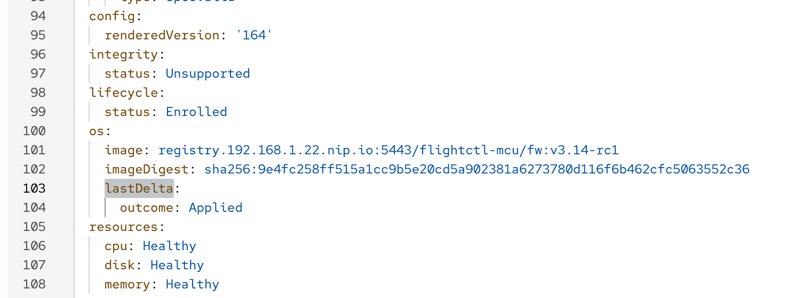

# Firmware updates as deltas

Publish a delta to reduce the download for devices on a known release. Keep the full image in the same signed index so every device has an update path. [Measured download sizes](#what-was-verified)

## Publishing a release with deltas

```bash
tools/fw-push.py --delta-from "$OLD_TAG" "$REGISTRY/flightctl-mcu/fw:$NEW_TAG"
```

Set `REGISTRY` to the registry host, `OLD_TAG` to the installed release tag and `NEW_TAG` to a fresh tag. Repeat `--delta-from` for each source tag or digest in the same repository. For each platform, the publisher generates a sequential, heatshrink-compressed patch and includes it only if smaller than the new image. The fleet still sets `spec.os.image` to the new release.

The publisher installs detools in `build/detools-venv` if needed. Its C extensions require a compiler and Python headers. The device uses the [core decoder](../core/src/fc_delta.c).

## In the registry

A delta is one more layer in the chip's manifest, after the image:

```
index (tag)
  manifest       platform {architecture: esp32c3}
    layer        application/vnd.espressif.app-image                        the image
    layer        application/vnd.flightctl-mcu.firmware.delta.v1+detools    a delta
                   io.flightctl-mcu.delta.from:      sha256 of the image it starts from
                   io.flightctl-mcu.delta.from-size: that image's size
```

Older firmware reads the first layer, which holds the full image. The index signature covers both full images and deltas through their manifest and layer digests.

## On the device

1. With the [OCI public key provisioned](SECURITY.md#two-signing-keys), verify the release signature. For each candidate delta, hash the first `from-size` bytes of the running slot and compare the digest with `from`.
2. If a delta matches, stream it into the decoder. Read unchanged bytes from the running slot and write the rebuilt image to the inactive slot.
3. Check the rebuilt image against the signed full-image SHA-256 before committing the slot. Normal signature, security variant, anti-rollback and boot confirmation checks still apply.

Decoder state, a window and read-ahead use about 7 KB of RAM.

| Decoder buffer | Size (KiB) |
|---|---:|
| Window | 4 |
| Read-ahead | 2 |

Read `status.os.lastDelta.outcome` after an update.

| Outcome | Meaning |
|---|---|
| `Applied` | Installed a matching delta. |
| `NotUsed` | No matching delta. The device downloaded the full image. |
| `Fallback` | Patch decoding, allocation or digest verification failed. The device retried with the full image. See `status.os.lastDelta.fallbackReason`. |

If the device rejects the rebuilt image at commit, downloading it whole would give the same result. The agent reports the error without another pull.



Flash encryption allows the decoder to read the running image in clear. With Secure Boot, the patch reconstructs the signed binary byte for byte.

## A delta is not trusted until the end

The decoder processes bytes before the final digest is available. It bounds reads to the source image, writes to the expected output size and rejects decompression windows over 4 KiB.

## Other ports

The decoder is in the core. A port only has to read its running image: `fc_port_fw_read(off, buf, len)`. One that cannot returns -1, and its updates are whole images. On the host port, the image is the file `FC_FW_IMAGE` names; on Zephyr, MCUboot's first slot, and the image is the one signed for MCUboot (`fw-push.py ... PLATFORM=zephyr.signed.bin`).

## What was verified

A dash means no value is given.

| Board | Change | Delta (KB) | Share of the full image (%) | Time (s) |
|---|---|---:|---:|---:|
| ESP-IDF S3 | Debug build to release build | 511 | — | 13 |
| Zephyr S3 | Successive builds | 19 | 2.2 | 8 |

Smallest and largest delta over several boards. All six boards retained their identities.

| Boards | Change | Smallest delta (B) | Largest delta (B) | Smallest share of the full image (%) | Largest share of the full image (%) |
|---|---|---:|---:|---:|---:|
| All six boards | Signed delta update | 10,816 | 14,114 | 1.03 | 1.04 |
| Other ESP-IDF deltas on ESP32, C5, C6 and S3 | Fixes | — | — | 2 | 3 |
| Other ESP-IDF deltas on ESP32, C5, C6 and S3 | Larger changes | — | — | 12 | 15 |

Unit tests cover truncated, corrupted and mismatched deltas and full-image fallback. The emulator checks both delta and full updates. [Test suite](TESTING.md#end-to-end-tests)

### Fleet update timings

Physical boards on a local network. Rollouts include scheduling and reboot. Both rollbacks restored the signed stable image with a 30 s confirmation window.

| Operation | Boards | Time (s) |
|---|---|---:|
| Firmware and dependent app rollout | The four ESP-IDF boards other than the canary | 53 |
| Firmware and dependent app rollout | Zephyr S3, scheduled independently | 50 |
| Fleet change to confirmed rollback | S3 Mini | 66.7 |
| Fleet change to confirmed rollback | Zephyr S3 | 118.8 |

## Limits

The running image must match the source of a published delta byte for byte. For a board flashed over USB, publish the same binary used for flashing.
