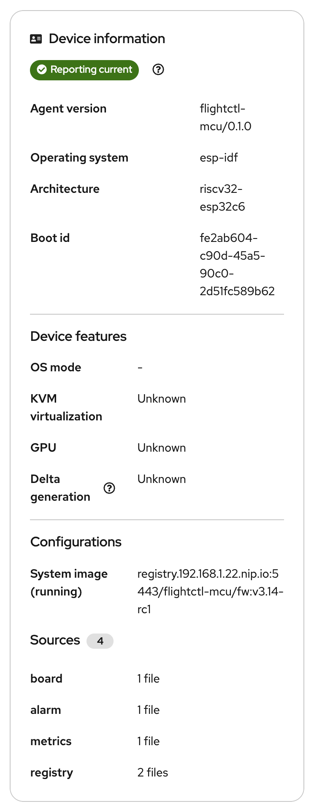
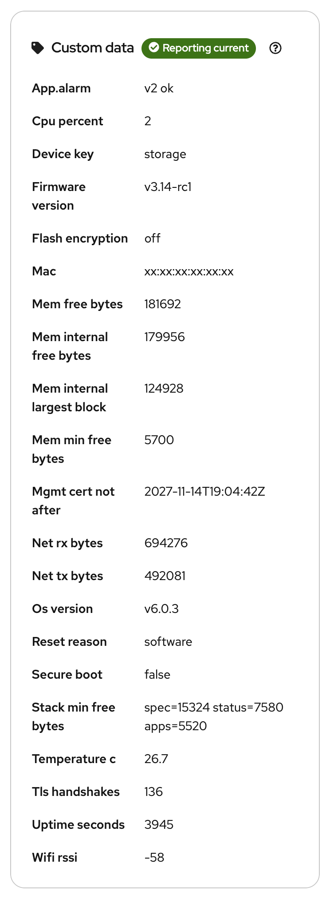

# Devices

What the agent asks of a device, where it runs today, and how to add another one.

## What a device needs

The agent is not tied to a chip or a vendor: it is a C core and a thin port for each system it runs on. What it asks of a device:

- a CPU that [WAMR](https://github.com/wasm-micro-runtime/wasm-micro-runtime) has a target for. In use here: Xtensa, RISC-V, Arm Cortex-M3 (emulated), and AArch64 and x86-64 on a host;
- 384 KB of SRAM at the least. What counts is the heap left once the agent and an app run ([RESULTS.md](RESULTS.md#ram)). Chips with less SRAM are not supported ([support levels](#support-levels));
- flash for two firmware slots, credentials and storage. The supplied [ESP-IDF partition table](../port/espidf/partitions.csv) requires 4 MiB and the [Zephyr ESP32-S3 overlay](../port/zephyr/boards/esp32s3_devkitc_procpu.overlay) requires 8 MiB;
- an IP network with TCP. Nothing in the core is about WiFi, but WiFi is the only link tried on hardware. Ethernet is tried on Zephyr in QEMU (`mps2/an385`, [ZEPHYR.md](ZEPHYR.md#on-an-emulated-arm-cortex-m3)). See [Adding another Zephyr board](#another-zephyr-board) for the board configuration and OTA registration;
- a random generator and a way to learn the time (SNTP), for TLS;
- mbedTLS 4.1.1.

## Where it runs

Three stacks have a port today:

| Stack | Devices | What works there |
|---|---|---|
| **[ESP-IDF](DEPENDENCIES.md#esp-idf-port)** `port/espidf` | Espressif's WiFi chips. Five run it: ESP32, S3, C3, C5, C6. Another one ESP-IDF supports is mostly configuration. | Everything, and the most complete: also Secure Boot, flash encryption, keys in hardware, WiFi provisioning over SoftAP ([SECURITY.md](SECURITY.md), [PROVISIONING.md](PROVISIONING.md)). On five boards, and on emulated chips in CI. |
| **Zephyr** 4.5 `port/zephyr` | Any board Zephyr supports that meets the list above: Zephyr brings the drivers, the network stack and MCUboot. One board runs it, an ESP32-S3-DevKitC, and an Arm Cortex-M3 on Ethernet emulated in QEMU (`mps2/an385`). | Enrollment, monitoring, config, WASM apps, firmware through MCUboot, whole or as a delta ([ZEPHYR.md](ZEPHYR.md)). The agent runs on the ESP32-S3 board and in end-to-end CI on `native_sim` and QEMU (`mps2/an385`). The WASM GPIO test runs on the emulated S3. |
| **Linux, macOS** `port/host` | Anything with POSIX threads and sockets: a gateway, a single-board computer, a container, your laptop. | Runs as a process. Enrollment, monitoring, config and WASM apps are real; a firmware update only saves the image to a file. It is the simulated device of the tests. A Linux device that can run bootc and Podman should run Flight Control's own agent instead. |

Any other RTOS (NuttX, RT-Thread, ThreadX, FreeRTOS outside ESP-IDF, ...) needs a port: about 30 functions, in `core/include/fc_port.h` (see [Adding another device](#adding-another-device)). None is written.

"Everything" means enrollment, monitoring, config, firmware OTA with rollback and WASM apps. The same `.wasm` file runs on every one of these, whatever the CPU.

## Support levels

| Level | Chips | SRAM | What it means |
|---|---|---|---|
| **Supported** | ESP32-S3 (ESP-IDF and Zephyr), ESP32 (classic), ESP32-C6, ESP32-C5 | 512, 520, 512, 384 KB | Each release is tried on a board. New features come here first. |
| **Best effort** | ESP32-C3 | 400 KB | Built in CI and with each release; tried on a board from time to time. |
| **Removed** | ESP32-S2, Raspberry Pi Pico W (RP2040) | 320, 264 KB | Below 384 KB of SRAM: the S2 needed its PSRAM for TLS, the Pico W had about 30 KB free with an app. |
| **Emulated** | Arm MPS2 AN385 (Cortex-M3, Ethernet) on Zephyr, in QEMU | 4 MB, of which the build uses 300 KB | The end-to-end test (e2e workflow), with the memory of a 384 KB device. The first link other than WiFi. No firmware updates (no MCUboot there) and no random generator: not a device. |
| **Planned** | NUCLEO-F767ZI, Raspberry Pi Pico 2 W and Nordic nRF7002-DK on Zephyr | 512, 520, 512 KB (nRF5340 application core) | Ethernet enrollment on the Nucleo and WiFi enrollment on the Pico and Nordic boards. [Roadmap](ROADMAP.md#blocked-on-hardware-availability) |

The host port (Linux, macOS) is supported: it is the simulated device of the tests.

Another chip Espressif or Zephyr supports, with 384 KB of SRAM or more, should work ([Adding another device](#adding-another-device)), but it is not part of these levels until it is tried.

## Boards tried

 

*An ESP32-C6 as Flight Control shows it: the system (`esp-idf` on `riscv32-esp32c6`), the firmware it runs and its config sources; then what the device reports of itself: heap, stack margins, traffic, temperature, WiFi signal (the MAC is hidden here).*

Verified with ESP-IDF 6.0.3 and 6.1.1 on the five ESP-IDF chips, and with Zephyr 4.5 and MCUboot ([ZEPHYR.md](ZEPHYR.md)); what was verified on each is in [RESULTS.md](RESULTS.md#what-works), the heap in [RAM](RESULTS.md#ram):

| Chip | Core | ESP-IDF | Zephyr |
|---|---|---|---|
| ESP32-S3 | Xtensa LX7 | ✓ | ✓ |
| ESP32-C3 | RISC-V | ✓ | – |
| ESP32-C5 | RISC-V | ✓ | – |
| ESP32 (classic) | Xtensa LX6 | ✓; the chip has no temperature sensor, so the status's temperature is simulated | – |
| ESP32-C6 | RISC-V | ✓ | – |

The C6 DevKitC flashes only over its native USB port, started in download mode (plug them in holding BOOT).

PSRAM is not used, so a single image runs on every board variant of a chip, except on the ESP32-S3, where it holds the memory of apps too large for internal RAM. An S3 comes with no PSRAM, 2 MB of quad PSRAM (N4R2, N8R2) or 8 MB of octal (N8R8, N16R8), and the mode is fixed at build time, so a release has two S3 images: `esp32s3`, for quad PSRAM, which boots without it on the other boards, and `esp32s3-r8` (`VARIANT=r8`), for octal. A board takes updates for the image it runs: an N8R8 is flashed once over USB with `esp32s3-r8`, and then updates from it over the air. Tried on an N4R2 and an N8R8. The Zephyr build for the S3 uses the N8R8's octal PSRAM the same way ([ZEPHYR.md](ZEPHYR.md)).

The firmware images, what takes the space and the agent's own share are in [RESULTS.md](RESULTS.md#firmware-size).

## Adding another device

### Another ESP32 chip

If ESP-IDF supports the chip, it is mostly configuration:

1. Build for it: `TARGET=esp32c61 FW_VERSION=v1 port/espidf/build.sh`. The build directory is `port/espidf/build-<target>`.
2. Put board-specific defaults in `port/espidf/sdkconfig.defaults.<target>`. For example the LED pin: see `sdkconfig.defaults.esp32c3` or `sdkconfig.defaults.esp32`.
3. If the chip has no temperature sensor, `port/espidf` already falls back to a simulated one (`SOC_TEMP_SENSOR_SUPPORTED`).
4. `tools/fw-push.py` picks up every `build-*` directory, so the chip ends up in the next firmware index on its own.

Per-device differences, such as a different LED pin on a clone board, don't need a separate build. Set a label on the device (`led-gpio=38`, `led-order=rgb`, `led-ws2812=false`) and the fleet template passes it into the config.

### Another Zephyr board

If Zephyr supports the board and it meets [the list above](#what-a-device-needs), start with its configuration in `port/zephyr/boards/`:

1. `<board>.overlay`: the `fc_creds` (16 KB) and `fc_storage` partitions, usually carved out of the board's storage partition, and the nodes Zephyr leaves off (the WiFi chip, the random generator).
2. `<board>.conf`: the network driver, MCUboot's image manager, and the memory the board can give: the kernel heap (thread stacks come from it), the C heap, the agent's stacks.
3. Build with `BOARD=<board> port/zephyr/build.sh`, write the credentials with `tools/provision.py --format zephyr --board <board files>`. Firmware updates need MCUboot: the script builds with it for a board named `.../mcuboot` and for Espressif's, and for any other with `MCUBOOT=1`.
4. For OTA, add the board’s `CONFIG_FC_FW_PLATFORM` (the board name by default) to `ZEPHYR_BOARD_MODULES` in [tools/sbom.py](../tools/sbom.py). List its board-specific modules, or use an empty tuple if the common modules cover it. Pass the same platform name to `tools/fw-push.py` as `PLATFORM=path/to/zephyr.signed.bin`.

A CPU family that is new here needs its WAMR target named in `port/zephyr/CMakeLists.txt`, and a chip without a random generator needs an entropy driver. What the ESP32-S3 took is in [ZEPHYR.md](ZEPHYR.md).

### Another RTOS (NuttX, RT-Thread, ThreadX, ...)

The core needs:

- POSIX threads (mutex, condition variable, threads with a configurable stack);
- BSD sockets, reachable through `mbedtls_net_*`;
- `time()` that returns the real time (certificates are validated);
- mbedTLS 4.1.1 (TLS 1.3; its cryptography is PSA only);
- a platform layer for WAMR. WAMR already has one for Zephyr, NuttX, RT-Thread and RIOT, among others.

Then implement [core/include/fc_port.h](../core/include/fc_port.h) for your platform, the reference for each function:

| Functions | What they do |
|---|---|
| `fc_port_kv_get/set/del` | Persistent key/value storage: device key, certificate, config files, WASM modules |
| `fc_port_sysinfo`, `fc_port_custom_info`, `fc_port_metrics` | Hardware and OS facts for `status.systemInfo`: what stays the same, and what changes (heap, uptime, RSSI, temperature) |
| `fc_port_stack_unused`, `fc_port_heap_largest/free/free_now/watch/low` | Stack and heap figures, for the status and for the checks that keep the agent its heap; -1 when the port cannot tell |
| `fc_port_write_file`, `fc_port_read_file`, `fc_port_remove_file` | Where `spec.config` files end up, reading them back, and removing those the spec no longer gives (the registry's CA and credentials, [REGISTRY.md](REGISTRY.md)) |
| `fc_port_fw_platform` | The `platform.architecture` to pick from a firmware index, e.g. `esp32c3` |
| `fc_port_ota_begin/write/end` | Write an image into the inactive slot and make it the next boot image |
| `fc_port_ota_pending_verify/confirm/rollback`, `fc_port_reboot` | Confirm a new image or go back. On Zephyr this is MCUboot's test and confirm. |
| `fc_port_fw_read` | Read the running image, for [delta updates](DELTA-UPDATES.md). A port that cannot returns -1, and its updates are whole images. |
| `fc_port_hwkey_bits/seal/pk/forget` | A device key kept in hardware ([SECURITY.md](SECURITY.md)). A port without one says so, and the key stays in storage. |
| `fc_port_log` | Logging |

`port/host/fc_port_host.c`, `port/zephyr/fc_port_zephyr.c` and `port/espidf/fc_port_espidf.c` (with the keys in hardware) are the three references. The firmware wiring in `port/espidf/main/` covers WiFi, time sync and the apps' host functions; it is ESP-IDF specific and would be rewritten for another platform.
