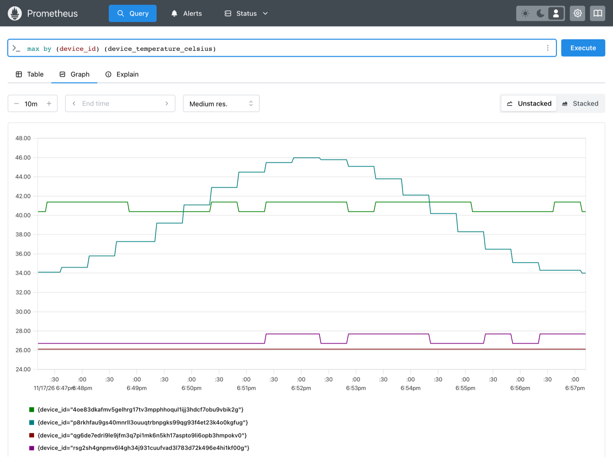

# Metrics

Configure the Telemetry Gateway to export device and app metrics to Prometheus. The gateway adds `device_id` and `org_id` to each series.

## Turning it on

The fleet writes the gateway's address in `/etc/fc/metrics.json`, an inline config file:

```yaml
spec:
  template:
    spec:
      config:
        - name: metrics
          inline:
            - path: /etc/fc/metrics.json
              content: '{"endpoint": "telemetry.flightctl.example.com:443", "intervalSeconds": 60}'
```

| Setting | Meaning |
|---|---|
| `endpoint` | The gateway, `host:port` (443 if no port). |
| `intervalSeconds` | How often the device sends, 60 by default, at least 30: each export is a TLS connection. |

On OpenShift Flight Control's chart exposes the gateway as `telemetry.<base domain>`; elsewhere it needs a route of its own (on kind, [tools/kind/telemetry-route.yaml](../tools/kind/telemetry-route.yaml)).

Remove the file or its `endpoint` to stop exports. The device requests a separate gateway certificate using its device key, signer `flightctl.io/device-svc-client` and CN `otel-<device name>`. Flight Control approves it automatically. It is valid for a year and renewed after one quarter of its lifetime. The device verifies the gateway against its Flight Control CA.

## What is sent

Every interval, one `ExportMetricsServiceRequest` (OTLP over gRPC), with the resource `service.name="flightctl-mcu"` and `service.version` (the firmware's tag). In Prometheus the gateway adds `device_id` and `org_id`, and the names take their unit (`_bytes`, `_total`).

| OTLP name | Unit | Type | Prometheus name | Ports | Notes |
|---|---|---|---|---|---|
| `device.memory.free` | `By` | gauge | `device_memory_free_bytes` | every port | |
| `device.memory.min_free` | `By` | gauge | `device_memory_min_free_bytes` | ESP-IDF, Zephyr, NuttX | |
| `device.memory.internal.free` | `By` | gauge | `device_memory_internal_free_bytes` | ESP-IDF, NuttX | |
| `device.memory.internal.largest_block` | `By` | gauge | `device_memory_internal_largest_block_bytes` | ESP-IDF, NuttX, Zephyr with the agent’s C heap | |
| `device.memory.kernel.free` | `By` | gauge | `device_memory_kernel_free_bytes` | Zephyr | |
| `device.memory.kernel.min_free` | `By` | gauge | `device_memory_kernel_min_free_bytes` | Zephyr | |
| `device.network.io` | `By` | counter | `device_network_io_bytes_total` | every port | The agent's TLS traffic. `direction` is `transmit` or `receive`. |
| `device.tls.handshakes` | `{handshake}` | counter | `device_tls_handshakes_total` | every port | |
| `device.cpu.utilization` | `%` | gauge | `device_cpu_utilization_percent` | where the port can tell | |
| `device.uptime` | `s` | gauge | `device_uptime_seconds` | ESP-IDF, NuttX | |
| `device.wifi.rssi` | `dBm` | gauge | `device_wifi_rssi…` (the unit as the exporter writes it) | ESP-IDF on WiFi, NuttX on Espressif chips | |
| `device.temperature` | `Cel` | gauge | `device_temperature_celsius` | ESP-IDF and NuttX, chips with a sensor | |
| `device.metrics.skipped` | `{export}` | counter | `device_metrics_skipped_total` | every port | Exports not made ([limits](#limits)) |
| `device.metrics.export_min_free` | `By` | gauge | `device_metrics_export_min_free_bytes` | ESP-IDF | The internal heap at its lowest during the last export |
| `app.<app>.<name>` | none | gauge or counter | `app_<app>_<name>` (`_total` for a counter) | — | An app's `fc_metric`, with `metrics` in its `FC_ALLOW` |

Device counters start at boot. App counters start at their first update. Exports begin after the device clock synchronizes.




On the S3, compare `app_trend_temp_c` (smoothed) with `device_temperature_celsius` (chip reading).

## Limits

| Limit | Value | Unit | Notes |
|---|---:|---|---|
| Metrics per app | 8 | metrics | The first metric an app publishes allocates room for its eight metrics. An installed app that publishes none uses no heap for metrics. |
| App metrics per interval, up to | 16 | metrics | Two publishing apps |
| Slots for device and exporter metrics | 15 | slots | The export reserves them beside one point per active app series. |
| App name in the exported name, up to | 47 | B | The full app name |
| Metric name in the exported name, up to | 32 | B | |
| Point array with no app series | 2,160 | B | ESP32-C6 |
| Point array with all 16 app series | 4,464 | B | ESP32-C6 |
| Contiguous block needed for an export | 24 | KiB | ESP-IDF, and Zephyr builds with the agent's C heap |
| Free heap needed above the agent's reserve | 20 | KiB | |
| Free heap needed in total | 60 | KiB | With the agent's default 40 KiB reserve. [App sizing](APPS.md#size-and-limits) |
| Retry after a skipped export | 10 | s | The skip increments `device.metrics.skipped`. The agent logs every tenth memory skip. |
| Gateway request timeout | 15 | s | |
| Back-off after repeated failures, up to | 1 | hour | Updating `metrics.json` retries immediately. |

Each export briefly opens a second TLS connection. It waits for downloads, status, spec changes, firmware verification, MQTT handshakes and decommissioning. A series first published while the snapshot is being collected can appear in the next export. [Board measurements with apps and MQTT](ESP-IDF.md#runtime-memory)

- A metric is a gauge or a counter, as a number (a double). Histograms are not supported.
- The device's own metrics are fixed by the firmware.
- A board-map restart preserves the app’s counters. Removal, replacement and parking for primary-app memory release its series.
- Gateway enrollment with a hardware-backed device key is unverified.

## Management traffic

The three traffic tables were measured with telemetry off. The first two compare two ways of reporting status:

- **Periodic full status**: the agent sends its full status periodically, with PUT.
- **Changed sections**: the agent sends only the sections that changed, with PATCH.

Physical ESP32-C3 Mini with `alarm`, ESP-IDF 6.1.1, Flight Control 1.4.0, 120 s status interval and 19 listed console requests. Counters cover both directions over TCP/TLS for six minutes, including the five-minute refresh. The app stayed running with zero restarts. [Console session lifetime](FLIGHTCTL-LIMITATIONS.md#14-a-console-session-whose-user-left-before-the-device-came-stays-listed)

| Workload | Status reporting | Rendered GETs | Status writes | Sent (B) | Received (B) | Total (B) | Traffic saved (%) |
|---|---|---:|---:|---:|---:|---:|---:|
| Alarm steady | Periodic full status | 3 | 3 | 6,660 | 28,147 | 34,807 | — |
| Alarm steady | Changed sections | 3 | 1 | 1,922 | 10,095 | 12,017 | 65.5 |
| One alarm cycle | Periodic full status | 3 | 5 | 10,880 | 46,405 | 57,285 | — |
| One alarm cycle | Changed sections | 3 | 3 | 4,276 | 28,268 | 32,544 | 43.2 |

Two runs compared the agent at commit `eaa68b5` (periodic full status) with the updated agent against Flight Control 1.4.0 on each platform, the emulated ESP32-C3 and the host simulator. The emulated ESP32-C3 ran ESP-IDF 6.1.1 firmware. Each device had applied rendered version 1 and had no apps, telemetry or console sessions. The counters below measure bytes sent and received over TCP, including HTTP and TLS. Sampling started after enrollment and included the first five-minute metrics refresh.

| Device | Sample (s) | Status interval (s) | Status reporting | Sent (B) | Received (B) | Total (B) | Reduction (%) |
|---|---:|---:|---|---:|---:|---:|---:|
| Emulated ESP32-C3 | 360 | 120 | Periodic full status | 5,610 | 9,924 | 15,534 | — |
| Emulated ESP32-C3 | 360 | 120 | Changed sections | 1,778 | 4,080 | 5,858 | 62.3 |
| Host simulator | 310 | 60 | Periodic full status | 6,984 | 12,403 | 19,387 | — |
| Host simulator | 310 | 60 | Changed sections | 1,208 | 3,124 | 4,332 | 77.7 |

With periodic full status and telemetry off:

| Board | Workload | Status interval (s) | Listed console requests | Management traffic over TLS (kB/h) |
|---|---|---:|---:|---:|
| Emulated C3 | `alarm` | 120 | 0 | 216 |
| Physical C3 | `alarm` | 120 | 19 | 351 |
| Zephyr S3 | No apps or console commands during sampling | — | 16 | 563 |
| ESP-IDF C3 | `alarm`, device spec returned immediately on each poll | — | 11 | 752 |

Reconciliation events on a simulated device with no app and one status report per minute, before and after the changes described under [A change in the status is a label event](FLIGHTCTL-LIMITATIONS.md#11-a-change-in-the-status-is-a-label-event):

| Window (min) | Events before | Events after |
|---:|---:|---:|
| 9 | 10 | 2 |
