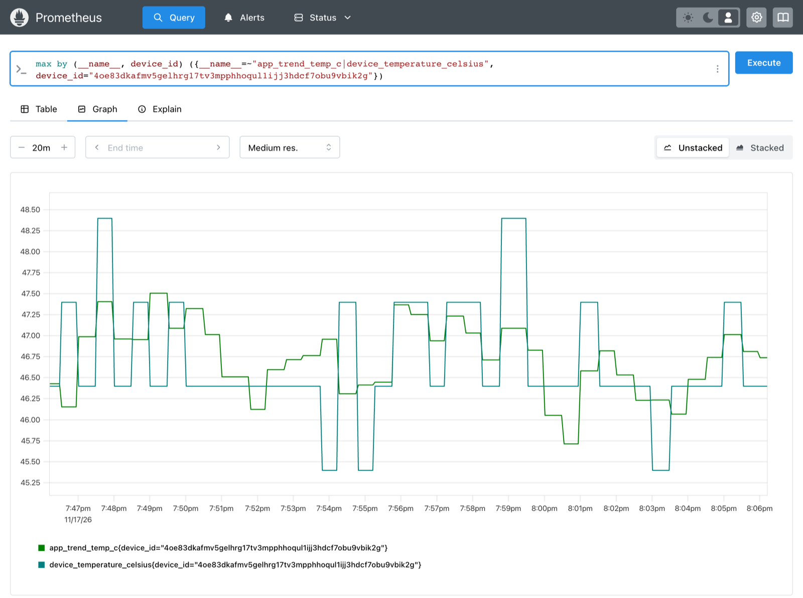

# Metrics

A device sends its metrics, and its apps', to Flight Control's Telemetry Gateway, which adds the device's ID and organization and exports them to Prometheus, as for a Linux device with the OpenTelemetry Collector. Nothing is sent unless the fleet gives the gateway's address.

## Turning it on

The fleet writes the gateway's address in `/etc/fc/metrics.json`, an inline config file:

```yaml
spec:
  template:
    spec:
      config:
        - name: metrics
          inline:
            - path: /etc/fc/metrics.json
              content: '{"endpoint": "telemetry.flightctl.example.com:443", "intervalSeconds": 60}'
```

| Field | What it is |
|---|---|
| `endpoint` | the gateway, `host:port` (443 if no port). On OpenShift Flight Control's chart exposes it as `telemetry.<base domain>`; elsewhere it needs a route of its own (on kind, [tools/kind/telemetry-route.yaml](../tools/kind/telemetry-route.yaml)). |
| `intervalSeconds` | how often the device sends, 60 by default, at least 30: each export is a TLS connection |

Without the file, or with no `endpoint` in it, nothing is sent; taking the file out of the fleet stops the exports.

The device then asks Flight Control for the gateway's certificate on its own, as the Linux agent does for the collector: a request signed by `flightctl.io/device-svc-client`, with the CN `otel-<device name>` and the device key, which the server approves at once. It is valid for a year and renewed after a quarter of it; it is kept apart from the management certificate. The gateway's server certificate is checked against the CA the device already has for Flight Control.

## What is sent

Every interval, one `ExportMetricsServiceRequest` (OTLP over gRPC), with the resource `service.name="flightctl-mcu"` and `service.version` (the firmware's tag). In Prometheus the gateway adds `device_id` and `org_id`, and the names take their unit (`_bytes`, `_total`):

| Metric | Prometheus | Where |
|---|---|---|
| `device.memory.free` (By) | `device_memory_free_bytes` | every port |
| `device.memory.min_free` (By) | `device_memory_min_free_bytes` | ESP-IDF, Zephyr |
| `device.memory.internal.free`, `.largest_block` (By) | `device_memory_internal_free_bytes`... | ESP-IDF |
| `device.memory.kernel.free`, `.min_free` (By) | `device_memory_kernel_free_bytes`... | Zephyr |
| `device.network.io` (By, counter), `direction` transmit or receive | `device_network_io_bytes_total` | every port: the agent's TLS traffic |
| `device.tls.handshakes` (counter) | `device_tls_handshakes_total` | every port |
| `device.cpu.utilization` (%) | `device_cpu_utilization_percent` | where the port can tell |
| `device.uptime` (s) | `device_uptime_seconds` | ESP-IDF |
| `device.wifi.rssi` (dBm) | `device_wifi_rssi…` (the unit as the exporter writes it) | ESP-IDF on WiFi |
| `device.temperature` (Cel) | `device_temperature_celsius` | ESP-IDF, chips with a sensor |
| `device.metrics.skipped` (counter) | `device_metrics_skipped_total` | every port: exports not made (below) |
| `device.metrics.export_min_free` (By) | `device_metrics_export_min_free_bytes` | ESP-IDF: the internal heap at its lowest during the last export |
| `app.<app>.<name>` | `app_<app>_<name>` (`_total` for a counter) | an app's `fc_metric`, with `metrics` in its `FC_ALLOW` |

Counters start at boot (or, for an app's, when the app first adds to it). A device sends nothing until its clock is set.


*In Prometheus, the temperature four ESP-IDF boards send, one series per `device_id`, the label the gateway adds.*


*An app's metric next to the device's: `trend`'s smoothed temperature (`app_trend_temp_c`, from its `fc_metric`) and the chip's own reading (`device_temperature_celsius`), on an ESP32-S3.*

## Memory

The export opens a TLS connection of its own beside the agent's, for a few seconds, and closes it. It is made only when all of these hold:

- the heap's largest free block is at least 24 KB, where the port can tell (not on Zephyr);
- the free heap is at least 20 KB above what the device keeps for the agent (40 KB by default, [APPS.md](APPS.md#size-and-limits)): 60 KB by default;
- nothing else is under way: no download or pull, no status due, no firmware being verified, no spec being applied, no handshake with an app's MQTT broker, no decommissioning.

Otherwise the export is skipped, counted in `device.metrics.skipped` (a skip for memory is also logged, once every ten), and tried again 10 seconds later. A download, or a spec to apply, waits for an export under way, as a download does for a status. A gateway that does not answer is given up after 15 seconds and tried again later and later, up to an hour; a new `metrics.json` from the fleet is tried at once.

## Limits

- 8 metrics per app, 32 for all the apps together; an app's metrics go when the app is removed or updated.
- A gauge or a counter, as a number (a double); no histograms.
- The device's own metrics are fixed by the firmware.
- Checked against Flight Control 1.4.0 with the simulated device, on the classic ESP32, C3, C5, C6 and S3 (ESP-IDF) and on the ESP32-S3 with Zephyr: the certificate approved by the server at once, the device's metrics in the gateway's Prometheus exporter with its `device_id`, and the `trend` app's (`app_trend_temp_c`) from the C6. The unit tests check the request byte for byte against what OpenTelemetry's own protobuf classes write, and an app's `fc_metric`. The heap during the exports, per board, is in [RESULTS.md](RESULTS.md#ram): where an app and MQTT leave little heap, an export can fail for want of memory or be skipped. On Zephyr only the free-heap condition applies; not yet checked on the board. Not tried with the device key in hardware (the ECDSA or Digital Signature peripheral), which must sign the gateway's certificate request too.
