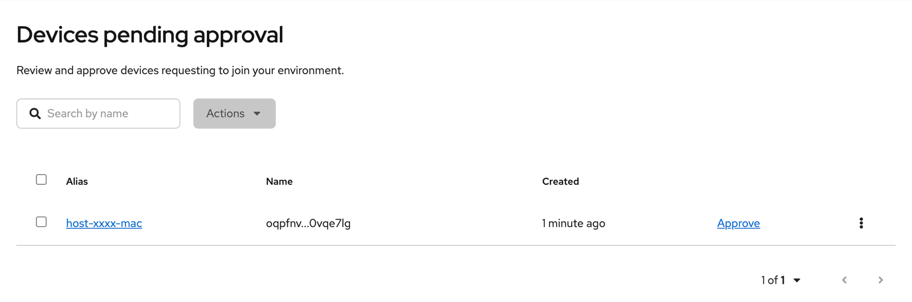
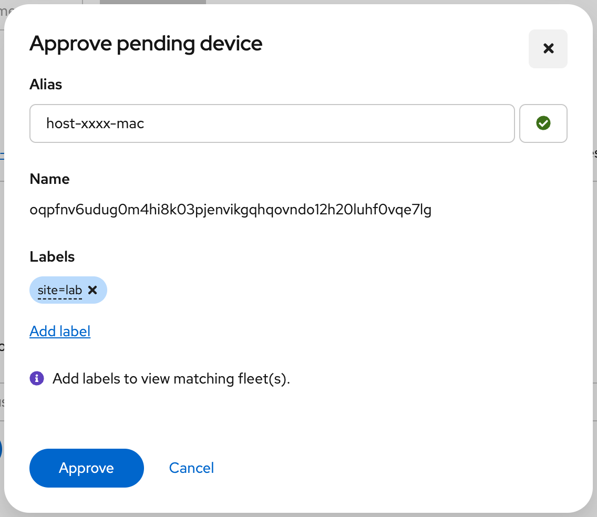

# Provisioning

A device needs two things to join a fleet: credentials for Flight Control, which belong to the installation, and a network, which belongs to the site. The firmware has neither built in: one image serves every installation.

What follows is the ESP-IDF firmware; the Zephyr build does the same over its access point ([below](#on-zephyr)).

## At the factory, over USB

`tools/provision.py` writes the `fc_creds` partition: the CA, the enrollment certificate and key, the image signing key, the agent endpoint and the labels, and optionally the WiFi network. One partition serves a whole batch: each device generates its own key on its first boot. Into a merged image, to flash a batch:

```bash
tools/provision.py --image port/espidf/build-esp32c3-secure/merged-binary.bin --secrets .secrets/batch-2026-11-a --pop <secret>
```

### One enrollment certificate per batch

```bash
BATCH=2026-11-a EXPIRATION=30d tools/enrollment.sh .secrets/batch-2026-11-a
```

A leaked enrollment certificate lets anyone create enrollment requests until it expires: Flight Control 1.4.0 cannot revoke one ([limitation 2](FLIGHTCTL-LIMITATIONS.md#2-an-enrollment-certificate-cannot-be-revoked)). A certificate per batch with a short lifetime limits that; approving devices from an allow list (`tools/auto-approve`) decides who actually gets in. The lifetime must cover the factory window and the longest a device may stay offline before it enrolls, or enrolls again after its management certificate expired.




*On its first boot a device asks to enroll: the request waits under Devices pending approval, and approving it shows the labels the device asked for, which can be changed there. Here the simulated device of [QUICKSTART.md](QUICKSTART.md#without-a-board); the host's name is hidden.*

## In the field: the WiFi network

When the site's network is not known at the factory, provision the device with a proof of possession instead of a network (`--pop`, 8 to 63 characters, printed on the device's label or its box). With no network, the device opens an access point named `FC-xxxxxx` (the end of its MAC) and waits for an installer:

- with Espressif's provisioning app (ESP SoftAP Prov, iOS and Android): join `FC-xxxxxx` with the proof of possession as its password, then pick the site's network;
- with Espressif's `esp_prov`, from a laptop on that access point. It comes with Espressif's `network_provisioning` component (ESP-IDF 6 no longer has it); `tests/e2e/esp-prov.sh` fetches it and runs it:

  ```bash
  tests/e2e/esp-prov.sh 192.168.4.1:80 --pop <secret> --ssid <site network> --passphrase <password>
  ```

The session is ESP-IDF's provisioning Security 1: an X25519 key exchange, authenticated by the proof of possession, then AES-CTR; a wrong proof is refused before anything is sent. The device tries the network with the access point still up: if it cannot join, the installer is told why (wrong password, network not found) and can send another. Once the device is on the network the access point closes, and the device enrolls. The protocol is served by the agent core (`core/src/fc_prov.c`), the same code on both ports; the access point and the scan are the port's (`port/espidf/main/main.c`).

The network is kept with the device's credentials, as if it had been given at the factory: in `fc_creds`, or in the encrypted store in the secure variant. The device uses it from then on; provisioning the device again, or erasing the flash, brings the access point back. A network given at the factory (`--wifi-ssid`) replaces it.

For a field-provisioning build, set `LOCAL=0` when running `port/espidf/build.sh` so the firmware has no development WiFi settings. When provisioning over USB, leave `WIFI_SSID` unset as well. A device with a network still saved by an older WiFi driver tries that network at startup.

On an ESP32-C6 with ESP-IDF, the phone reported a credential error and accepted a retry. The C6 joined the selected network and reconnected after a restart. [Measured timings](RESULTS.md#what-works)

`CONFIG_FC_FIELD_PROVISIONING` (on by default) adds 17.4 KB of flash on the ESP32-S3 (ESP-IDF 6.0.3, debug build) and no static RAM to speak of (16 bytes): `fc_prov.c` takes 6.9 KB, the rest is the WiFi access point and its DHCP server. Espressif's `network_provisioning` takes 117.5 KB: its manager, protocomm, an HTTP server and parser, protobuf-c and their strings.

## On Zephyr

A Zephyr build takes its credentials from one partition (`tools/provision.py --format zephyr`, [ZEPHYR.md](ZEPHYR.md)), and its network the same three ways: given there (`--wifi-ssid`), kept from an earlier provisioning in the field, or, with `--pop` and neither, from an installer. The device scans for networks, opens the access point `FC-xxxxxx` with the proof of possession as its password, gives installers an address (192.168.4.1 is the device), and serves the same protocol on port 80 with the same code (`core/src/fc_prov.c`); the access point is the port's (`port/zephyr/src/wifi.c`).

Where the radio can be an access point and a station at once (Espressif's, `CONFIG_ESP32_WIFI_AP_STA_MODE`), the device tries the network with the access point still up, and the installer is told whether it joined, or why not (wrong password, network not found); the server stays up 5 s after that, so that the answer reaches the installer before the access point closes. A radio that cannot closes the access point to try it and opens it again after three failed tries. The network is kept in the storage partition, in clear, as the device key is there, for the credentials it was given with: writing `fc_creds` again (a new proof of possession, another installation) forgets it and brings the access point back, as erasing the storage does.

Espressif's app can take the device from a QR code: `{"ver":"v1","name":"FC-xxxxxx","pop":"<secret>","password":"<secret>","transport":"softap","security":1}`, with `security` a number and `password` the access point's (the proof of possession here). The iOS app refuses a code whose `security` is a string.

On the ESP32-S3-DevKitC with Zephyr, an iPhone running ESP SoftAP Prov scanned the QR code and received an address from the device. The device joined the selected network in 8 s, confirmed the connection to the app and was Online in Flight Control with its app running a second after the access point closed.

## What the CI checks

The plain emulator runs (`tests/e2e/e2e-emu.sh`, in the end-to-end workflow) provision their device in the field: the image has a proof of possession and no network, the emulator joins the device's access point, `tests/e2e/esp-prov.sh` tries a wrong proof (refused) and then the right one with the emulator's network, and the device carries on to enroll. The end-to-end test also takes a one-day enrollment certificate for the run, as for a batch.

The Zephyr build's protocol is checked against esp_prov on the host (`tests/e2e/prov-host.sh`, in the CI's test job, on every push): a wrong proof of possession is refused, a wrong WiFi password is reported to the installer, the network picked from the device's scan is joined, and a radio that cannot join with its access point up gets the network to try.

Not done: setting the Flight Control endpoint or labels in the field.
