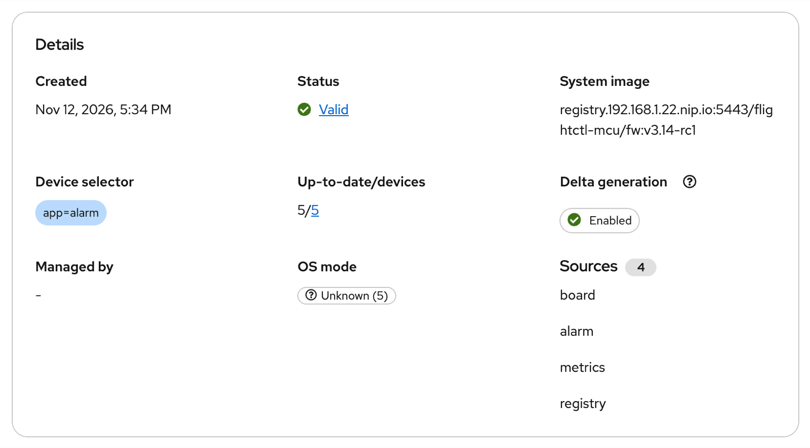

# Quick start

Start with the [Flight Control environment](#flight-control-environment), the [control plane](#1-control-plane) and [enrollment credentials](#2-credentials) for all three ports. Choose a board and firmware in the [hardware compatibility matrix](DEVICES.md#hardware-compatibility).

- [ESP-IDF](#3-build-and-flash-a-board-esp-idf) — Flash and enroll an ESP32-C3, then deploy the example app.
- Zephyr — Flash MCUboot and enroll an [ESP32-S3-DevKitC N8R8](ZEPHYR.md#on-an-esp32-s3), a [Raspberry Pi Pico 2 W](ZEPHYR.md#on-a-raspberry-pi-pico-2-w) or a [Nordic nRF7002-DK](ZEPHYR.md#on-a-nordic-nrf7002-dk) over Wi-Fi.
- [Apache NuttX](NUTTX.md#build-and-provisioning) — Build and provision an ESP32-S3 N4R2, N8R8 or N16R8. Choose the [MCUboot layout](NUTTX.md#firmware-ota-with-mcuboot) to deploy fleet firmware updates.
- [Simulator on macOS or Linux](#without-a-board) — Run the agent on your computer using the same control plane and credentials.

## Flight Control environment

Install Docker, kind, Helm, kubectl, the [flightctl CLI](https://github.com/flightctl/flightctl/releases), ORAS and Python 3 with PyYAML. Flashing an ESP-IDF board needs esptool. Building apps needs clang with the wasm32 target and `wasm-ld` (`brew install lld` on macOS). The simulator also needs CMake and Ninja.

Run these commands from the repository root in each terminal where you build or publish images or apply the simulator fleet. They read the firmware and alarm tags independently from the [lab fleet manifest](../tools/fleet/idf-lab.yaml).

```bash
FW_TAG=$(sed -n 's|^[[:space:]]*image: .*/flightctl-mcu/fw:||p' tools/fleet/idf-lab.yaml)
ALARM_TAG=$(sed -n 's|^[[:space:]]*image: .*/flightctl-mcu/alarm:||p' tools/fleet/idf-lab.yaml)
```

## 1. Control plane

Start Flight Control on kind and the local registry. Replace `<your-ip>` with the host's LAN address. For an existing Flight Control installation, skip `tools/kind/up.sh`, log in to that installation and pass its agent endpoint to `tools/provision.py --server` in step 4.

```bash
tools/kind/up.sh
tools/registry/up.sh
flightctl login https://api.<your-ip>.nip.io:8443 --insecure-skip-tls-verify -t "$(kubectl create token flightctl-admin -n flightctl --duration=24h)"
```

Log in to `http://ui.<your-ip>.nip.io:8080` with the same token. Under **Software Catalog → MCU lab (test)** you should see three firmware entries and thirteen app entries, as [the catalog manifest](../tools/kind/mcu-lab.yaml) defines them. The setup creates a missing catalog. To refresh an existing one, run `tools/kind/apply-catalog.sh`. [Upgrading a v0.9.3 catalog](#upgrading-the-v093-lab-catalog)

Images live in the separate `fc-registry` Docker volume. If it was deleted, publish the tags you need in step 6.

Apply the fleet’s label mapping to keep heap and traffic counters out of device labels. [Label sync](FLIGHTCTL-LIMITATIONS.md#11-a-change-in-the-status-is-a-label-event)

```bash
tools/fleet/apply.sh tools/fleet/labelsync-custom-info.yaml
```

## 2. Credentials

For a fresh installation, generate enrollment credentials and an OCI signing key in the git-ignored `.secrets/` directory. Devices receive the signing **public** key. The publishing scripts use the private key. Reuse the existing signing key when deploying images already in your registry.

```bash
tools/enrollment.sh
tools/signing/keygen.sh
```

`.secrets/` then holds `ca.crt`, `enroll.crt`, `enroll.key`, `signing.key` and `signing.pub`.

## 3. Build and flash a board (ESP-IDF)

For Zephyr or NuttX, use the build and provisioning guide linked above for steps 3 and 4, then continue with [enrollment approval](#5-approve-it). For the NuttX example fleet in step 6, use the MCUboot layout and provision the labels `app=nuttx-lab,os=nuttx`.

Match the board's USB serial number to its port. Replace `/dev/cu.usbmodem1101` in steps 3 and 4. `LOCAL=0` omits development Wi-Fi and endpoint settings.

On the ESP32-C6 DevKitC, hold BOOT while connecting the native USB port to enter download mode.

**ESP32-S3 firmware.** In the build command below, use these settings:

| ESP32-S3 module | `TARGET` | `VARIANT` |
|---|---|---|
| Internal RAM or 2 MiB quad PSRAM (N4R2, N8R2) | `esp32s3` | — |
| 8 MiB octal PSRAM (N8R8, N16R8) | `esp32s3` | `r8` |

Flash the `r8` build once over USB by prefixing the flash command with `BUILD=build-esp32s3-r8`. Include `esp32s3-r8` in subsequent OTA releases.

```bash
third_party/fetch-wamr.sh
LOCAL=0 TARGET=esp32c3 FW_VERSION="$FW_TAG" port/espidf/build.sh
port/espidf/flash.sh /dev/cu.usbmodem1101
```

`flash.sh` prints `flashing esp32c3 on /dev/cu.usbmodem1101` and returns once esptool has written the image.

The default build leaves eFuses untouched. The separate `secure` variant permanently burns eFuses on first boot. Read [Device security](SECURITY.md) before selecting it. For quieter logs use `VARIANT=release`, flash the corresponding build directory and publish with `--variant release`.

## 4. Provision it

Write credentials and the site's Wi-Fi network to the board.

```bash
tools/provision.py --port /dev/cu.usbmodem1101 --labels site=lab,app=alarm --wifi-ssid <ssid> --wifi-password <password>
```

The default endpoint is `agent-api.<your-ip>.nip.io:8443`. The tool prints `fc_creds: agent-api.<your-ip>.nip.io:8443, labels site=lab,app=alarm, signing key yes, WiFi provisioned` and writes the partition with esptool.

If an installer will supply Wi-Fi later, use `--pop <secret>` instead of the Wi-Fi arguments. See [field provisioning](PROVISIONING.md#in-the-field-the-wifi-network). [All flags](PROVISIONING.md#at-the-factory-over-usb)

## 5. Approve it

A few seconds after boot the board asks to enroll:

```bash
flightctl get enrollmentrequests
```

```bash
flightctl approve -l stage=canary enrollmentrequest/<name>
```

For batch approval, copy `tools/auto-approve/allowlist.example.yaml` to `allowlist.yaml` in the same directory. List the expected device names or MAC addresses and their labels. Then run the watcher.

```bash
tools/auto-approve/auto-approve.py tools/auto-approve/allowlist.yaml --watch 10
```

## 6. Give it firmware, config and an app

If the registry already contains the signed lab firmware for your platform and the signed alarm app, skip the publish commands and apply the fleet below. For an empty local registry, publish the alarm app once for all three ports.

```bash
wasm-apps/build.sh alarm "$ALARM_TAG"
```

**ESP-IDF.** Publish the firmware from step 3. With no platform argument the publisher includes each built default-profile image, including `esp32s3` and `esp32s3-r8` when present. If you built the release profile, add `--variant release` before the registry reference.

```bash
tools/fw-push.py "localhost:5001/flightctl-mcu/fw:$FW_TAG"
```

**Zephyr.** Publish the compact MCUboot-signed image for each board in the fleet. This example includes the ESP32-S3, Pico 2 W and nRF7002-DK. Set `ZEPHYR_FW_TAG` to a fresh tag in your registry. After publishing, set the Zephyr fleet’s `os.image` to the tag you published before applying the manifest.

```bash
tools/fw-push.py "localhost:5001/flightctl-mcu/fw:${ZEPHYR_FW_TAG:?}" \
  esp32s3_devkitc=port/zephyr/build-esp32s3/zephyr/zephyr/zephyr.signed.bin \
  rpi_pico2_rp2350a_m33_0_w=port/zephyr/build-pico2w-ota/zephyr/zephyr/zephyr.signed.bin \
  nrf7002dk_nrf5340_cpuapp=port/zephyr/build-nrf7002-board/zephyr/zephyr/zephyr.signed.bin
```

**NuttX S3.** Publish the compact MCUboot image under the platform name for your module. [NuttX firmware publishing](NUTTX.md#firmware-ota-with-mcuboot)

If several ports share a firmware tag, list all their images in one invocation of `tools/fw-push.py`. Each publish replaces the index at that tag. Use a fresh tag for subsequent firmware releases and update the fleet’s `os.image` to match.

Apply the fleet for your port. The script supplies the TLS registry address, CA and credentials. [Registry configuration](REGISTRY.md#fleet-configuration)

| Port | Command | Devices selected |
|---|---|---|
| ESP-IDF | `tools/fleet/apply.sh tools/fleet/idf-lab.yaml` | `app=alarm`, with `stage=canary` first |
| Zephyr ESP32-S3, Pico 2 W and nRF7002-DK with MCUboot | `tools/fleet/apply.sh tools/fleet/zephyr-lab.yaml` | `app=zephyr-lab` |
| NuttX S3 with MCUboot | `tools/fleet/apply.sh tools/fleet/nuttx-lab.yaml` | `app=nuttx-lab` and `os=nuttx` |

In the UI, check that the device is up to date and the `alarm` app is running.



## 7. Decommission the device (optional)

```bash
flightctl decommission device/<name>
```

Once Flight Control reports `Decommissioned`, you can delete its record.

```bash
flightctl delete device/<name>
```

Unenrollment wipes the management key and certificate. Installed apps and config remain. To enroll the board again, erase storage and reprovision it.

- ESP-IDF: `esptool -p <port> erase-flash`, then steps 3 and 4 again.
- For Zephyr S3, repeat the [build and flash procedure](ZEPHYR.md#on-an-esp32-s3) with the Zephyr fleet label and site Wi-Fi credentials.

## Without a board

The simulator can enroll, accept config and run the same signed alarm app using its simulated temperature sensor. Do steps 1 and 2 first.

1. Build the host agent.

   ```bash
   third_party/fetch-wamr.sh
   third_party/build-mbedtls-host.sh
   cmake -S . -B build/host -G Ninja && cmake --build build/host
   ```

2. Start the simulator with the label used by the host fleet. Replace `<your-ip>` with the control plane’s LAN address.

   ```bash
   build/host/fc-host-agent --server agent-api.<your-ip>.nip.io:8443 --ca .secrets/ca.crt --enroll-cert .secrets/enroll.crt --enroll-key .secrets/enroll.key --signing-key .secrets/signing.pub --label app=host-lab
   ```

3. In a second terminal, approve the request as in [step 5](#5-approve-it).

4. If the registry is empty, run `wasm-apps/build.sh alarm "$ALARM_TAG"`.

5. Apply this fleet from the repository root.

```bash
tools/fleet/apply.sh /dev/stdin <<YAML
apiVersion: flightctl.io/v1beta1
kind: Fleet
metadata:
  name: host-lab
spec:
  selector:
    matchLabels:
      app: host-lab
  template:
    spec:
      applications:
        - name: alarm
          appType: container
          image: \${REGISTRY}/flightctl-mcu/alarm:${ALARM_TAG:?}
          envVars:
            FC_ALLOW: led0
      config:
        - name: alarm
          inline:
            - path: /etc/fc-app/alarm.json
              content: '{"threshold_c":40}'
YAML
```

6. Check that the simulator reports `alarm` as running.

**Optional firmware download.** To test the download path, publish a platform image as in [step 6](#6-give-it-firmware-config-and-an-app). Restart the host command with `FC_FW_PLATFORM` set to that platform (for example `FC_FW_PLATFORM=esp32c3`). Add `os: {image: "\${REGISTRY}/flightctl-mcu/fw:${FW_TAG:?}"}` under `spec.template.spec` in the host fleet example and apply it again. The simulator saves the image to `build/host-data/ota-next.bin` and exits at reboot. On the next start the host reports rollback because it cannot boot the MCU image. Use a board or an emulator with OTA slots to test confirmation.

## Upgrading the v0.9.3 lab catalog

Refresh the catalog first with `tools/kind/apply-catalog.sh`. The neural model is now under `tinyml` on the `neural` channel, and the Zephyr lab firmware is under `fw-zephyr-lab`. Once the old entries have zero deployments, remove them from the catalog.

```bash
flightctl delete catalogitem tinymlp fw-zephyr --catalog mcu-lab
```
