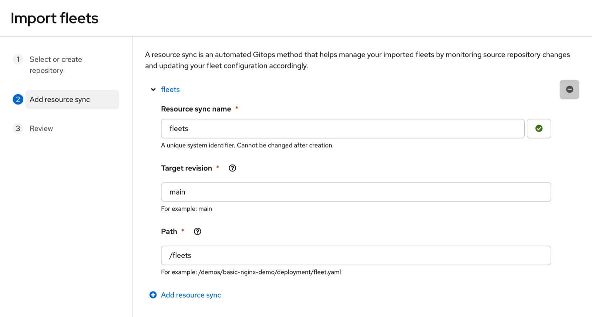

# Registry

Devices pull firmware and WASM apps from an OCI registry over TLS and HTTP/2 (ALPN `h2`). Configure the registry or its reverse proxy to serve blobs directly. The agent does not follow redirects to object storage or a CDN. For Quay, set `FEATURE_PROXY_STORAGE: true`. For Harbor, set `storage_service.redirect.disable: true` in `harbor.yml`.

## Fleet configuration

Supply the CA chain even for a public registry. The device has no public CA bundle. A missing CA error names the expected file.

| File | Contents |
|---|---|
| `/etc/containers/certs.d/<host>/ca.crt` | The registry's CA (PEM), for any port of that host; port 443 when the image reference names no port. Flight Control refuses a `:` in a config file's path, so `certs.d/<host:port>/ca.crt`, which containers use, cannot come from a fleet. The device still reads it first, for a file put there another way. |
| `/etc/ostree/auth.json`, `/etc/containers/auth.json`, `/root/.config/containers/auth.json` | The credentials, in podman's format. The device uses the first of these files that has an entry for the registry. |

```json
{"auths": {"registry.example.com:5443": {"auth": "<base64 of user:password>"}}}
```

Entries can name a host or a repository path. For `registry.example.com:5443/flightctl-mcu`, the longest matching entry wins. You can supply separate `username` and `password` fields instead of `auth`.

The device sends credentials on an HTTP 401 challenge. It supports Basic and Bearer authentication. For Bearer, it requests a scoped token from the HTTPS realm, with Basic credentials or anonymously for public repositories. A realm on a different host needs its own CA and a temporary second connection. The agent reuses the token for the pull and replaces an expired token once.

A robot account of Harbor or Quay goes into `auth.json` as any account: its name (`<organization>+<robot>` in Quay, `robot$<project>+<robot>` in Harbor) as the user and its token as the password:

```json
{"auths": {"quay.example.com": {"username": "flightctl-mcu+device", "password": "<the robot's token>"}}}
```

Use a pull-only account for devices. The local `registry:3` password file also permits pushes. Inline credentials are visible to anyone who can read the fleet. Use a [Kubernetes secret](#fleets-kept-in-git) to keep them out of Git.

After a successful config update, the agent removes managed registry files dropped from the spec. An untracked file left by firmware that predates config tracking can persist.

| HTTP 401 in `status.updated.info` | What to check |
|---|---|
| `credentials refused` | Registry password or token-service credentials |
| `no pull access with these credentials` | Repository permissions for the account |
| `no pull access without credentials` | Missing registry or repository entry in `auth.json` |
| `the registry refused the token` | The registry's error, such as `invalid_token` |

## What was verified

The host client pulled signed firmware and WASM from Quay 3.17 and from `registry:3` with same-host and cross-host token services. Expired tokens were replaced during a pull. Bearer authentication on hardware and against Harbor remains unverified. [Reproduce the registry tests](TESTING.md#registry-tokens)

## The local registry

`tools/registry/up.sh` exposes the same image store at two addresses.

| Endpoint | Use |
|---|---|
| `<your-ip>:5001` | Plain HTTP for local publishing. Anyone on the LAN can read or push. |
| `registry.<your-ip>.nip.io:5443` | TLS with a password for device pulls. |

The script stores the CA, server certificate, generated `device` credentials, `auth.json` and TLS hostname in `.secrets/registry/`. It regenerates the server certificate when the LAN IP changes. Publishing tools read these files for the local TLS endpoint. For another registry, set `REGISTRY_CA` and `REGISTRY_AUTH_FILE`. With no CA the publishing tools use plain HTTP.

```bash
tools/fw-push.py $(cat .secrets/registry/host)/flightctl-mcu/fw:<tag>
```

```bash
REGISTRY=$(cat .secrets/registry/host) tools/fleet/apply.sh tools/fleet/zephyr-lab.yaml
```

When the registry has a CA, `apply.sh` adds both files to the fleet's template as a config provider named `registry` (`tools/fleet/registry-config.py`).

## Fleets kept in Git

For a Git-managed fleet, export the resolved registry address and mount its CA and `auth.json` through `secretRef`. The scripts create two Kubernetes secrets and grant the Flight Control worker read access to just those secrets. The default Helm configuration disables cluster-wide secret access.

```bash
tools/fleet/registry-secrets.sh
```

```bash
tools/fleet/git-export.py $(cat .secrets/registry/host) <your repo>/fleets tools/fleet/idf-lab.yaml
```

Commit the files, then point a `Repository` and a `ResourceSync` at them:

```yaml
apiVersion: flightctl.io/v1beta1
kind: Repository
metadata:
  name: fleets
spec:
  type: git
  url: https://git.example.com/you/fleets.git
---
apiVersion: flightctl.io/v1beta1
kind: ResourceSync
metadata:
  name: fleets
spec:
  repository: fleets
  targetRevision: main
  path: /fleets
```

The UI's **Import fleets** form accepts the same repository, revision and path.



Make subsequent changes in Git. Before the first sync, remove a previously applied fleet with the same name. Secrets default to the `flightctl` namespace. Override it with `FLEET_SECRETS_NAMESPACE`.

## Changing the registry address

Changing the registry address in `os.image` triggers a firmware download and reboot even if the image is identical. Publish a [delta from the running release](DELTA-UPDATES.md#publishing-a-release-with-deltas) before changing the fleet. [Image reference comparison](FLIGHTCTL-LIMITATIONS.md#11-the-server-compares-osimage-only-as-a-string)

## Memory

During a registry pull the agent finishes any in-flight status update, closes its management connection and uses one connection for manifests, signatures and blobs. Status resumes after the download.

A TLS connection costs about 25 KB on these boards, including a 16.7 KB receive buffer for a full record. The agent reserves that buffer at startup. ESP-IDF uses smaller dynamic buffers for short records. A cross-host token request temporarily needs another receive buffer from the heap. [Heap during signed downloads](RESULTS.md#full-firmware-download-over-tls)
