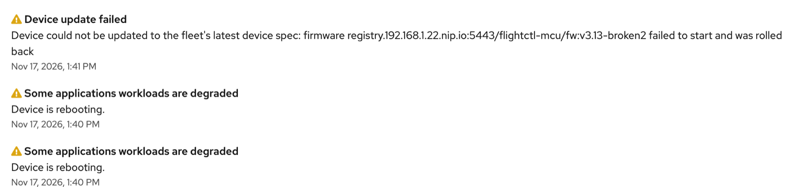

# Results

What works, where it was verified, and the measurements. The devices are microcontrollers with no Linux, managed by an unmodified **Flight Control 1.4.0** (the upstream of Red Hat Edge Manager) on [kind](https://kind.sigs.k8s.io/). The figures come from development builds before 1.0.

## What works

**Boards**: the classic ESP32, ESP32-C3, C5, C6 and S3 with ESP-IDF, and the ESP32-S3 with Zephyr. **Emulator**: the real firmware in Espressif's emulator ([below](#in-espressifs-emulator)). **Tests**: the end-to-end tests in CI with the simulated device and Zephyr's emulated builds, unit tests and host tests ([TESTING.md](TESTING.md)). ✓ verified, ◐ in part (what is missing is in [current limitations](#current-limitations) or the linked page), – not tried.

| Function | What it does | Boards | Emulator | Tests | More |
|---|---|---|---|---|---|
| Enrollment | Device key, CSR, mTLS | ✓ | ✓ | ✓ | [QUICKSTART](QUICKSTART.md#5-approve-it) |
| Automatic approval | From an allow list | – | – | ✓ | [QUICKSTART](QUICKSTART.md#5-approve-it) |
| Status | Full agent API status, `Unknown` when offline | ✓ | ✓ | ✓ | [Label sync](FLIGHTCTL-LIMITATIONS.md#label-sync) |
| HTTP/2 | Spec, status and downloads on one connection | ◐ | ✓ | ✓ | [Below](#http2) |
| Resource alerts | CPU, heap, storage against the fleet's rules | ◐ | – | ✓ | [Timings](#timings) |
| Config | Files from the spec, no reboot | ✓ | – | ✓ | [QUICKSTART](QUICKSTART.md#6-give-it-firmware-config-and-an-app) |
| Firmware OTA | A/B slots, staged rollouts | ✓ | ✓ | – | [Timings](#timings) |
| Firmware deltas | A patch from the running release | ✓ | ✓ | ✓ | [DELTA](DELTA-UPDATES.md) |
| Firmware and apps in one spec | The firmware first, then the apps that need it | ✓ | ✓ | ✓ | [APPS](APPS.md#size-and-limits) |
| Automatic rollback | Back to the previous firmware if the new one fails | ✓ | ✓ | – | [The way back](#the-way-back-on-the-esp32-s3-both-ports) |
| Mixed fleets | One fleet for every chip | ✓ | – | – | [DEVICES](DEVICES.md) |
| WASM apps | Installed and updated without a reboot | ✓ | ✓ | ✓ | [APPS](APPS.md) |
| App interface | Hardware by name, timers, events, storage, C library | ◐ | – | ✓ | [APPS](APPS.md#ports) |
| An app's limits | CPU budget per call, heap kept for the agent | ◐ | ✓ | ✓ | [APPS](APPS.md#size-and-limits) |
| Modules built for no device | Any WebAssembly module, run once | ✓ | – | ✓ | [APPS](APPS.md#modules-built-for-no-device) |
| Demo apps | emlearn's TinyML model, wasm3-arduino's blink as published | ◐ | – | ✓ | [APPS](APPS.md#the-blink-of-wasm3-arduino) |
| Apps that crash the device | Not started again | – | ✓ | ✓ | [APPS](APPS.md#how-an-app-runs) |
| Crash reports | `lastFatalError` in the status | ◐ | ✓ | ✓ | [Crash](#a-crash-in-the-status) |
| Certificate renewal | Same key, new certificate | – | ✓ | ✓ | [TESTING](TESTING.md) |
| Signed images | Cosign signatures checked on the device | ✓ | ✓ | ✓ | [SECURITY](SECURITY.md#two-signing-keys) |
| Registry with TLS and a password | CA and `auth.json` from the fleet | ✓ | ✓ | ✓ | [REGISTRY](REGISTRY.md) |
| Registry tokens | Bearer tokens, as Quay and Harbor use | – | – | ✓ | [TESTING](TESTING.md#registry-tokens) |
| Decommissioning | Key and certificate wiped | ✓ | ✓ | ✓ | [QUICKSTART](QUICKSTART.md#7-take-it-out) |
| Remote console | `flightctl console` and the UI's terminal | ✓ | – | ✓ | [CONSOLE](CONSOLE.md) |
| Device log | The UI's Logs tab, previous boot included | ✓ | – | ✓ | [CONSOLE](CONSOLE.md#the-log) |
| Metrics | OTLP to the Telemetry Gateway | ✓ | – | ✓ | [METRICS](METRICS.md) |
| MQTT for the apps | One broker connection for all apps, TLS | ◐ | – | ✓ | [APPS](APPS.md#mqtt) |
| Known vulnerabilities | SBOM per release, CVEs through Trustify | ✓ | – | – | [SBOM](SBOM.md) |
| Field provisioning | WiFi over the device's access point | ◐ | ✓ | ✓ | [PROVISIONING](PROVISIONING.md) |
| Secure Boot, flash encryption, anti-rollback | The `secure` variant | – | ✓ | – | [SECURITY](SECURITY.md) |

HTTP/2: the spec's long-poll and the status share one connection on the five ESP-IDF chips and on the ESP32-S3 with Zephyr; firmware and apps come over it on the classic ESP32, C5, C6 and S3 and on the ESP32-S3 with Zephyr (every request HTTP/2 in the registry's log); the end-to-end tests run over it in CI and in the emulator. Not yet tried on a board: a certificate renewal over it, and its traffic ([REGISTRY.md](REGISTRY.md#memory)).

A board keeps its identity across firmware updates; only a full flash erase makes it enroll again as a new device.

## Measurements

### Firmware size

ESP-IDF 6.0.3, built for size (`-Os`), with WAMR at `-O2`:

| Chip | Image, v3.12 | Free in the 1,664 KB OTA slot | Built for speed (`-O2`), v3.10 |
|---|---|---|---|
| ESP32 | 978 KB | 41% | 1,121 KB |
| ESP32-S3 | 977 KB | 41% | 1,118 KB |
| ESP32-C3 | 1,024 KB | 38% | 1,192 KB |
| ESP32-C5 | 1,107 KB | 33% | 1,282 KB |
| ESP32-C6 | 1,110 KB | 33% | 1,288 KB |

`-Os` saves 141 to 178 KB per image (about 13%). Delta sizes are in [DELTA-UPDATES.md](DELTA-UPDATES.md).

| Component, on the C3 built for speed | Flash |
|---|---|
| WiFi, WPA and lwIP | about 430 KB |
| Cryptography and TLS (mbedTLS 4, TF-PSA-Crypto) | about 197 KB |
| WAMR (fast interpreter) | 68 KB |
| **The agent** (`core/`) | **about 62 KB**; 79 KB with cJSON, WiFi provisioning, the delta decoder and the ESP-IDF port |
| The apps' C library | 7.7 KB |
| WiFi provisioning with its access point, on the S3 | 17.4 KB ([PROVISIONING.md](PROVISIONING.md#in-the-field-the-wifi-network)) |
| Floating point in `printf` (picolibc), Zephyr | 5.4 KB on the S3, 4.7 KB on a Cortex-M3, no RAM |
| The apps' `expf`, `logf` and `tanhf` | 3.6 KB on the C3, 2.5 KB on the S3 with Zephyr, no RAM |

Almost all the space goes to the network stack and to cryptography, which any securely connected device needs anyway.

### RAM

**App slots on the ESP32-S3 with Zephyr.** Moving the slot storage into the C heap increased its arena from 116,736 to 120,112 bytes. The linked descriptor is 896 bytes and its runner's handles, events and output buffer take 768 bytes. An isolated run of Zephyr's allocator on the host used the S3's chunk format, eight-byte alignment and those ELF sizes. Relative to two static slots, an otherwise empty arena gained 3,376 free bytes with zero apps, **1,696 with one** and 16 with two. Removing the second allocation restored the one-app result. The largest free block had the same gain in this test. Firmware running Wi-Fi, TLS and WASM can place other allocations between these blocks.

Internal heap with the `alarm` app running; on the ESP32, C5, C6 and S3 after 40 minutes of CoreMark installs and swaps:

| Board | Firmware | Free | Lowest | Largest internal block |
|---|---|---|---|---|
| Classic ESP32 | v3.12 | 154.0 KB | 2.3 KB | 76.0 KB |
| ESP32-C5 | v3.12 | 109.2 KB | 5.3 KB | 60.0 KB |
| ESP32-C6 | v3.12 | 205.2 KB | 1.8 KB | 164.0 KB |
| ESP32-S3 N4R2 | v3.12 | 161.2 KB | – (PSRAM counted) | 84.0 KB |
| ESP32-C3 | v3.13-rc6, an hour after boot | 70 to 75 KB | 2.8 KB, at start-up | 36.0 KB |

| Board | Lowest during a metrics export, every 30 s (v3.13-rc6) | Free once MQTT is connected (v3.14-rc6) |
|---|---|---|
| Classic ESP32 | 79 to 100 KB | 91 KB |
| ESP32-S3 | 93 to 108 KB | 96 KB |
| ESP32-C5 | 26 to 49 KB | 44 KB |
| ESP32-C6 | 25 to 44 KB, WiFi buffers at ESP-IDF's defaults | 141 KB |
| ESP32-C3 | 19 to 20 KB; 13 KB right after it took a whole firmware | 39 KB |
| ESP32-S3, Zephyr (z26) | 8.3 KB of the C heap, 55 KB free, steady | – |

| Part | What it takes |
|---|---|
| Device log | 4 KB |
| Resource alerts | about 4 KB: 65.6 KB free on the C3 five minutes after boot |
| App interface and C library | about 4.5 KB of static RAM; 1.5 KB less since the function tables are const, in flash |
| A WASM app: `trend`, 1.9 KB of `.wasm`, on the C3 | 17.7 KB of heap: the loaded module about 5 KB, the instance and its WAMR stack about 3.5 KB, its memory about 1 KB, its thread's stack 8 KB |
| The MQTT connection, on the C3 | 10 KB of heap (49 KB free before, 39 KB after, v3.14-rc7), and 29 to 31 KB free at the lowest during its handshake; the client's thread used 3.2 to 4.2 KB of its 8 KB stack |
| The metrics connection, Zephyr on the S3 | its 17 KB receive buffer, from the C heap |
| The `tinyml` app's memory | 1.2 KB, with 4.1 KB of `.wasm` |
| The `tinymlp` app's memory | 2.4 KB, with 6.8 KB of `.wasm` |
| The memory of wasm3-arduino's blink, any of its four builds | 64 KB, in one block |

The heap's lowest in the first 25 s after a restart (v3.14-rc7, three restarts each; the block held while a TLS connection opens left out):

| Board | `alarm` alone | `alarm` and `mqttdemo`, MQTT connected |
|---|---|---|
| ESP32-C3 | 51 to 55 KB | 16 to 19 KB |
| ESP32-C5 | 56 to 58 KB | 21 to 24 KB |
| Classic ESP32 | 67 to 69 KB | 33 to 34 KB |
| ESP32-C6 | 151 to 154 KB | 119 to 120 KB |

The difference is what the app and MQTT keep (`mqttdemo`'s instance 19 KB and its thread, the client's 8 KB thread and 4 KB pool), not a handshake beside another: the lowest comes during the first metrics export, before the broker's handshake. With the held block counted, the heap's own lowest is 1 to 10 KB on every chip, with or without MQTT. On the C3 with MQTT connected, a metrics export goes down to 6 to 10 KB, and the first one or two after a restart fail for want of memory (a 4.4 KB allocation); the later ones are sent. The C5 goes down to 9 to 15 KB and sends them. With Zephyr on the ESP32-S3, 4,112 bytes of the 372 KB DRAM segment are left at link time, with a 12 KB status-thread stack and a 92 KB kernel heap.

What the agent took of the internal heap once an app's instance was made, up to a minute after, with a metrics export every 30 s; the block held while a TLS connection opens left out ([APPS.md](APPS.md#size-and-limits)). The 40 KB the device keeps for the agent comes from these:

| Board | `alarm` (v3.14-rc12) | CoreMark's 64 KB build (v3.14-rc12) | Left at the lowest with CoreMark |
|---|---|---|---|
| Classic ESP32 | 21 to 25 KB | 35 KB | 10 KB |
| ESP32-C3 | 24 to 28 KB | 39 KB | 24 KB |
| ESP32-C5 | 21 to 27 KB | 33 to 34 KB | 7 KB, and two status updates failed |
| ESP32-C6 | 21 to 27 KB | 34 to 47 KB | 87 KB |
| ESP32-S3 N4R2 | 23 to 37 KB | 33 to 52 KB | 33 KB |

Without a metrics export the agent took 12 to 16 KB (v3.14-rc7): reconnecting and sending its status; an export adds 10 to 15 KB, a spec applied meanwhile up to 38 KB in all, an MQTT connection about 10 KB, a console session up to 25 KB while it is open, its buffers included ([CONSOLE.md](CONSOLE.md#limits)). On the S3 the TLS block is never held (its largest block is in PSRAM), so its lowest is the heap's own: 18 KB taken with no app and no export (v3.14-rc7). Since v3.14-rc12 the apps saved by a previous run start once the device's first status is accepted, 4 to 9 s after the firmware starts on the boards; before, they started before WiFi, with the heap the network and the agent take later still free.

Stack used at most (`stackMinFreeBytes`), of the stack each thread has; here a KB is 1,024 bytes:

| Firmware | Spec loop, on the main task | Status thread | App thread |
|---|---|---|---|
| Classic ESP32 | 8.9 of 24 KB (installing an app) | 4.2 of 12 KB | 3.4 of 8 KB |
| ESP-IDF v3.14-rc10 and rc11, the five chips | 8.3 to 9.1 of 14 KB (C3, C5, C6) or 16 KB (ESP32, S3), downloading a whole firmware or a delta | at most 5 KB, of 8 KB (C3, C5, C6) or 10 KB (ESP32, S3) | |
| Zephyr on the ESP32-S3 | 5.4 of 16 KB (polling, no firmware download) | 4.7 KB (now given 12 KB; no certificate renewal) | 3.0 of 8 KB (`alarm`) |
| Zephyr on a Cortex-M3 (`mps2/an385` in QEMU) | | | 2.7 of 8 KB (`printf` of `%f`); 2.5 without the C library |
| ESP32-C3 in the emulator, v3.14-rc4 | | | 2.8 of 8 KB (`printf` and `snprintf` of `%f`) |
| ESP-IDF with the `alarm` app | | | 3.4 of 8 KB on the classic ESP32 and the S3, 2.5 to 2.6 on the C3, C5 and C6 |

Installing an app or downloading firmware takes about twice the stack of polling. `printf` of `%f` adds little to an app's thread (0.2 KB on the Cortex-M3); it is not measured on Xtensa yet. The C3 with the `alarm` app uses 1% of its CPU.

### CoreMark

Iterations per second of [CoreMark](https://github.com/eembc/coremark) 1.0's two published WebAssembly builds, unmodified, on WAMR's fast interpreter ([APPS.md](APPS.md#modules-built-for-no-device)). ESP-IDF v3.14-rc12 built for size, swapped in for the `alarm` app; the 128 KB build with v3.13. Every run was valid (its CRCs right, a timed part of 10 s or more), with the agent connected and metrics sent every 30 s or none:

| Board | wasm3's build (64 KB of memory) | wasm-coremark's build (128 KB) | Native, one core (Espressif) |
|---|---|---|---|
| Classic ESP32 (240 MHz) | 14.23 | does not fit: largest free block 64–76 KB | about 505 |
| ESP32-C3 (160 MHz) | 14.21 | does not fit: largest free block 36–38 KB | about 409 |
| ESP32-C6 (160 MHz) | 12.10 | 13.24–13.71 | |
| ESP32-C5 (240 MHz) | 19.70; from 18.9 to 22.3 from one run to the next since v3.12, not explained yet | does not fit: largest free block 72 KB | |
| ESP32-S3 N4R2 (2 MB quad PSRAM) | 18.09 | 21.04–21.64, in PSRAM | about 614 |
| ESP32-S3, PSRAM off | 18.88–18.95 (v3.10, built for speed) | does not fit: no internal block of 128 KB left once running | about 614 |
| ESP32-S3 with Zephyr, no PSRAM | does not fit: the C heap has no block for the module and 64 KB | – | |
| ESP32-S3 N8R8 with Zephyr | 17.83–17.84, in PSRAM (z26) | 21.69–21.70, in PSRAM (z26) | about 614 |

| | |
|---|---|
| Against native code | about 30 times slower, the instruction count included; WAMR's AOT mode should be about 3 times slower, with one module per architecture instead of one for every device; not measured |
| Firmware built for size, WAMR still at `-O2` | about 5% slower than built for speed on the S3, 7% on the classic ESP32, nothing on the C5 and C6 |
| Classic ESP32 at 240 MHz | 2.2 times faster than at ESP-IDF's debug default of 160 MHz |
| Block needed for the memory | one free block of 68 KB for 64 KB, of 136 KB for 128 KB |
| ESP32-S3 with PSRAM | an app's memory goes to PSRAM when no internal block is large enough: the `esp32s3` image for quad PSRAM or none, `esp32s3-r8` for octal ([DEVICES.md](DEVICES.md)) |
| Zephyr on the S3 N8R8 | the octal PSRAM is a heap of its own for app memories of 16 KB or more; its driver takes 4 KB of internal RAM |
| Zephyr on an S3 without PSRAM | CoreMark needs about 85 KB of the C heap (a 68 KB block for its memory, the module, the instance); the agent alone leaves about 65 KB of the 114 KB, and the data region has 4 KB left at link, so some 20 KB more would have to come from the kernel heap or the WiFi driver's buffers |

With ESP-IDF the 64 KB build takes about 105 KB of heap in all: the loaded module about 18 KB, its thread's stack 8.7 KB, the instance about 71 KB with its 68 KB block. Whether that block is there depends on how broken up the heap is. With v3.14-rc12, 40 KB kept for the agent and app memories in blocks of their own size:

| | |
|---|---|
| Swapped in for `alarm` | run on all five chips |
| Classic ESP32 | refused once in three swaps (`would leave the agent 30 KB`) |
| ESP32-C5 | run with 7 to 11 KB left to the agent at the lowest, and two status updates failed meanwhile; added beside a finished CoreMark, `alarm` was refused (`layer is 2303 bytes (max 1641 with this heap)`) |
| Lowest heap seen, earlier releases | 2.3 KB on the classic ESP32, the agent still reporting; 108 bytes on the C3 after a failed swap, where one TLS handshake failed (`PSA_ERROR_INSUFFICIENT_MEMORY`) |

### Apps on the boards

The example apps ([APPS.md](APPS.md#examples)), with ESP-IDF unless the row says otherwise:

| App | What it did |
|---|---|
| `alarm` | Opened `led0` with the firmware's pin on the C3, the C6 (its WS2812 LED) and the ESP32-S3 with Zephyr (LED and temperature simulated); a new threshold took it from alarm to ok without restarting it; on the C6 it came back from flash after a restart. It also runs on the classic ESP32. |
| `hwcheck` | With nothing wired, I2C (a bus scan, a transfer), SPI, a UART write, ADC (a floating pin) and PWM open and answer on the classic ESP32, C5, C6 and S3 and on the emulated C3. GPIO interrupts and wired devices are not tried yet. |
| `mqttdemo`, the five chips | Beside `alarm`, against a broker with TLS on the LAN: published the temperature every 5 s with none missing over 8 minutes, and received and answered a command on the device's prefix (QoS 1) and one on the fleet's. |
| `mqttdemo`, Zephyr on the S3 | Published every 10 s with none missing over 45 minutes, and answered a command on each prefix within a second. Beside a metrics export every 30 s it used up the C heap ([current limitations](#current-limitations)). |
| `tinyml` | Said `steady` on the C3, C5, C6 and S3, and `warming` when the C3 warmed by 2 °C within a minute. The classic ESP32 has no temperature sensor, and the app says so. |
| `tinymlp` | With the device's `expf`, `logf` and `tanhf`, on the C3, C5, C6 and S3: `steady` at rest, 95 to 100% sure, once in a while `warming` or `cooling` at under 95% (`warming` at 46% once, `cooling` at 93%). |
| wasm3-arduino's blink, Rust build, beside `tinyml` | Ran for 45 minutes on the C3, C6 and S3. Refused on the C5 (`allocate linear memory failed (largest free block 52 KB)`) and on the classic ESP32 (`its memory would leave the agent 22 KB of heap, less than the 40 KB it needs`), the device reporting all along. |
| wasm3-arduino's blink, C++ build, beside `alarm` | Ran on the C3, C6, S3 and the classic ESP32. The blink also runs on the host and on Zephyr's `native_sim`. |

### Timings

ESP-IDF boards with an early build, unless the row says otherwise:

| Operation | Time |
|---|---|
| From boot to enrollment request (WiFi, SNTP, TLS) | about 10 s |
| Config change, from apply to device confirmation | 1–6 s |
| Firmware rollout to 3 devices, canary first | 50–80 s, about 20 s per device for download and reboot |
| Rollback of a broken firmware | about 3.5 min: the 150 s confirmation window and 2 reboots |
| WASM app update across the fleet, canary first | about 50 s, nearly all of it the rollout; the swap on the device is immediate |
| App state change, to Flight Control | about 2 s |
| Memory rule added to the fleet, to `Warning` and `DeviceMemoryWarning` (end-to-end test) | 21 s; `DeviceMemoryNormal` once the rule is removed |
| MQTT connected, from the spec that gives the broker (v3.14-rc6) | within 70 s; 13 s with Zephyr on the S3 |
| Firmware and an app that needs it, in one spec, to the five ESP-IDF chips, canary first | about 2 minutes |
| An app's call budget, 5 million instructions (a counting loop, five runs each, within 5%) | 0.66 s on the C5, 0.9 s on the S3, 1.06 s on the C3, 1.2 s on the classic ESP32, 1.3 s on the C6; with the second in the device's functions, at most 2.3 s on the C6 |
| A loop in a C constructor, emulated C3 | stopped by the budget in under a second, the app removed in 3 s |
| Decommissioning, from the request to `Completed` | 2.4 to 3 s |
| A whole firmware, from `Downloading` to `Rebooting` (v3.14-rc10 to rc10.1, polled every 3 s) | 13 s on the C3, 9 s on the C5 with fewer WiFi receive buffers (9 and 6 s before), 13 s on the C6 |

### Idle traffic

Bytes on the wire, TLS included (`netTxBytes`, `netRxBytes`), with the earlier HTTP/1.1 client and its two kept connections; not measured yet over HTTP/2:

| | Traffic |
|---|---|
| Simulated device, no app, a status every minute | about 220 KB/hour: 87 KB sent, 130 KB received |
| ESP32-C3 with the `alarm` app | about 280 KB/hour |
| A connection per request instead | 560 to 730 KB/hour, mostly the TLS 1.3 handshake with mTLS |
| Exchanges | a status at once on a change, else every 2 minutes; the long-poll lasts about 4 minutes |
| TLS handshakes | 2 after boot, none in the next 10 minutes |
| A reconnection | a full handshake, about 1.5 KB received: the server issues session tickets but does not resume them |
| After a server restart | both connections reopen; the next spec applies in 2 s |

What is left is the full status, and going lower needs differential updates (limitation 6). The apps' changes go out together, one status every 15 s at most.

### In Espressif's emulator

[esp-emu](https://github.com/espressif/esp-emulator) 0.51 runs the real firmware against the same Flight Control. The workflow runs the C5, the S3 and the C6 ([TESTING.md](TESTING.md)); the runs below had 4-minute certificates, the C3's by hand:

| Chip | Signed OTA (reboot into the other slot) | Unsigned app | Certificate renewal | Heap free / minimum / largest block |
|---|---|---|---|---|
| ESP32-C3 | confirmed, 19 s | refused | 6 renewals, still reporting after the first certificate expired | 57.8 / 37.6 KB / – |
| ESP32-C5 | confirmed, 15 s | refused | renewed, still reporting after the first certificate expired | 61.7 / 42.2 / 40.9 KB |
| ESP32-S3 | confirmed, 35 s | – | renewed | 121.3 / 102.1 / 73.7 KB |

The C3 figures match the board's.

### The way back on the ESP32-S3, both ports

Each port was given a firmware that reaches Flight Control on a wrong port (9443) and gives itself 30 seconds instead of 150:

| | ESP-IDF 6.0.3 | Zephyr 4.5 with MCUboot |
|---|---|---|
| Before | the release build, received as a delta ([DELTA-UPDATES.md](DELTA-UPDATES.md)) (`lastDelta: Applied`) | a build received as a delta of 28 KB (`lastDelta: Applied`) |
| Broken image | 1181 KB, whole, downloaded and restarted in 11 s | 885 KB, whole, in 14 s |
| Given up | 30 s after the agent started, by the image itself | the same |
| Back | the bootloader takes the previous slot | MCUboot swaps the slots back: 15 s |
| Reported | 53 s after the fleet changed: "failed to start and was rolled back; not retried" | 1 min 53 s, the same message |

*The device's events when a release does not start: the device reboots into it, goes back to the one it ran, and Flight Control reports the update failed.*

Neither tried the image again. The ESP32-C6 was back and reporting 50 s after it restarted into a broken firmware, and with v3.13 online again 3 to 5 s after the restart back.

### A crash in the status

After a crash, the status gives `lastFatalError`: the fault, the task or thread, the uptime, the `pc` and the callers, for `addr2line` against the ELF of the firmware that crashed. `tools/fw-push.py` keeps each release's ELF in the registry, and `tools/fw-elf.py` gets it back. With ESP-IDF the panic handler records a fault, an `abort()`, the interrupt watchdog, and the task watchdog when it is set to panic (by default it only logs). On Xtensa the record has the backtrace; on RISC-V, which has no frame pointers, `ra` and the firmware's code addresses found on the stack. Zephyr gives the same text with the `pc` and `lr` on Arm, and the `pc` and Zephyr's own backtrace on the ESP32-S3.

In the emulator against Flight Control ([tests/e2e/fatal-emu.sh](../tests/e2e/fatal-emu.sh)), with test builds that crash from a task 30 s after power-on:

| Chip | Crash | `lastFatalError` |
|---|---|---|
| ESP32-C5 | write to address 0 | `Store access fault (7) in thread "fc_fault", 30112 ms after boot, pc 0x4200d96a ra 0x4200d994` |
| ESP32-C3 | write to address 0 | `… (7) …, pc 0x4200cb7e ra 0x4200cba8` |
| ESP32-S3 | write to address 0 | `StoreProhibited (29) …, pc 0x420c2d5c backtrace 0x4200ecda` |
| ESP32-C5 | `abort()`, as a failed assert makes (also run on the C3, C6 and S3) | `abort() (2) …, pc 0x4200d973 ra 0x4080c926, stack 0x4080b76e 0x4200d976 0x4200d9a2`: the `pc` is abort()'s caller; the log has the assert, the function and the task |
| ESP32-C5 | interrupt watchdog (a loop with interrupts off) | `Interrupt wdt timeout on CPU0 (24) …, pc 0x4200d97a ra 0x4200d978, stack 0x4200d9b0`, `resetReason` `int_wdt` |
| ESP32-S3 | interrupt watchdog | `… (5) …, pc 0x420c2d5e backtrace 0x4200ecda` |
| ESP32-C5, S3 | task watchdog set to panic (a loop that starves the idle task) | `task watchdog (0) …`, the `pc` in the loop, `resetReason` `task_wdt` |

In every run the `pc` decodes to the function that crashed, and its caller, the task's function, is among the addresses. The device crashed once and went on. The previous boot's log (`journalctl -b -1`, through the console) ends with `fatal: ` and the same text. A release's ELF, pushed with four platforms (ESP-IDF and Zephyr), came back byte for byte and left the release's index unchanged. The unit tests check that the record is valid before it is believed, and its text.

Zephyr builds for the ESP32-S3 (its backtrace linked in), `mps2/an385` and `native_sim`; on the S3 a crash leaves Zephyr's report of the fault in the previous boot's log ([CONSOLE.md](CONSOLE.md#the-log)), but `lastFatalError` itself has not been checked there yet.

The handler takes 799 bytes of IRAM on the ESP32, 907 on the S3 and 1,102 on the C3, C5 and C6; the record takes 140 bytes of RAM kept across restarts.

### The registry with TLS, and decommissioning, on boards

With the registry behind TLS and a password, its CA and `auth.json` from the fleet ([REGISTRY.md](REGISTRY.md)):

| | ESP32-C3, ESP-IDF 6.0.3 | ESP32-S3, Zephyr |
|---|---|---|
| App over TLS | running 3 s after the config, no restart | about 6 s |
| Firmware over TLS, whole | 1234 KB in 5 s | 886 KB |
| Firmware over TLS, as a delta | not tried | 17 KB (`Applied`) |
| Decommissioning, from request to Completed | 3 s | 2.4 s |

After decommissioning each board wiped its key and certificate, showed as `Decommissioned` and kept running its app without enrolling again; erased, each enrolled again as a new device. The heap during a download over TLS is not measured yet.

### Zephyr on the ESP32-S3

An ESP32-S3-DevKitC with Zephyr 4.5 and MCUboot ([ZEPHYR.md](ZEPHYR.md#on-an-esp32-s3)), against Flight Control 1.4.0:

| | |
|---|---|
| Enrollment | key made by PSA from the chip's random generator, certificate for a year |
| WASM app | the signed `alarm` app runs (WAMR's fast interpreter on Xtensa); a copy signed with another key was refused |
| Firmware, whole | 885 KB in 7 s, 24 s from the restart to the agent, MCUboot's swap included; confirmed |
| Firmware, as a delta | 19 KB (2.2%) rebuilt the 885 KB image in 8 s; confirmed |
| A firmware that cannot reach Flight Control | rolled back ([The way back](#the-way-back-on-the-esp32-s3-both-ports)) |
| Reflashed over USB | same device: its key is in the storage partition |
| Memory | the C heap with an app and metrics every 30 s: [RAM](#ram); a signed image with MQTT linked in is 1,038 KB |
| Downloads over HTTP/2 | a delta and the `mqttdemo` app: manifests, signatures and blobs, every request HTTP/2 in the registry's log |
| MQTT | [Apps on the boards](#apps-on-the-boards) |
| Without PSRAM | with one app, the C heap got down to 368 bytes while downloading an update, which failed (`HTTP -1`); the spec then stopped coming in while statuses went out, until a reset |
| The UI's Logs tab, metrics | the tab's commands answered (every filter, live mode); the device's metrics at the Telemetry Gateway ([CONSOLE.md](CONSOLE.md), [METRICS.md](METRICS.md)) |
| Field provisioning | from an iPhone with Espressif's app ([PROVISIONING.md](PROVISIONING.md#on-zephyr)) |

## Flight Control limitations

The gaps found in Flight Control for this class of device, each with a proposal, are in [FLIGHTCTL-LIMITATIONS.md](FLIGHTCTL-LIMITATIONS.md); this page cites them by number.

## Current limitations

- **Registry**: TLS only, with the CA the fleet gives; no public CA bundle, no redirects to another host ([REGISTRY.md](REGISTRY.md)).
- **Device key**: in flash in clear, except in the `secure` variant, where it is encrypted, or on the C5 in its ECDSA peripheral ([SECURITY.md](SECURITY.md)).
- **Provisioning**: credentials over USB; the WiFi network over USB or the device's own access point ([PROVISIONING.md](PROVISIONING.md)).
- **Enrollment certificates**: issued per batch, but Flight Control 1.4.0 cannot revoke one (limitation 8).
- **Offline longer than the certificate** (a year by default): the device enrolls again as a new device, with its apps, config and firmware (limitation 13).
- **Server unreachable**: without an accepted status for 10 minutes the device restarts, its apps with it, and again every 10 minutes; a write gives up after 30 s.
- **App format**: WASM OCI artifacts only (`application/vnd.wasm.content.layer.v1+wasm`), not a `.wasm` inside a container image.
- **JSON depth**: at most 32 levels; real documents use fewer than 10.
- **Not yet on a board**: the `secure` variant, certificate renewal, registry tokens, GPIO interrupts, wired peripherals; with Zephyr, `lastFatalError`.
- **Zephyr**: an app's heap floor and the `.wasm` size limit are not checked yet.
- **MQTT with Zephyr**: beside a metrics export every 30 s it used up the ESP32-S3's C heap, and the device restarted itself after 10 minutes without a status. The firmware now makes the broker's connection and the export wait for heap; not yet tried on the board ([Apps on the boards](#apps-on-the-boards)).
- **Zephyr on the ESP32-S3 without PSRAM**: with one app it got down to 368 bytes of free C heap while trying to download an update, which did not go through, and the device then took no spec while its statuses went out ([Zephyr on the ESP32-S3](#zephyr-on-the-esp32-s3)).
- **A stuck agent**: no status accepted, or no spec taken, for 30 minutes restarts the device from outside the agent's threads, on ESP-IDF and Zephyr; tried in unit tests only.
- **Memory for apps**: a 64 KB app memory such as CoreMark's fits on every ESP-IDF board, but on the classic ESP32 and the C5 not every time, and with little heap left to the agent ([CoreMark](#coremark)).

What comes next is in the [roadmap](ROADMAP.md).
