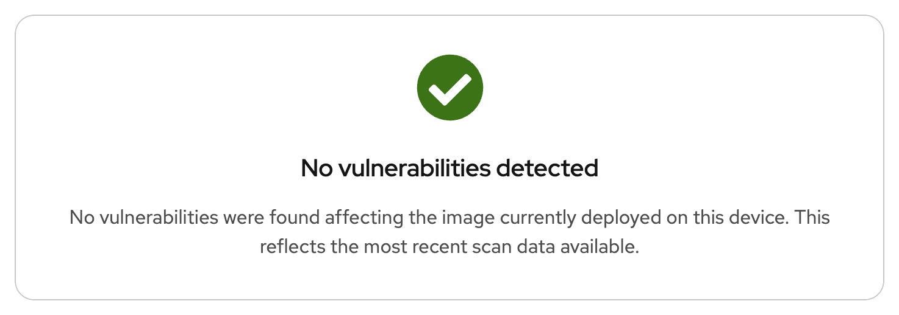
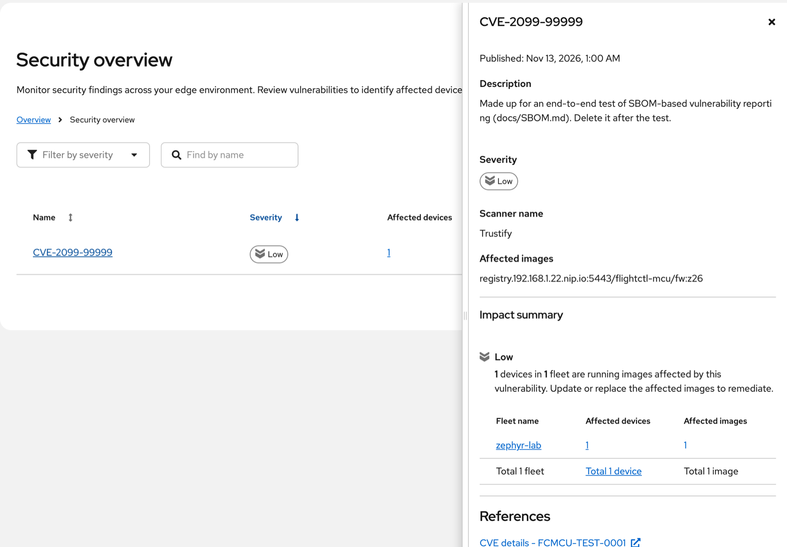

# SBOM and known vulnerabilities

Flight Control uses each device's running firmware digest to look up advisories in Trustify. Publish a release SBOM and import advisory data for the components you ship.

## What a release's SBOM holds

`tools/fw-push.py` generates one CycloneDX 1.6 JSON document per OCI index. Its root package URL includes the index digest reported in `status.os.imageDigest`. Components include a package URL, license and CPE when known.

| | From |
|---|---|
| the agent (this repository, at its commit), cJSON, WAMR | cJSON's header, `third_party/fetch-wamr.sh` |
| ESP-IDF, its mbedTLS and managed components | SDK version from the application binary’s `esp_app_desc_t.idf_ver`, checked against `port/espidf/dependencies.lock.<chip>`. The lock supplies managed component versions. `MBEDTLS_IN_ESP_IDF` maps SDK releases to mbedTLS versions. |
| Zephyr, its modules: mbedTLS, TF-PSA-Crypto, MCUboot, littlefs, picolibc, zcbor, and each board's HALs | the Zephyr tree (`third_party/zephyr-ws`): the modules' own version files, else the revision Zephyr's manifest names |

One SBOM covers every image in the release. Publish from the checkout and dependency trees used for the build. Before writing to the registry, `fw-push.py` checks each selected ESP-IDF image against its chip’s lock and resolves the Zephyr modules for each selected board. If an SDK version differs, rebuild the image or publish from its original checkout.

## Where it goes

- `build/sbom/<repository>-<tag>.cdx.json`;
- the registry, as an artifact that refers to the release's index (OCI 1.1 `subject`, type `application/vnd.cyclonedx+json`), also tagged `sha256-<index digest>.sbom`, as cosign tags its attachments: `registry:3` has no referrers API, so `oras discover` finds it only on registries that do;
- Trustify, when `TRUSTIFY_URL` is set (and `TRUSTIFY_TOKEN`, when it asks for one): `POST /api/v2/sbom`, labelled with the index's digest, as Flight Control's image builder uploads its own.

To regenerate a release’s SBOM, use its source checkout, dependency trees and binaries. For ESP-IDF, `--esp-idf esp32c3` reads `port/espidf/build-esp32c3/flightctl_mcu_fw.bin`. Pass `--esp-idf esp32c3=path/to/flightctl_mcu_fw.bin` to select a variant or an archived image. For example, `tools/sbom.py --ref <registry>/flightctl-mcu/fw:<tag> --digest sha256:<index> --esp-idf esp32c3 --zephyr esp32s3_devkitc --upload <Trustify URL>`.

## In Flight Control

Flight Control 1.4 reads the vulnerabilities from Trustify (Helm values `vulnerabilityReporting.enabled: true`, `vulnerabilityReporting.trustify.endpoint`). Its client speaks Trustify 0.4's API (`/api/v2`): Trustify 0.5 and later moved it to `/api/v3`. For a test setup, `tools/trustify/up.sh` runs Trustify 0.4.21 next to the kind cluster and points Flight Control at it; then:

```bash
TRUSTIFY_URL=http://127.0.0.1:8095 tools/fw-push.py ...
```

Every 15 minutes Flight Control looks up reported digests in Trustify and stores matching advisories. The device already reports the digest.




The device view groups findings by severity. The security overview lists affected releases, fleets and devices. Matching depends on the imported advisories and their package URLs or CPEs.

## What was verified with a test advisory

On kind with Flight Control 1.4.0 and Trustify 0.4.12, the server found all three Zephyr release SBOMs by digest. A synthetic OSV advisory for mbedTLS 4.1.1 appeared in device, fleet and organization views within a minute. Trustify required a CVE alias. Withdrawing the advisory exposed [a server reconciliation limit](FLIGHTCTL-LIMITATIONS.md#14-a-withdrawn-advisory-stays-on-the-devices).

Trustify 0.4.12's stock CVE and OSV importers did not associate C-library advisories with the firmware SBOMs, even with the full `cve-from-2024` feed. The NVD import below supplies the missing package associations.

## From NVD: `tools/advisories.py`

Run the importer for every release still deployed. It checks shipped versions against NVD's CPE ranges and writes an OSV advisory with the matching component package URLs, CVE alias and CVSS vector.

```bash
tools/advisories.py build/sbom/fw-<esp-idf tag>.cdx.json build/sbom/fw-<zephyr tag>.cdx.json --upload http://127.0.0.1:8095
```

Repeat the import as NVD adds records. Without `NVD_API_KEY`, allow for NVD's rate limit. The importer checks known alternate CPE names. In the tested dictionary, MCUboot, littlefs and picolibc had no entries.

Two board releases (ESP-IDF 6.0.3 and Zephyr 4.5) produced four cJSON version matches in Flight Control within a minute. Three were high severity and one medium. The firmware's build and usage ruled them out. [Reviewed findings and reasons](../tools/not-affected.json)

Flight Control has no per-finding applicability field. The importer reports reviewed exclusions separately and skips uploading them. Recheck each justification when a component or its use changes.
