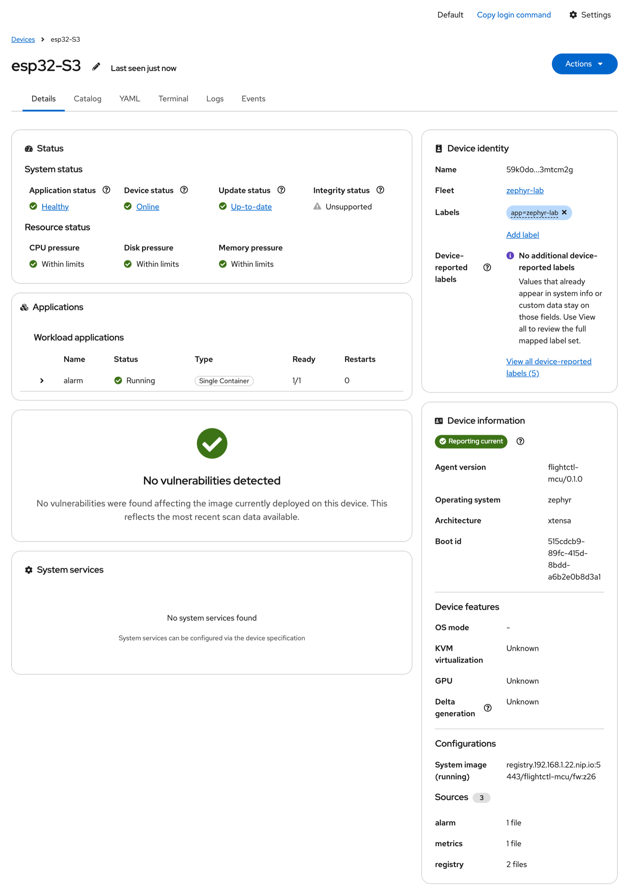

# The agent on Zephyr

The second port of the agent, after ESP-IDF: `port/zephyr`, the port and a small application (`port/zephyr/src`). The core is unchanged between the two.

**Where it stands.** On `native_sim` (Zephyr built as a Linux process) the agent passes the end-to-end test of the simulated device, against an unmodified Flight Control. On a real ESP32-S3 it enrolls over WiFi, stays online, runs a signed WASM app and updates its firmware through MCUboot, whole or as a delta, going back when the new one does not work (below): the first chip to run both ports. On an Arm Cortex-M3 with Ethernet, emulated in QEMU, it passes the same end-to-end test as on `native_sim`.

## Try it

Needs Docker. The first command pulls Zephyr's build image (about 10 GB) and a Zephyr tree with the modules the port uses (about 900 MB, in `third_party/zephyr-ws`).

```bash
third_party/fetch-wamr.sh
```

```bash
third_party/fetch-zephyr.sh
```

```bash
port/zephyr/build.sh
```

Then a flash image with the device's credentials (`tools/enrollment.sh` makes them, as for the other devices), and the device itself:

```bash
python3 -c "open('build/zephyr-flash.bin','wb').write(b'\xff'*(2*1024*1024))"
```

```bash
tools/provision.py --format zephyr --image build/zephyr-flash.bin
```

```bash
port/zephyr/run.sh build/zephyr-flash.bin
```

It asks to be approved like any device (`flightctl approve enrollmentrequest/<name>`), and keeps its key, certificate and apps in the flash file across restarts.

## What is Zephyr's and what is ours

| | |
|---|---|
| Kernel, threads, clock | Zephyr, through its POSIX layer: the core uses pthreads and `clock_gettime` as elsewhere. |
| TLS, X.509 | Zephyr's mbedTLS module, 4.1, the version ESP-IDF 6.0 has; its cryptography is PSA's (TF-PSA-Crypto), with its threading layer on POSIX mutexes (`include/fc-tf-psa-user.h`), which Zephyr has no option for: the agent's threads use PSA at the same time. |
| Network | Zephyr's sockets; `port/zephyr/fc_net_zephyr.c` gives mbedTLS its `mbedtls_net_*` functions on them. On `native_sim` the sockets are the host's (no TAP interface to set up). |
| Storage | LittleFS on the `fc_storage` flash partition: one file per key, written through a rename. |
| Credentials | The `fc_creds` partition: `"FCC1"`, a length and a JSON object with the fields of the ESP-IDF firmware's partition (`tools/provision.py --format zephyr`). |
| C heap | `port/zephyr/fc_heap_zephyr.c`, a heap the port owns, so that the device can report how much is free (`memFreeBytes`, `memMinFreeBytes`); Zephyr's malloc does not say. |
| WASM | WAMR's Zephyr platform, fast interpreter, as in the other builds. |
| Firmware updates | MCUboot's two slots (boards built with it): the image is streamed into the second, read back, and asked for as a test; MCUboot checks its signature, swaps the slots, and swaps them back unless the agent confirms the image once it has reached Flight Control. `native_sim` has no MCUboot and no updates. |
| Firmware deltas | the core's decoder, as elsewhere; the port reads the running image from the first slot. |

## Hardware for apps

The names apps open are the devicetree's: the children of a node with compatible `flightctl,app-hw` ([its binding](../port/zephyr/dts/bindings/flightctl,app-hw.yaml)), each a GPIO, an ADC channel, a PWM, an I2C bus, an SPI device or a UART by what it has. A board's overlay adds them and its `.conf` enables the drivers they need:

```dts
/ {
	fc-hw {
		compatible = "flightctl,app-hw";
		relay1 { gpios = <&gpio0 5 GPIO_ACTIVE_HIGH>; safe = <0>; };
		button0 { gpios = <&gpio0 6 GPIO_ACTIVE_LOW>; };
		level { io-channels = <&adc0 0>; };
		fan { pwms = <&pwm0 0 1000000>; };
		sensors { i2c-bus = <&i2c0>; clock-frequency = <100000>; };
		flash { spi-bus = <&spi2>; cs-gpios = <&gpio0 10 GPIO_ACTIVE_LOW>; spi-mode = <3>; };
		modbus { uart = <&uart1>; current-speed = <9600>; };
	};
};
```

A GPIO's active level becomes the board map's `active_low`. The fleet's `/etc/fc/board.json` may give a node another name (`{"gpio": {"pump": {"dt": "relay1"}}}`); it may not name pins, and a node the devicetree lacks is refused. The console's UART is never offered, and RS-485 (`de-gpios`) is not there yet. Zephyr's I2C and SPI calls take no timeout, so a transfer lasts as long as the driver makes it; an SPI device waiting for another app's to let go of the bus gives up after 100 ms, as on ESP-IDF.

None of the boards here names any yet: the ESP32-S3 build, with 4 KB of its data region free, has little room for the drivers until something else gives way. [`tests/zephyr-hw`](../tests/zephyr-hw) runs it all on `native_sim`'s emulated drivers (GPIO, ADC, a fake PWM, I2C with an AT24 EEPROM, SPI with a loopback device, UART wired back to itself), in CI: `tests/zephyr-hw.sh`. Not yet on a board.

## Zephyr 4.5

`third_party/fetch-zephyr.sh` pins v4.5.0, which has mbedTLS 4.1.1, the same as ESP-IDF 6.0.3: the core is written for mbedTLS 4, whose cryptography is PSA only. (The port was first made on Zephyr 4.3, the last release with mbedTLS 3.6, when the core was written for that.)

## What the port taught the core

- **One `pthread_attr_t` per thread, kept until the thread is joined.** On Zephyr the attribute object owns the thread's stack: the core used one for its two threads (the second took the first one's stack, which never ran), and destroyed an app thread's right after creating it.
- **Thread stacks by platform.** A 64-bit host needs more than a microcontroller, and `native_sim` is a 64-bit host that gives a thread exactly what it asks for.

## What the tests check

`DEVICE_KIND=zephyr tests/e2e/e2e.sh` is the end-to-end test of the simulated device with the Zephyr build as the device: CI builds the application in Zephyr's image on every push, and the end-to-end workflow runs that build against Flight Control on kind, nightly or on request ([TESTING.md](TESTING.md)): enrollment and approval, status, a config file and its change, a WASM app installed, updated in place and removed, an unsigned app refused, an update while the registry is down, a second app, the renewal of the management certificate, a server restart, and a device whose certificate expired while the server was down, which enrolls again under a new key after rebooting itself.

One check is weaker than on the host: that a config file was stored is read from the device's log, as the file is inside the flash image.

`DEVICE_KIND=qemu tests/e2e/e2e.sh` is the same test with the build for `mps2/an385` in QEMU ([below](#on-an-emulated-arm-cortex-m3)), run the same way.

## On an emulated Arm Cortex-M3

QEMU's `mps2-an385`: Arm's MPS2 board with a Cortex-M3 and an SMSC LAN9118 Ethernet controller, which Zephyr drives. It is how CI tries the port on Arm and on Ethernet, without a board:

```bash
third_party/fetch-zephyr-sdk.sh
```

```bash
BOARD=mps2/an385 port/zephyr/build.sh
```

```bash
python3 -c "open('build/qemu-flash.bin','wb').write(b'\xff'*(1024*1024))"
```

```bash
tools/provision.py --format zephyr --board mps2_an385 --image build/qemu-flash.bin
```

```bash
port/zephyr/run-qemu.sh build/qemu-flash.bin
```

QEMU's user network gives the device an address by DHCP, a DNS server and the way out to Flight Control. The board has no flash controller: the credentials and the storage are in Zephyr's flash simulator, in the last MB of SRAM, where `run-qemu.sh` loads the credentials partition. What the device stores survives its restarts (a certificate, the decommissioning), not the end of QEMU.

The build has the memory of a microcontroller with 384 KB of SRAM, the least a device needs ([DEVICES.md](DEVICES.md#what-a-device-needs)): 300 KB of static data, of which 96 KB of kernel heap (thread stacks) and 128 KB of C heap; 400 KB of code. It passes the end-to-end test of the simulated device, from enrollment to decommissioning.

What it is not: there is no MCUboot and no firmware update, and no random generator (Zephyr's test generator, whose numbers are not secret, stands in for one).

## What the boards taught the port

- **A stack that cannot be had becomes a 1 KB stack.** Zephyr takes a thread's stack from the kernel heap when its size is set; if that fails the thread keeps the default. The core checks, and says so instead of overflowing.
- **A fatal error restarts the device**, and what it was is kept in RAM and logged at the next boot: Zephyr's default is to stop for ever. The status says it too, in `customInfo`: `resetReason` is `panic`, as on ESP-IDF, and `lastFatalError` gives the reason, the thread, the uptime, the `pc` and what was calling: the `lr` on Arm, on the ESP32-S3 (Xtensa) the return addresses of Zephyr's own backtrace; on `native_sim` the `pc` is 0. It is the ESP-IDF firmware's text ([core/include/fc_fatal.h](../core/include/fc_fatal.h)), for `addr2line` against `zephyr.elf` (`tools/fw-elf.py` gets a release's back from the registry), with the firmware's version after it when a rollback put another one in its place.
- **One DNS query at a time** is Zephyr's default; the agent's two threads ask together at start. **Four connections in all** is another: the two to Flight Control, DHCP and DNS used them up, and the one to the registry was refused. Since HTTP/2 there is one connection to Flight Control.
- **POSIX mutexes come from a fixed pool** (`CONFIG_MAX_PTHREAD_MUTEX_COUNT`, 5 by default), and so do condition variables. The core takes 7, mbedTLS's threading layer 7, the HTTP/2 client up to 11 (two per connection, one per session, one for the TLS buffers). Short of them, mbedTLS's own mutexes fail and a TLS handshake ends in `PSA_ERROR_GENERIC_ERROR` when the device signs with its key: a build with too few did, on the ESP32-S3. `prj.conf` gives 28 mutexes and 12 condition variables, and the core logs it when it finds none left.
- **The port reads a firmware slot back** before it asks MCUboot to try it: a flash driver may report a write it did not do.

The Raspberry Pi Pico W (RP2040) ran the port. It was removed for its RAM, below what a device needs ([support levels](DEVICES.md#support-levels)); what was verified on it is in [RESULTS.md](RESULTS.md#what-works).

## On an ESP32-S3

An ESP32-S3-DevKitC (Xtensa LX7, 512 KB of RAM, 8 MB of flash, WiFi in the chip): the board the ESP-IDF firmware runs on, here with Zephyr's own WiFi driver, MCUboot and TF-PSA-Crypto instead of Espressif's.


*The ESP32-S3 with Zephyr in Flight Control: operating system `zephyr`, architecture `xtensa`, the firmware `z26` from its fleet, and the WASM app `alarm` running.*

```bash
third_party/fetch-zephyr.sh
```

```bash
third_party/fetch-zephyr-sdk.sh
```

```bash
BOARD=esp32s3_devkitc/esp32s3/procpu BUILD_DIR=build-esp32s3 port/zephyr/build.sh
```

```bash
ERASE=1 port/zephyr/flash-esp32.sh /dev/cu.usbmodemXXXX .secrets
```

The fetch scripts bring Espressif's HAL module (164 MB), the binary WiFi libraries it needs (under Espressif's licence) and the Xtensa toolchain. The build is always with MCUboot, which is how Zephyr starts this chip when it is to be updated; `flash-esp32.sh` writes MCUboot, the signed application and the credentials with esptool, through the board's UART port, where the console also is (115200). Nothing burns eFuses: MCUboot checks the image's signature in software, and Secure Boot and flash encryption stay off.

Tried on the board, against Flight Control 1.4.0:

| | |
|---|---|
| Enrollment | key made by PSA from the chip's random generator, certificate for a year |
| WASM app | the signed `alarm` app runs (WAMR's fast interpreter on Xtensa); a copy signed with another key was refused |
| Firmware, whole | 885 KB in 7 s, 24 s from the restart to the agent, MCUboot's swap included; confirmed |
| Firmware, as a delta | 19 KB (2.2%) rebuilt the 885 KB image in 8 s; confirmed |
| A firmware that cannot reach Flight Control | downloaded whole in 14 s; given up after its 30 s; MCUboot put the previous firmware back (a 15 s swap), which reported the failure 1 min 53 s after the fleet changed, and did not try the image again |
| Reflashed over USB | same device: its key is in the storage partition |
| Memory | 49 KB of the 128 KB C heap free with the app and both connections up (before HTTP/2), 40 KB at the lowest. With z26 (the C heap 115 KB, 4 KB having gone to the device's log) and metrics sent every 30 s on a second connection: 55 KB free, 8.3 KB at the lowest; the first core's data region is 99.9% full. z27 (MQTT linked in): a 1,038 KB signed image, the data region 98.9% full (4 KB free) |
| The UI's Logs tab, metrics | the tab's commands answered (every filter, live mode); the device's metrics at the Telemetry Gateway ([CONSOLE.md](CONSOLE.md), [METRICS.md](METRICS.md)) |

What it took, beyond the board's two files in `port/zephyr/boards/`:

- **Memory by hand.** Zephyr gives the first core 372 KB for data. The kernel heap is the larger of what the application asks and what the drivers add: the WiFi driver's 51 KB are not added to a size that is set, and with 64 KB there were 28 KB left for thread stacks. It is 92 KB now, the C heap 114 KB (4 KB went to the PSRAM driver, 5 KB to the device's log), the status thread's stack 12 KB (4.7 KB used on the board), the main thread's, where the spec loop runs, 16 KB (5.4 KB used): 99% of the region, 4 KB left.
- **PSRAM for apps.** The N8R8's 8 MB of octal PSRAM is a heap of its own (`CONFIG_ESP_SPIRAM`, `CONFIG_SPIRAM_MODE_OCT`, its size in the overlay); WASM apps' memories of 16 KB or more come from it, through WAMR's `set_exec_mem_alloc_func` (`port/zephyr/fc_heap_zephyr.c`), the rest of the firmware keeps internal RAM. Its driver takes 4 KB of that, from the C heap. CoreMark, which did not fit before, runs there ([RESULTS.md](RESULTS.md#coremark)).
- **The WiFi driver joins after the request returns**, and chooses the access point itself (`CONFIG_ESP32_WIFI_STA_SCAN_ALL`: the strongest).
- **A kept connection the server closed** is `ENOTCONN` to Zephyr's TCP, not a reset: the port took it for an error and warned at every request, before the core opened another connection as it should.

The board is in a fleet of its own (`tools/fleet/zephyr-lab.yaml`). A release is one OCI index with an image for each Zephyr board, named by the board's `CONFIG_FC_FW_PLATFORM`:

```bash
tools/fw-push.py --delta-from <running tag> <registry>/flightctl-mcu/fw:<new tag> esp32s3_devkitc=port/zephyr/build-esp32s3/zephyr/zephyr/zephyr.signed.bin
```

It took its image as a delta: 9 KB (1.0%). A board must hold the public half of the key the release is signed with; one provisioned with another refuses the fleet's app until its credentials are written again.

Field provisioning ([PROVISIONING.md](PROVISIONING.md#on-zephyr)): with a proof of possession and no network in its credentials, the board opened `FC-E8EC00` on channel 6 three seconds after boot, with the provisioning server listening, and the access point went away once the network was written back. The build that added it came to the board as a delta (72 KB) and changed nothing for a board with its network: it was Online with the app running about 90 s after the fleet changed. Provisioned from an iPhone with Espressif's app: Online with its app a second after the access point closed. What it took: Zephyr's STA+AP usage mode (`CONFIG_WIFI_USAGE_MODE_STA_AP`; with `ESP32_WIFI_AP_STA_MODE` alone the network manager keeps one interface, the access point's address and DHCP server land on the station's, and installers get none), 4 KB of stack for the DHCP server's thread, and no ICMP probe before a lease (with it, the board restarted a second after a client joined).

Not tried: Secure Boot or flash encryption under Zephyr ([SECURITY.md](SECURITY.md#zephyr)). CI builds it on every push, with the Xtensa toolchain; no emulator runs it.

## Things to know about native_sim

- **Always `--seed-random`** (`port/zephyr/run.sh` passes it). Without it the random generator starts from a fixed seed, and every instance makes the same device key, hence the same device name.
- **A reboot starts the process again** (`CONFIG_NATIVE_SIM_REBOOT`), with the same flash file, as a board would start again.
- **The time is the host's**: the simulated clock starts there. A board takes it from SNTP (`CONFIG_FC_SNTP_SERVER`).
- **It is not a microcontroller.** Memory figures from it (a peak of about 120 KB of heap with one app, on a 64-bit build) say little about a board.
